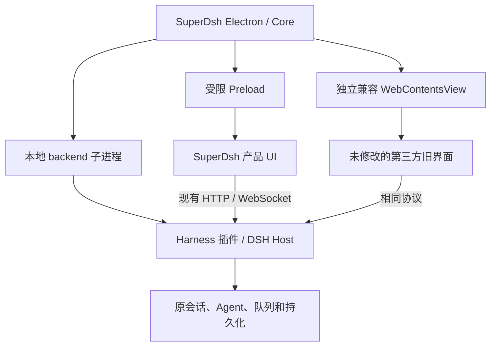

# SuperDsh 产品与平台架构

SuperDsh 是产品外壳，Harness 是由它启动与管理的必需插件。桌面开发入口位于 `apps/desktop`，不再从 DSH 的 root 插槽选择产品界面。平台统一位于 `apps/admin`：`src` 是 Next.js 管理网页，`server` 是 Node.js API 与 Agent 生命周期；安卓位于 `apps/android`。

三端通过现有 API v2 访问 Node 平台。`server:dev` 在一个入口中启动 Next.js、API 与按需准备的本机 Agent 进程，管理网页与 API 同源；Docker 只运行 PostgreSQL 和 Redis。已有电脑继续经 Connector 连接桌面 Harness，服务端 Agent 使用原生 Node Connector 和同版本完整 Host。共享协议基准、原 Connector 和 Bridge 留在固定 AA 子模块；迁出的应用通过稀疏检出从上游工作区排除。根 `sources:prepare` 建立此布局，`sources:check` 检查旧目录没有恢复。

## 平台边界

后台框架拥有总览、RBAC、模型、设备运维、系统管理和个人中心；聊天作为 Agent 工作台接入。网页界面只通过 HTTP/WebSocket 使用 API，不直接导入 `server` 实现、数据库驱动或 Node 内置模块。UI 与 Node 服务端分别进行完整类型检查。

Node API 管理身份、权限、资源归属、模型代理、持久化和 Agent 生命周期。每个用户的服务端 Agent 使用独立进程、Home 和工作区，数据库租约限制重复运行；它们以平台进程的操作系统身份执行，没有容器或操作系统文件沙箱。Harness 仍管理原有执行队列。退出客户端不终止已提交任务，停止平台则关闭其管理的 Agent 进程。

平台接受空数据库，或将现有产品 `v2_35` 至 `v2_39` 数据库增量迁移；更早版本需先使用原版本完成升级。既有密钥、用户 ID、设备归属与凭据格式保持兼容。旧容器 Agent 数据通过离线导出、校验归属并导入空目标迁移，步骤见[部署与配置](../apps/admin/deployment/README.md)。

## 控制与进程

Core 管理后端启停、Profile 切换、重试、退出与恢复。只有必需 Harness 就绪后才进入产品业务界面；失败显示诊断、重试和恢复。DSH 保留 Agent 执行、会话持久化和原有执行队列，避免引入重复执行或第二套审批状态。

平台身份独立于本地 Host 生命周期。正常启动即加载产品 RuntimeBridge 和本地模型网关，原位登录只更换凭据、Connector 与模型目录，不重启 Host 或切换 Home。安全模式不开放平台连接；平台故障不关闭本机 DeepSeek 聊天。Connector 由 Core 明确选择产品管理的 Python 3.12，不使用系统默认 Python。

主聊天通过 Core 的 `ConversationTarget` / `ConversationSource` 区分本机和远程目标，共用消息组件和输入区。原生 DSH 日志与 API v2 时间线分别适配，远程调用、订阅及附件携带账号代次和完整设备目标；旧响应、旧订阅不能写入新目标。平台绑定和同步检查点按服务地址与用户 ID 保存，但历史来源始终是同一个本地 Home。

## 源码职责

| 包                             | 职责                                                                         |
| ------------------------------ | ---------------------------------------------------------------------------- |
| `apps/desktop/ui`              | React 根、产品导航、聊天/工作流/设置/插件/引导等组件、统一主题、兼容渲染入口 |
| `apps/desktop/core`            | main/preload、后端生命周期、业务服务、浏览器安全模型、跨进程契约             |
| `apps/desktop/plugins/harness` | 固定 Host、Profile、协议适配和引擎运行依赖                                   |
| `apps/desktop`                 | 公共产品身份、运行资源清单、构建/打包入口                                    |
| `dsh-community-market`         | 可选插件的包身份和依赖；实现位于 UI features 和 Core services/contracts      |
| `apps/admin/src`               | 管理网页、模块导航、个人工作台与 API 客户端                                  |
| `apps/admin/server`            | Node API v2、身份与 RBAC、数据库、模型代理、原生 Agent 运行                  |
| `apps/admin/deployment`        | PG/Redis Compose、部署与离线数据迁移说明                                     |
| `apps/android`                 | Kotlin 安卓客户端，沿用 API v2 与原应用身份                                  |

UI 只能依赖 Core 公开的 `client/*` 和 `contracts/*`。Core/client 不得引入 Node/Electron 或平台实现。Harness 可在构建时使用纯契约，不能对 Core 建立生产依赖循环。第三方源码、固定引擎和手机端仍在原依赖边界内。

## 产品与第三方界面

`ui/src/app` 创建唯一产品根和导航。内置客户端通过固定清单接入；第三方旧模块不会在产品渲染上下文激活。兼容容器继续提供原模块 ID、Cordis、Slots、Remote 和桌面桥接，其旧 root 只影响兼容界面。

Electron 兼容页使用另一个 sandboxed WebContentsView，独立 `dsh-app://compat` 来源。普通浏览器使用没有 opener 的单独窗口。关闭、产品刷新或 renderer 异常都会触发资源释放。兼容入口仍经过原 Host 认证；未授权请求和关闭浏览器访问后的请求被拒绝。

自有界面中的原协议调用逐步通过兼容适配层迁移。协议 ID、事件顺序、重连、取消和审批语义保持原样，每个渲染上下文内 React/Cordis 等保持单实例。

## 构建与运行数据

根 Yarn 负责产品，固定 Harness 上游保留 pnpm。市场 → Harness → Core → UI → 组装包依次构建。UI 产出静态根、兼容页、原生辅助页及70个内置动态模块，由清单声明来源；缺少自有产物直接失败，不回退到上游界面。

安装版数据使用系统应用数据目录下 `SuperDsh/home`，开发版使用仓库 `.superdsh/home`。导入只允许空目标，保留来源备份并按失败回退，不改写源目录。手机 AA Bridge 继续运行于 Harness 中，协议与数据目录保持兼容。

具体文件和命令见 [README](../README.md#项目结构)，实测范围见[验收记录](superdsh-migration-validation.md)。
