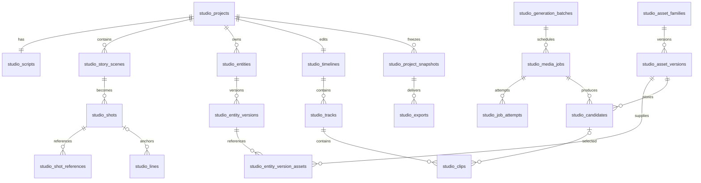

# 星桥娱乐作品制作：数据表与一致性设计

状态：完整目标设计；2026-11-15 阶段 A 已落地 17 张新增表，并演进既有作品、素材和任务存储。实际字段、阶段性差异、旧工程转换与验收见[第一阶段交付记录](starbridge-studio-foundation-delivery.md)。下文 25 表清单仍是后续阶段的目标，不代表已经全部实现。配套的[菜单、交互与业务方案](starbridge-studio-workflow.md)定义用户流程。

2026-11-15 已对照 Zou、OpenTimelineIO 和 Storyboarder 官方源码，补充[完整字段数据字典与关联约束](starbridge-studio-schema-dictionary.md)：25 张表的类型、默认值、可空性、复合外键、索引、删除规则及三张带字段 ER 图。本文保留业务职责说明；具体字段和精度以数据字典为准。

## 1. 存储边界

重构前创作域主要依赖 `studio_projects`、`studio_revisions`、`studio_assets`、`studio_media_jobs` 四张表。阶段 A 已将当前工程、设定与媒体版本切换为结构化存储；旧工程文档作为不可变兼容投影保留，`studio_assets` 改为只读兼容视图。后续阶段继续补充确认、制作、候选与交付契约。

目标采用“当前实体表 + 不可变素材/设定版本 + 关键工程快照”。视频、配音采用的唯一当前来源是时间线片段；镜头卡从时间线读取，不再额外保存一份采用状态。JSONB 仅用于有 Schema 的配置、补丁、检查报告及只读快照，不充当所有关系的替代品。

复用现有账号、角色、产品菜单、`resources/resource_versions`、模型配置及版本、`model_operations`、`web_file_entries/web_file_references`。不重建身份、文件存储、供应商密钥或 Agent 会话体系。作品保存 DSH 会话关联，DSH 仍是唯一对话执行引擎。

### 1.1 表清单

共 25 张目标领域表，按业务归属组织；包括对现有项目和媒体任务表的演进，并非全部另起一套。实施按功能阶段创建所需表，不提前创建空壳工作流平台。

| 领域       | 表                                                                                           | 职责                                         |
| ---------- | -------------------------------------------------------------------------------------------- | -------------------------------------------- |
| 作品与故事 | `studio_projects`、`studio_scripts`、`studio_story_scenes`                                   | 作品规格、剧本和叙事场次                     |
| 修改与确认 | `studio_project_snapshots`、`studio_proposals`、`studio_stage_reviews`、`studio_commands`    | 快照、导演建议、阶段确认、幂等写操作         |
| 媒体素材   | `studio_asset_families`、`studio_asset_versions`、`studio_project_assets`                    | 文件素材及版本、项目引用                     |
| 人物与设定 | `studio_entities`、`studio_entity_versions`、`studio_entity_version_assets`                  | 角色/场景/道具身份、造型声音版本、多参考素材 |
| 分镜       | `studio_shots`、`studio_shot_references`、`studio_lines`                                     | 稳定镜头、设定引用、逐句台词                 |
| 制作       | `studio_generation_batches`、`studio_media_jobs`、`studio_job_attempts`、`studio_candidates` | 计划、持久任务、执行尝试、结果候选           |
| 剪辑       | `studio_timelines`、`studio_tracks`、`studio_clips`                                          | 当前工程、轨道、媒体及字幕片段               |
| 检查与交付 | `studio_validation_runs`、`studio_exports`                                                   | 输入关联的检查、冻结版本的交付               |

角色库和场景与道具菜单查询 `studio_entities`；媒体素材菜单查询 `studio_asset_families`。三者复用文件、版本选择和引用组件，但“角色”不等于“一张图片”。

### 1.2 通用约定

- 主键沿用现有不透明字符串 ID，兼容既有长度和格式，不因改表给镜头、台词或任务换身份。关联公共表时使用其实际列类型。时间为 UTC `timestamptz`，展示时转换时区。
- 计划时长使用整数毫秒；精确时间线使用工程 tick，源媒体使用独立有理时间基准，详见数据字典。画幅使用宽高比和实际宽高，帧率以分子/分母表示。时间区间统一左闭右开，避免逐镜舍入累积误差。
- 可修改行有 `revision`、`created_at`、`updated_at`；归属明确为用户和可选项目。版本行及快照追加后不可改内容，只能追加新版本或标记访问/保留状态。
- 作品写用例检查 `expected_revision`，原子更新相关行和工程修订。项目修订用于并发，内容指纹用于依赖匹配；不能把二者混用导致改标题后所有视频失效。
- 同项目关联采用包含 `project_id` 的复合外键或等效数据库约束，跨用户素材再由 service 授权。只检查某个 ID 存在不能证明它属于当前作品。
- 普通编辑写当前表；剧本/分镜确认、生成、导出和恢复建立必要快照。自动保存不必每次复制整个工程。
- 快照、配置及输入 manifest 使用统一契约 Schema 元数据；不在业务路径或多个文件里复制发布版本号。

## 2. 作品、故事与修改

### 2.1 `studio_projects`：作品

| 字段                                | 含义与约束                                                                                           |
| ----------------------------------- | ---------------------------------------------------------------------------------------------------- |
| `id`、`owner_id`                    | 保留当前身份，所有者关联公共账号                                                                     |
| `title`、`brief`                    | 名称、创作目的与描述；界面可自动建议名称                                                             |
| `lifecycle`                         | `active/archived`；交付成功不会禁止继续编辑                                                          |
| 制作规格列与 `output_preferences`   | 画幅、目标时长、语言、风格分别存列；输出偏好为受约束扩展参数，剪辑帧率归时间线管理；未知项制作前检查 |
| `preset_resource_id/preset_version` | 可空，引用已发布创作预设版本；后续发布不回写本作品                                                   |
| `revision`、`session_id`            | 当前工程修订、已有 DSH 会话关联                                                                      |
| `created_at/updated_at/archived_at` | 首页按本人最近更新查询                                                                               |

不保存一个含糊的 `completed` 布尔值；阶段健康、已采用镜头数和最后交付从关联数据派生。继续制作默认进入下一项待处理阶段，用户上次浏览位置作为用户偏好保存，不改变业务完成状态。

### 2.2 `studio_scripts`：当前剧本

`id, project_id, source_kind, source_file_id, source_text, body, adaptation_mode, language, revision, content_hash`。

- `project_id` 唯一；首期一作品一个当前剧本，历史在快照中。
- `source_kind` 表示想法、粘贴、文件或导入；原文与当前编辑内容分开，选择 `original/adapt` 决定导演能提出何种改写建议。
- `body` 使用受约束的编辑文档结构，叙述段落直接存文案，结构化场次和对白节点引用场次/台词 ID。对白权威文本在 `studio_lines.text`，剧本编辑器读取和修改同一对象，不另存一份会与配音台词分叉的完整正文。上传/粘贴的原始全文仍在 `source_text` 或源文件中。
- 上传原文关联公共文件；纯文本不制造文件记录。结构化场次与台词通过导演草案或明确编辑命令产生，不在每次文本输入时偷偷重建镜头。整篇替换或重新拆剧本先形成差异方案，确认后同步修改文档节点和领域实体。
- 原文修改后显示需要重新核对的场次/台词；现有拍摄方案保持可用，用户决定合并范围。

### 2.3 `studio_story_scenes`：叙事场次

`id, project_id, script_id, position, title, synopsis, source_anchor, revision`。

场次表达故事中的一次事件/时空片段，例如“夜，站台，二人告别”；可复用的“站台环境设定”属于 `studio_entities`。同一环境可用于多个场次，同一场次可以拆成多个镜头。原文锚点保存来源片段和校验指纹，不能只依赖文本偏移量。

### 2.4 `studio_project_snapshots`：只读工程快照

`id, project_id, project_revision, reason, label, schema_id, manifest, manifest_hash, created_by, created_at`。

manifest 包含当时的规格、剧本、设定版本、镜头、台词、精确时间线、素材版本和人工保留旧结果的决定。文件内容仍在公共存储，通过文件引用保留；不把音视频或密钥嵌入 JSON。

同一作品修订可被多个用途复用一个完整快照，`(project_id, project_revision)` 唯一。恢复按旧快照生成新的当前修订，保留历史导出和任务，不倒退修订计数。恢复前展示将被替换的当前修改。

### 2.5 `studio_proposals`：导演方案

`id, project_id, source_session_id, base_revision, purpose, operations, status, reviewed_operations, created_by, created_at, updated_at`。

- `operations` 是有严格 Schema 的新增/修改/删除/重排操作，每项有稳定操作 ID、目标实体 ID、原字段指纹、建议值和依赖。只允许声明式领域操作，不执行脚本或任意 JSON 路径。
- 状态为 `proposed/partially_applied/applied/rejected/superseded`。用户逐镜、逐字段确认；未选项需保留待处理或明确拒绝，不能默认为接受。
- 重排必须包含稳定 ID 顺序，作为独立操作应用；不能只遍历旧镜头逐个更新字段。
- 用户编辑与导演建议冲突时按目标字段检查；允许合并不相交变更。应用一个选定集合和更新审阅记录在同一事务完成。

### 2.6 `studio_stage_reviews`：阶段确认

`id, project_id, stage, decision, input_hash, snapshot_id, validation_run_id, reason, reviewed_by, reviewed_at`。

`decision` 为确认或允许跳过；跳过原因及适用规则保存。阶段“待更新”由当前依赖哈希与最近有效确认不同推导，不改写过去的确认。存在硬阻塞的生成/导出不能用跳过确认绕过。

### 2.7 `studio_commands`：写入幂等回执

`id, owner_id, project_id, scope_key, operation_key, command_type, request_hash, result_reference, resulting_revision, created_at`。

唯一键为 `(owner_id, scope_key, operation_key)`。领域写入与命令回执同事务提交：网络中断后同号同请求返回已有结果，同号不同内容返回冲突。读取已有回执仍需验证当前权限，不能通过重放绕过授权撤销。

只服务短事务写入，不充当任务队列；慢任务由制作计划和媒体任务承担。保存结果引用与必要的脱敏回执，不无限复制完整工程。清理策略保留必要的去重索引/墓碑，过期请求明确拒绝，不能清完后把旧请求当成新命令执行。

## 3. 设定与素材

### 3.1 `studio_asset_families`：同一媒体素材的版本族

`id, owner_id, scope, project_id, kind, name, description, current_version_id, archived_at, created_at, updated_at`。

`scope=personal/project`；项目素材必须带项目，个人素材不带项目。`kind` 为图片、视频、音频、音乐或音效。名称等目录信息可编辑；实际文件替换产生新版本。生成候选也使用这套文件归档，不能另建供应商 URL 存储作为永久来源。

### 3.2 `studio_asset_versions`：不可变媒体版本

`id, family_id, version_no, parent_version_id, file_id, origin, source_job_id, metadata, content_hash, created_by, created_at`。

- `(family_id, version_no)` 唯一，`file_id` 关联公共文件记录；元数据保存实测时长、宽高、音轨、编解码和来源说明。
- `origin` 表示上传、生成、引用或导入；父版本说明派生来源。候选引用本表，供应商临时链接在安全收集完成后不成为业务预览地址。
- 跨项目收藏可建立新的个人版本族，引用同一个已授权文件和来源版本；无须复制二进制。生成任务和素材互相记录来源时，先建任务，再建版本，最后关联结果，禁止互相要求创建时非空。

### 3.3 `studio_project_assets`：作品使用的媒体

`id, project_id, asset_version_id, source, label, created_at`；唯一 `(project_id, asset_version_id)`。

引用固定版本。个人素材更新不自动替换已引用版本。项目库“使用镜头”由镜头引用与时间线反查，不复制计数作为判定依据。移除目录引用前检查实际引用；仍被快照、候选、时间线使用的文件继续保留。

### 3.4 `studio_entities`：角色、环境与道具身份

`id, owner_id, scope, project_id, kind, name, current_version_id, source_entity_id, archived_at, revision`。

`kind=character/environment/prop`。个人库与项目库使用相同设定模型，但引用进作品时创建本作品的稳定设定身份，并指定来源版本；另一个作品拥有自己的身份和版本选择。更新个人库时给作品升级建议，不主动覆盖作品。

角色身份承接台词的说话人；角色换装不重新创建说话人。场景日夜、天气、布景是环境版本或镜头局部覆盖，不能靠改共用场景名称影响全部镜头。

### 3.5 `studio_entity_versions`：造型与声音设定版本

`id, entity_id, version_no, origin_version_id, definition, voice_configuration_id, voice_configuration_revision, voice_id, voice_parameters, content_hash, created_at`。

- `(entity_id, version_no)` 唯一；`definition` 按类型验证人物外观/性格、环境/天气或道具描述。版本不可变。
- 声音引用公共模型配置版本及该能力支持的音色 ID、语速/情绪等已验证参数。存的是配置引用，不存 API Key、供应商请求地址或未校验参数。
- 多个造型版本可共享同一声音设置。对“改造型”计算视觉指纹，对“改声音”计算声音指纹，不能因为设定版本号变化就全部重做。
- `origin_version_id` 记录个人库→项目、项目→个人库或派生造型的来源。当前版本指针必须属于该实体。

### 3.6 `studio_entity_version_assets`：设定的多参考素材

`id, entity_version_id, asset_version_id, purpose, position`；同版本、素材和用途去重。

用途包含正面、侧面、服装、场景参考、道具参考和声音试听。绑定不可变设定版本后不直接增删；修改引用产生新版本。角色卡因此能够保存多张参考图和一个试听结果，不以一张主图替代整套设定。

个人库允许编辑/上传、试听和生成参考素材。制作计划可属于个人设定而非作品，此时 `project_id` 为空且必须关联本人设定；不得为试听创建用户看不见的假作品。能力授权、用量确认和任务恢复规则与作品内一致。

## 4. 分镜与台词

### 4.1 `studio_shots`

`id, project_id, story_scene_id, position, title, action, framing, camera_motion, composition, planned_duration_ms, local_overrides, keyframe_candidate_id, revision, archived_at`。

镜号由当前排序显示，ID 永不随排序变。`local_overrides` 仅承载验证后的本镜天气、时间、构图等覆盖，不夹带整个角色或素材库。分镜图的选用可以保存在 `keyframe_candidate_id`；**视频采用不在本表再存一份**，从时间线主画面片段读取。

复制镜头创建新镜头及台词 ID；可显式沿用原素材版本，不能继承原任务身份。拆分镜头必须确认台词和媒体区间归属。删除为归档，并在同一命令移除当前时间线占位/引用；历史快照仍保留。

### 4.2 `studio_shot_references`

`id, project_id, shot_id, entity_version_id, asset_version_id, purpose, position`。

实体版本或媒体版本二选一，用数据库 XOR 约束。项目设定关联必须属于本作品；个人媒体先经过授权并登记项目引用。直接引用的参考画面、人物造型、环境版本与道具均可追溯。

“第三镜改雨夜”追加环境版本并只改第三镜引用；选择是否升级其他镜头是独立操作。生成前根据本镜实际引用构造输入，而不是读取全局角色当前版本后暗中换造型。

### 4.3 `studio_lines`

`id, project_id, story_scene_id, anchor_shot_id, position, speaker_entity_id, speaker_version_id, kind, text, delivery, voice_override, revision, archived_at`。

- 台词独立于镜头排序和生成任务；`kind` 区分对白、旁白等。分镜尚未安排时 `anchor_shot_id` 可空，正式生成时检查归属。
- 说话人必须为同作品角色，声音版本必须属于该角色；无说话人的旁白需要显式声音配置。声音覆盖采用严格参数 Schema，并记录有效配置版本。
- `delivery` 保存语气和停顿意图。配音时间、字幕区间、采用音频不在台词表保存第二份，统一属于时间线。
- 一句可以关联多个字幕片段；声音可以由用户安排跨过镜头边界。默认只按本镜顺序排时，跨镜和重叠必须是可见的编辑决定。

## 5. 制作计划、任务与候选

### 5.1 `studio_generation_batches`

`id, owner_id, project_id, library_entity_id, operation_key, request_hash, purpose, selection_mode, input_manifest, input_hash, validation_run_id, state, confirmed_by, confirmed_at, created_at`。

- 作品与个人设定二选一作为作用范围。状态为草案、待确认、已确认、失效或取消；执行结果从任务汇总，不重复维护“全部成功”等容易失真的批次状态。
- manifest 冻结本批具体镜头/台词/参考图、输入版本、模型配置版本、操作意图及预估用量。每条有稳定 `item_key`；计划未确认时不产生收费请求。
- `selection_mode` 为补缺失、待更新、失败重做或显式选择。相同输入已有进行中任务时返回现有任务；用户明确要求新增候选时分配新的制作意图。
- 确认后不可原地改模型、输入和范围。输入变更需刷新计划并重新确认。计划哈希不能替代当次权限校验。
- 初期批次使用已准备好的参考素材；需要先生成参考图再生成视频时，前一批结果确认后形成下一份计划。沿用媒体任务执行器，不为阶段步骤引入通用 DAG 调度系统。

### 5.2 `studio_media_jobs`

保留现有任务 ID 和已取得的回执，按迁移逐步补充结构化字段：

| 字段组 | 设计                                                                                                          |
| ------ | ------------------------------------------------------------------------------------------------------------- |
| 归属   | `id, owner_id, project_id, batch_id, item_key`；个人库任务允许无项目，批次范围必须一致                        |
| 目标   | `shot_id/line_id/entity_version_id/snapshot_id`，按任务类型明确主目标，互斥规则由 Schema 和数据库约束共同保证 |
| 能力   | `kind, capability, configuration_id, configuration_revision`；本地渲染任务无需伪造模型配置                    |
| 输入   | `input_manifest, input_hash, source_revision`；生成真正用到的设定、素材、台词和参数均冻结                     |
| 状态   | `state, error_code, error_summary, next_poll_at, deadline_at`，错误内容脱敏                                   |
| 控制   | `lease_token, lease_until, cancel_requested_at, cancel_reason, created_at, updated_at`                        |

唯一 `(batch_id, item_key)` 防止一次制作计划重复提交；同一镜头可以有视频和分镜图任务、多个主动候选，不再仅用镜头 ID 当去重键。不能使用全局唯一输入哈希禁止用户主动再生成。

状态语义：

| 状态               | 含义及允许动作                                         |
| ------------------ | ------------------------------------------------------ |
| `queued`           | 持久排队；可原子取消                                   |
| `submitting`       | 已记录提交意图，正在建立供应商操作；异常需判断是否受理 |
| `polling`          | 已有可信回执，按同一操作查询                           |
| `downloading`      | 结果已产生，正在收集和探测；恢复只重收集               |
| `ready`            | 完整结果通过媒体检查，可生成候选                       |
| `failed`           | 有明确失败结论；只在安全且允许时重试                   |
| `unknown`          | 是否受理/结果未知；保留待核对，不直接重新提交          |
| `cancel_requested` | 正等待供应商取消确认，不等于已经取消                   |
| `cancelled`        | 未提交时取消成功，或远端确认取消                       |
| `paused`           | 仅暂停本地查询；远端可能继续执行，允许恢复查询         |

进程重启不会把 `submitting` 全部改成 `queued`。超时根据是否可能受理进入 `failed/unknown` 或暂停查询，不假称供应商失败。迟到回执与取消竞争通过条件写入处理，最终结果保留审计但不自动采用。

### 5.3 `studio_job_attempts`

`id, job_id, attempt_no, operation_id, executor_kind, phase, lease_token, started_at, finished_at, error_code, recovery_evidence`。

- `(job_id, attempt_no)` 唯一。供应商调用的 `operation_id` 关联现有 `model_operations`；收据、用量、供应商状态及加密信息仍以公共模型操作账本为准。本地渲染不强造供应商操作。
- 扩展公共模型 service 的执行上下文，支持 `owner/product/resource` 的后台媒体用例；现有 `session_id` 必填约束需兼容调整，非会话任务不创建假会话。既有聊天调用保持原行为。
- 媒体 service 不另写一套凭据读取与裸供应商请求；具体适配器接入公共模型调用端口。恢复依据已有 operation/receipt，安全重试才追加 attempt。
- 认领采用租约和条件更新。旧执行者失去租约后不能提交结果；仍可能存活的外部请求通过同一操作账本核对，不能仅靠换租约认定重发安全。
- 核对记录保存操作者、依据和原状态；敏感回执仍走已有加密字段。无法证实未受理时，原任务继续未知。用户另行确认的潜在重复制作属于新批次，不把旧 attempt 改成“未发生”。

### 5.4 `studio_candidates`

`id, owner_id, project_id, shot_id, line_id, entity_version_id, kind, job_id, asset_version_id, input_hash, review_state, created_at`。

按类型校验目标：视频/分镜图对应镜头，配音对应台词，设定参考/试听对应设定版本。纯导出结果进入交付记录，不伪装为某镜头候选。

`review_state` 记录保留/不采用等用户审看决定；文件是否可用由存储和探测结果判断；是否匹配当前内容由依赖指纹计算。三者分别展示。“已采用”通过时间线或设定版本引用派生，不能依赖候选上的单个布尔值。

多个镜头引用一个文件不会相互覆盖；新候选到达只进入候选区。用户采用一个过时但仍可用的结果需明确确认，其例外选择写入检查结果和工程快照。

## 6. 时间线与交付

### 6.1 `studio_timelines`

`id, project_id, revision, ticks_per_second, fps_num, fps_den, audio_sample_rate, duration_mode, auto_arrange_basis_hash, created_at, updated_at`。

`project_id` 唯一；首期每部作品一个当前剪辑工程，版本回退通过快照。整片实际时长从片段最大有效结束时间推导，目标时长仍属于作品规格，两者不能混为一列。

### 6.2 `studio_tracks`

`id, project_id, timeline_id, kind, name, position, muted, gain_db, locked, revision`。

`kind=video/voice/subtitle/music/effect`。界面按画面、角色声音、字幕、音乐音效四类展示；角色可有独立声音轨，不强制所有人共用一条音轨。轨道顺序与音量属于工程，不污染原素材。

### 6.3 `studio_clips`

| 字段                                                                                  | 规则                                                                       |
| ------------------------------------------------------------------------------------- | -------------------------------------------------------------------------- |
| `id, project_id, timeline_id, track_id`                                               | 片段稳定身份，相关对象必须属于同一工程                                     |
| `shot_id, line_id, role`                                                              | 定位镜头/台词；主画面、主配音、字幕或自由素材等明确用途                    |
| `candidate_id, asset_version_id`                                                      | 来源二选一；候选经关联获得素材，导入媒体直接引用素材版本；占位片段两者皆空 |
| `source_review`                                                                       | 有意保留旧输入结果时的候选/输入哈希、确认人和理由；不表示采用第二个来源    |
| `start_ticks, duration_ticks`                                                         | 在整片中的位置与播放长度，使用工程 ticks_per_second；占位长度从计划换算    |
| `source_start_ticks, source_duration_ticks, source_timebase_num, source_timebase_den` | 源媒体取用区间及独立时间基准，按实测时长检查；不隐式拉伸配音               |
| `subtitle_text, subtitle_mode`                                                        | 字幕片段可跟随台词或手工覆盖；改字幕不回写对白                             |
| `gain_db, muted, use_source_audio`                                                    | 分贝音量、静音与视频原声选择                                               |
| `timing_mode, locked_fields`                                                          | 自动/手工安排及被锁定的起点、裁剪、来源等；自动排列不得覆盖锁定字段        |
| `revision`                                                                            | 用于局部冲突合并                                                           |

每镜最多一个当前主画面片段、每句最多一个主配音片段，使用部分唯一索引。一个台词允许多个字幕片段；后续自由剪辑重复使用原媒体可以创建普通片段，不改变“当前主候选”的确定性。

采用视频或配音是同一类领域命令：核对目标与当前修订 → 校验候选输入和文件 → 计算与已锁定裁剪的冲突 → 用户决定后原子替换主片段来源。不能先在镜头表写选中项，再等下一次“保存工程”补写时间线。

自动初剪按镜头顺序、实际声音长度及停顿给出排时建议。若手工锁定片段冲突，返回定位问题，不能自动移动到另一处或裁掉尾音。声音可跨镜头，但必须有明确的时间线安排；默认不把所有台词的开始时间置为零。

重排分镜先计算时间线影响，保持媒体来源和局部裁剪；手工锁定绝对位置时提示冲突。时间线拖动顺序同步表达为同一领域重排命令，不另存一套互相矛盾的镜头顺序。

### 6.4 `studio_validation_runs`

`id, owner_id, project_id, library_entity_id, purpose, input_hash, rule_set_reference, findings, created_at, expires_at`。

- `purpose` 包含阶段、生成、预演、采用和导出；作用范围与输入哈希必须明确。
- 每个问题有稳定规则码、严重程度、对象类型/ID、关联字段、用户说明和可行处理。硬阻塞不可前端忽略；允许保留的提醒通过确认命令记录。
- 生成检查模型权限、当前可用性、音色、文件读取、参考格式、时长和供应商能力；成片检查缺失来源、文件可解码、裁剪越界、声音截断、字幕范围等。
- 费用仅展示可获得的估算与依据，不虚构精确报价。凭据变动、权限撤销或能力失效即使内容哈希相同也需重新检查。

### 6.5 `studio_exports`

`id, owner_id, project_id, snapshot_id, validation_run_id, command_id, job_id, purpose` 及明确的输出规格列、三个结果素材版本字段，详见字段数据字典。

- `purpose=preview/final`；只有正式成功交付进入成片列表，预览任务在作品内使用。导出任务状态从关联 job 读取。
- `snapshot_id` 必填。输出尺寸、帧率、编解码、字幕策略和音频设置以明确列冻结并经能力校验；扩展编码参数才进入 JSON，不继续读取当前工程或硬编码固定分辨率。
- 主成片、可选独立字幕、封面均关联具体文件素材版本。导出前创建记录，成功后通过条件更新一次性关联结果；失败记录保留目标版本和原因。
- 一个快照可按不同规格多次导出；幂等重复点击复用同一导出任务。继续编辑、修改角色库或更换默认模型不会改变已交付文件。
- 浏览器组合预览与渲染共享时间区间规则。无法以浏览器准确呈现的效果显示需渲染确认，不以预览近似代替最终成片检查。

## 7. 关系、约束与查询

核心关系简图，省略确认、命令、检查及公共账号/文件表：

必需约束与索引：

| 类别       | 要求                                                                                                                |
| ---------- | ------------------------------------------------------------------------------------------------------------------- |
| 租户与归属 | 所有列表先按 owner/product 授权，再分页；单条请求和 Range 下载同样检查。复合键防止同一个请求夹入另一作品的台词/镜头 |
| 唯一身份   | 剧本与时间线的项目唯一键、实体/素材版本号唯一键、主片段部分唯一键、批次条目和写命令幂等唯一键                       |
| 排序       | 同作品或同父对象位置唯一，采用可延迟检查约束或安全重排策略，在一个事务完成；不靠前端一条条保存                      |
| 数值与类型 | 时间非负，出点大于入点，音量及参数范围按契约；目标类型与候选类型一致，来源 XOR 约束                                 |
| 列表       | 项目 `(owner_id, updated_at, id)`、素材/设定 `(owner_id, scope, kind, updated_at, id)`；交付按所有者与创建时间      |
| 执行器     | 活跃任务按 `(state, next_poll_at)` 与租约到期查询；项目任务按 `(project_id, created_at, id)`；attempt 按任务与序号  |
| 引用反查   | 对文件版本、实体版本、候选、镜头、台词的外键建索引，支持“谁在使用”和局部失效范围                                    |
| 留存       | 被当前工程、候选、快照或交付引用的文件保留；归档不级联物理删文件。正式清理通过公共文件引用计数及保留策略完成        |

文件、模型、资源跨领域写入只能调用对应公开 service，不能由创作 DAO 直接写别的模块表。数据库关联约束与 Python 分层同时落实，不以约束替代授权。

## 8. 事务与内容指纹

### 8.1 “第三镜换雨夜”的精确写入

1. 读取当前作品修订、第三镜稳定 ID、环境引用、人物造型、台词、采用视频与配音。
2. 创建环境版本或本镜天气覆盖建议，列出只影响第三镜的视觉变更。用户确认后在一个事务更新镜头引用、修订和幂等回执。
3. 原视频保留，因视觉输入哈希变化显示待更新。原台词、声音指纹及主配音片段不变；其他镜头不变。
4. 新生成计划冻结第三镜的人物造型、雨夜环境、动作、参考图及配置版本。生成后追加候选，用户只点击预览时不改工程。
5. 用户采用后，原子更新第三镜主画面片段。旧裁剪超出新视频长度时先处理冲突，不静默截断。换回旧候选同样走采用用例。
6. 交付快照准确记录选用的画面和配音。与当前视觉设定不同的旧候选若被保留，检查页提示并保存用户决定。

### 8.2 指纹组成

| 结果              | 参与指纹的实际依赖                                         | 不应导致该结果失效               |
| ----------------- | ---------------------------------------------------------- | -------------------------------- |
| 设定参考图        | 视觉描述、输入参考版本、构图与生成参数/配置版本            | 作品标题、角色音色               |
| 一句配音          | 台词、有效声音配置/音色、语气、停顿、受支持参数            | 镜头顺序、字幕错字校正、角色换装 |
| 普通镜头视频      | 本镜动作/镜头语言、视觉设定与参考版本、时长/画幅、模型参数 | 无关镜头编辑；未使用的配音       |
| 声音驱动视频      | 普通视频输入加实际参与的音频版本                           | 其他台词变化                     |
| 分镜预演/自动排时 | 镜序、计划时长、采用声音/停顿、手工锁定范围                | 纯目录标签                       |
| 导出              | 冻结时间线、素材版本、字幕、输出规格                       | 导出后对当前工程的任何编辑       |

规范化序列化排除更新时间等非业务字段，同时保留有意义的顺序和参数差异。能力适配器声明实际使用的输入类型，不能无论供应商能力如何都把语音加入视频依赖。

### 8.3 长任务与短事务

- 预检需要的网络/媒体探测在写事务外运行；写入检查结果绑定输入哈希。确认时重新验证当前条件，不能长时间锁作品等供应商响应。
- 确认生成：校验范围与幂等号 → 冻结计划 → 创建 jobs → 提交。执行器随后认领并调用外部能力。
- 保存成功结果：临时下载/探测完成 → 公共文件服务登记 → 条件更新任务、追加候选与引用。采用可重入的分阶段流程；事务失败留下的未引用临时文件有回收策略，不把部分文件报告为 ready。
- 采用/重排/草案应用：检查修订和目标 → 同事务改当前实体及片段 → 递增修订 → 写回执。需要用户处理的冲突在执行前返回，不能先保存半数变更。
- 导出：确认检查指纹 → 固化快照及规格 → 创建导出和本地媒体任务 → 提交；渲染不得再读取当前可变表拼工程。

## 9. 现有数据如何演进

本次不清库。此前曾允许清理测试数据，不代表现在可以删除已有作品、任务或回执。后续迁移必须在隔离库验证，并保留可恢复备份。

| 当前来源                         | 转换目标及约束                                                                                                               |
| -------------------------------- | ---------------------------------------------------------------------------------------------------------------------------- |
| `studio_projects`                | 保留 ID、owner、会话和修订；新增规格、生命周期和预设引用，缺失参数显式标记待确认                                             |
| 最新 `studio_revisions.document` | 转换成当前剧本、场次、设定、镜头、台词和时间线。原稳定 ID 保留；缺 ID 的对象用确定性映射表补齐                               |
| 历史 `studio_revisions`          | 导入只读快照，保留原修订及原文档。转换器/历史读取适配明确区分旧格式，不能用当前默认值伪造旧输出                              |
| `studio_assets` 的角色/场景/道具 | 转为设定身份、版本和多参考关联；保留来源与版本映射。相同名字不自动合并成同一个角色                                           |
| `studio_assets` 的媒体           | 转为素材族、版本与项目引用，复用已有公共文件；不复制或替换真实文件身份                                                       |
| 镜头采用视频和台词音频           | 转成稳定主画面/主配音片段；原裁剪、音量、位置按旧语义转换，不在迁移时擅自自动排时                                            |
| `studio_media_jobs`              | 保留任务 ID、状态、输入、provider 回执。能可靠恢复输入才补指纹，不能还原的标记旧任务待核对，不编造 provenance 或重新收费提交 |

迁移步骤：

1. 建立加法式 schema 和转换器，先在备份副本校验数量、身份、引用和媒体读取；记录无法转换的条目，不静默跳过。
2. 逐个旧工程比对当前镜序、采用结果、配音/字幕时间及导出来源；只读旧工程转换输出作为校验输入，不长期维持两个可编辑存储源。
3. 正式切换期间暂停新的制作提交，处理/安全暂停已有任务，确保旧执行器不再写入；短暂冻结工程写入后完成最终转换。未知任务原样保留核对状态。
4. 切换 API 到新 service，旧入口只做集中协议适配。旧文档字段不再接受独立写入，避免双写分歧。
5. 切换前可以恢复备份并回退；新结构产生写入后不可直接启动旧写逻辑。需要回退时先停止写入、保全增量并制定转换，不假称改一个开关就能无损回退。
6. 验收确认后再制定旧存储退役迁移，保留历史快照和审计。用户显式选择重建隔离测试库时才另走重建流程。

旧 `apps/admin` 不参与此迁移，也不作为数据读取或业务执行回退。旧产品协议、账号与办公会话保持当前边界。

## 10. 设计验收与实施进度

- [x] 定义全局菜单与作品内八阶段职责。
- [x] 定义当前工程、设定/素材版本、候选和快照的权威来源。
- [x] 定义 25 张领域表、关键关系、幂等、并发和恢复语义。
- [x] 对照 Zou、OpenTimelineIO、Storyboarder 源码，补齐字段类型、可空性、默认值、外键矩阵、删除规则及带字段 ER 图，并完成文档结构检查。
- [x] 定义迁移映射、阶段交付和真实验收边界。
- [ ] 实现数据库迁移与旧工程转换，验证历史媒体和回执保留。
- [ ] 实现新的菜单、工作台、领域服务及能力契约。
- [ ] 完成真实导演到真实媒体的完整用户流程和文件核验。
- [ ] 完成权限、并发、异常、窄屏、主题、旧包保护与隔离测试清理。

必测场景包括：两个作品引用同一角色后单独换装；镜头重排不丢台词；改字幕不重做声音；改一句台词不重做其他镜头；迟到候选不覆盖当前采用；同请求重复确认只产生一次任务；未知回执不盲目重发；更换已采用音频立即持久化；导出期间编辑不改变导出内容；办公管理员兼娱乐用户不得调用娱乐管理或读取他人作品。

以上复选框描述完整 A/B/C/D 目标，不代表所有表已同时实现。阶段 A 的结构化工程及阶段 B 的作品内准备流程已分批交付；实际字段、接口和已验证范围分别见[基础交付](starbridge-studio-foundation-delivery.md)与[准备交付](starbridge-studio-preparation-delivery.md)。未交付目标保持待办。测试源码位于 `apps/web-admin/tests`，过程数据位于 `.superdsh-work/web-admin-validation`。

阶段 C 的个人库独立生成、冻结计划、输入指纹和取消/受理核对已交付，实际新增表及接口见[制作闭环记录](starbridge-studio-production-delivery.md)。完整目标字典中的后续剪辑、尝试和候选规范化表不因此自动标记为全部完成。
