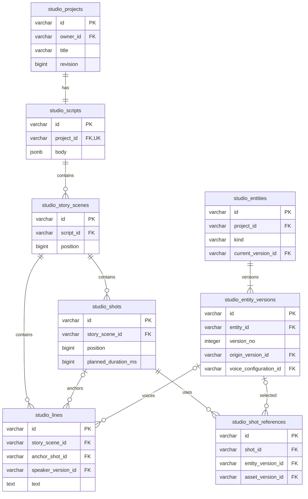
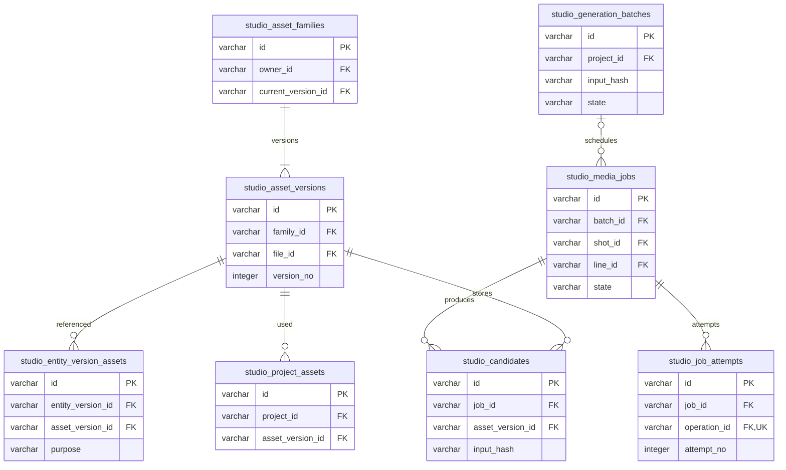
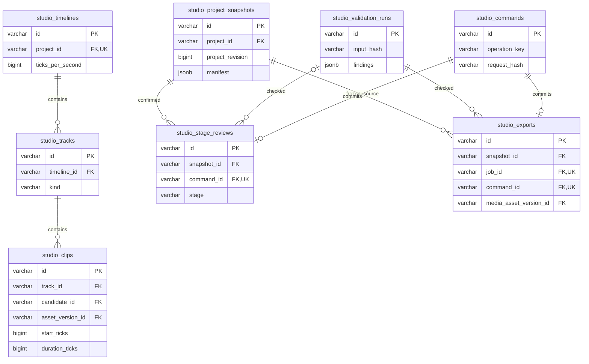

# 星桥娱乐数据字典与关联约束

状态：2026-11-15 完成字段级设计，阶段 A 与阶段 B 作品内准备流程已分批交付。本文为完整 25 表目标字典；阶段 A 的 17 张新增表以[基础交付](starbridge-studio-foundation-delivery.md)为准，阶段 B 追加的确认/方案两表及声音投影以[准备交付](starbridge-studio-preparation-delivery.md)和冻结迁移为准。个人库独立生成及 C/D 未交付目标继续按本文细化，不将目标字段误认为当前接口。[用户流程](starbridge-studio-workflow.md)保持不变。

## 1. 开源依据与取舍

本轮直接读取官方 GitHub 仓库中以下提交的源码。采用领域建模思路，不引入新的执行引擎，不复制第三方业务实现。

| 项目及固定源码                                                                                                                                                                                                                                                                                                                                                                                                                                                  | 观察到的结构                                                     | 星桥采用方式                                                                                                                           |
| --------------------------------------------------------------------------------------------------------------------------------------------------------------------------------------------------------------------------------------------------------------------------------------------------------------------------------------------------------------------------------------------------------------------------------------------------------------- | ---------------------------------------------------------------- | -------------------------------------------------------------------------------------------------------------------------------------- |
| Zou / Kitsu 后端：[Entity 与关联](https://github.com/cgwire/zou/blob/9d1fd95bf975d7731faccba2724c1cf9e96ef59f/zou/app/models/entity.py)                                                                                                                                                                                                                                                                                                                         | 制作对象有稳定身份，归属项目；对象之间使用关联表，版本独立记录   | 镜头、角色、场景拥有稳定 ID，镜头与设定版本建立明确关联；保留独立镜头和台词表，便于约束类型                                            |
| Zou：[Task](https://github.com/cgwire/zou/blob/9d1fd95bf975d7731faccba2724c1cf9e96ef59f/zou/app/models/task.py)、[PreviewFile](https://github.com/cgwire/zou/blob/9d1fd95bf975d7731faccba2724c1cf9e96ef59f/zou/app/models/preview_file.py)、[OutputFile](https://github.com/cgwire/zou/blob/9d1fd95bf975d7731faccba2724c1cf9e96ef59f/zou/app/models/output_file.py)                                                                                             | 任务、审看片与发布文件分别记录；文件包含版本和来源               | 制作任务、候选、正式交付分开；AI 的受理未知、费用和恢复另按本项目模型操作账本设计，不把人工制作任务直接当供应商队列                    |
| OpenTimelineIO：[Clip](https://github.com/AcademySoftwareFoundation/OpenTimelineIO/blob/bad7ab5a40ac1a95d9d78a87c95a688d8b57cf28/src/opentimelineio/clip.h)、[Item](https://github.com/AcademySoftwareFoundation/OpenTimelineIO/blob/bad7ab5a40ac1a95d9d78a87c95a688d8b57cf28/src/opentimelineio/item.h)、[RationalTime](https://github.com/AcademySoftwareFoundation/OpenTimelineIO/blob/bad7ab5a40ac1a95d9d78a87c95a688d8b57cf28/src/opentime/rationalTime.h) | 剪辑引用媒体、保存来源区间；时间值携带速率并可换算               | 区分工程时间与源文件时间，明确实际采用来源及裁剪。这里是工程对象格式参考，不是现成 SQL 表；整数时间基准是星桥自己的存储方案            |
| Storyboarder：[board.js](https://github.com/wonderunit/storyboarder/blob/8b81a25c71d5f7ca46e8d5b8e3d4f7b3968f95c2/src/js/models/board.js)、[scene.js](https://github.com/wonderunit/storyboarder/blob/8b81a25c71d5f7ca46e8d5b8e3d4f7b3968f95c2/src/js/models/scene.js)                                                                                                                                                                                          | 分镜保存稳定标识、参考图层和音频；播放长度考虑画面计划与音频时长 | 分镜计划时长与实际配音分开，预演按两者检查节奏；星桥让用户确认延长或调整，不直接覆盖手工剪辑。所查分支提交为 2022 年，作为数据组织参考 |

这些项目不直接提供星桥的角色权限、收费幂等、候选依赖指纹和双产品隔离；下面相关设计属于本项目方案。现有 DSH、RuoYi 分层、公共文件和模型配置继续保留。

## 2. 数据字典读法

下列每张表均明确声明公共字段组，再列专属字段。**公共字段组是实际字段，不能在实现时省略**。共 25 张目标领域表；不含复用的公共表。

### 2.1 公共字段组

| 组  | 字段         | PostgreSQL 类型 | 可空 / 默认       | 约束与含义                                                                              |
| --- | ------------ | --------------- | ----------------- | --------------------------------------------------------------------------------------- |
| B   | `id`         | `varchar`       | 否 / service 生成 | PK；沿用当前创作域无定长 ID，旧 ID 不截断、不重新编号                                   |
| B   | `created_at` | `timestamptz`   | 否 / `now()`      | UTC 创建时间                                                                            |
| B   | `created_by` | `varchar(80)`   | 否 / 当前操作主体 | FK → `users.id`；后台任务保留发起人，不伪造公共用户                                     |
| M   | `revision`   | `bigint`        | 否 / `1`          | 可编辑对象并发修订，`>=0` 兼容旧初始修订；M 同时包含 B                                  |
| M   | `updated_at` | `timestamptz`   | 否 / `now()`      | service 成功修改时更新                                                                  |
| M   | `updated_by` | `varchar(80)`   | 否 / 当前操作主体 | FK → `users.id`                                                                         |
| S   | `owner_id`   | `varchar(80)`   | 否 / 授权上下文   | FK → `users.id`；从登录态和父资源确定，不信任请求体                                     |
| S   | `project_id` | `varchar`       | 见各表 / 无       | FK → `studio_projects.id`；可空仅表示个人库，不表示公共共享                             |
| S   | `scope_key`  | `text`          | 否 / 生成列       | 有项目为 `project:<id>`，个人库为 `personal:<owner_id>`；用于复合外键，不能由客户端填写 |

M 替代 B，不重复添加。`B+S` 表示创建字段和作用域字段，`M+S` 另含并发更新字段。版本内容、快照、确认和回执不可改写；状态表哪些字段可变会单列说明。

所有 S 表增加 `UNIQUE(scope_key,id)`、`UNIQUE(owner_id,id)`。`studio_projects` 增加 `UNIQUE(id,owner_id)`；有项目的 S 行增加 `(project_id,owner_id)` 复合 FK，保证所有者一致。S→S 的同范围关联优先使用 `(scope_key,foreign_id)` 复合 FK，避免 `project_id=NULL` 使外键跳过检查。

字典中的 `FK → table.id` 为目标说明；同范围引用需按第 28 节展开为复合 FK，不能仅创建简单 ID 外键。允许个人库→作品或来源溯源的跨范围引用使用 owner 复合 FK，并由 service 限定方向。

### 2.2 类型、默认值和删除规则

- `—` 表示无数据库默认值，必须由用例提供；`NULL` 表示未确定/不适用，不使用空字符串假装有效 ID。
- 状态码使用 `varchar` 加 CHECK，能力码由注册能力目录校验。哈希使用 `char(64)`，约束为规范小写 SHA-256。JSONB 均有服务端 Schema、大小上限和字段白名单。
- 外键默认 `ON UPDATE RESTRICT ON DELETE RESTRICT`。主键、版本和历史引用不级联删除；项目、设定和素材族通过归档隐藏。物理清理由专门保留策略按依赖顺序执行。
- 当前版本指针使用 `DEFERRABLE INITIALLY DEFERRED` 复合 FK：同事务先创建实体、再创建初始版本、最后写指针，提交时必须完整。循环引用不靠取消外键解决。
- JSON 内只有冻结 manifest、声明式建议和扩展参数。可编辑核心关联必须是字段或关联行；快照文件通过公共文件引用服务登记留存，不只留下 JSON 里的 URL。

### 2.3 时间与精度：对上一版的修订

计划时长、供应商请求时长仍可使用 `*_ms bigint`。精确剪辑使用工程 tick，源媒体裁剪使用独立有理时间基准；不再把所有工程时间压成整数毫秒。

工程 `ticks_per_second` 按约分后的输出帧率分子、输出音频采样率与 1000 的最小公倍数计算。它让帧边界、采样点和旧毫秒输入精确落点；上限和溢出在规格校验中检查。不支持的规格明确拒绝，不使用浮点近似强行写入。

`时间秒数 = ticks / ticks_per_second`。源媒体时间为 `source_tick × source_timebase_num / source_timebase_den`。区间全部左闭右开；出点由起点加长度计算。工程有内容后调整帧率/时间基准必须事务性换算，并提示帧对齐差异；导出快照保存自己的基准。

## 3. `studio_projects` 作品

公共字段：M；本表不使用 S，避免项目自引用。

| 字段                 | 类型           | 可空 / 默认   | 关联或规则                                                                          |
| -------------------- | -------------- | ------------- | ----------------------------------------------------------------------------------- |
| `owner_id`           | `varchar(80)`  | 否 / —        | FK → `users.id`                                                                     |
| `title`              | `varchar(200)` | 否 / —        | 非空；不强制同名唯一                                                                |
| `brief`              | `text`         | 否 / `''`     | 创作目的与受众                                                                      |
| `lifecycle`          | `varchar(20)`  | 否 / `active` | `active/archived`                                                                   |
| `aspect_width`       | `integer`      | 是 / NULL     | 与高度同时为空或同时为正                                                            |
| `aspect_height`      | `integer`      | 是 / NULL     | 保存约分后的画幅比例                                                                |
| `target_duration_ms` | `bigint`       | 是 / NULL     | `>0`；与实际成片长度分开                                                            |
| `language`           | `varchar(35)`  | 是 / NULL     | 经验证的语言标记                                                                    |
| `style_brief`        | `text`         | 否 / `''`     | 视觉风格说明                                                                        |
| `output_preferences` | `jsonb`        | 否 / `{}`     | 输出预设参数，不重复保存上列规格                                                    |
| `preset_resource_id` | `varchar(80)`  | 是 / NULL     | 与 preset_version 成对                                                              |
| `preset_version`     | `integer`      | 是 / NULL     | 复合 FK → `resource_versions(resource_id,version)`；资源类型必须为创作预设          |
| `session_id`         | `varchar(100)` | 是 / NULL     | FK → `web_conversations.id`，唯一；经会话 service 校验本人归属，删除会话时 SET NULL |
| `archived_at`        | `timestamptz`  | 是 / NULL     | 与 lifecycle 对应                                                                   |

索引：`(owner_id,updated_at DESC,id)`；唯一 `(id,owner_id)`、非空 session_id。画幅/时长等常用检查字段提为列，不再全部藏在 specification JSON。

## 4. `studio_scripts` 剧本

公共字段：M+S，project_id 必填。

| 字段              | 类型           | 可空 / 默认     | 关联或规则                                         |
| ----------------- | -------------- | --------------- | -------------------------------------------------- |
| `source_kind`     | `varchar(20)`  | 否 / —          | `idea/paste/file/import`                           |
| `source_file_id`  | `varchar(100)` | 是 / NULL       | FK → `web_file_entries.id`；公共文件授权及引用留存 |
| `source_text`     | `text`         | 否 / `''`       | 原始输入                                           |
| `body`            | `jsonb`        | 否 / —          | 文档树；段落文案和场次/台词引用节点                |
| `adaptation_mode` | `varchar(20)`  | 否 / `original` | `original/adapt`                                   |
| `language`        | `varchar(35)`  | 是 / NULL       | 剧本语言，可覆盖作品显示偏好                       |
| `content_hash`    | `char(64)`     | 否 / —          | 包含解析后的台词文本；改台词时同事务刷新           |

唯一 project_id。台词权威文案在 lines.text，body 不复制第二份对白。文档树引用由同一 service 校验，删除节点与关联实体必须通过领域命令处理。

## 5. `studio_story_scenes` 叙事场次

公共字段：M+S，project_id 必填。

| 字段            | 类型           | 可空 / 默认 | 关联或规则                            |
| --------------- | -------------- | ----------- | ------------------------------------- |
| `script_id`     | `varchar`      | 否 / —      | 同范围 FK → `studio_scripts.id`       |
| `position`      | `bigint`       | 否 / —      | `>=0`，场次顺序                       |
| `title`         | `varchar(200)` | 否 / —      | 场次名称                              |
| `synopsis`      | `text`         | 否 / `''`   | 场次事件，不等同于可复用场景设定      |
| `source_anchor` | `jsonb`        | 否 / `{}`   | 原文片段/节点与指纹，不能只存字符偏移 |
| `archived_at`   | `timestamptz`  | 是 / NULL   | 删除当前场次时保留历史身份            |

活跃行唯一 `(project_id,position)`。移动时先锁项目，再批量临时移入不冲突位置区间，最终写入目标顺序；不把部分唯一索引误写成可延迟约束。归档前处理所属镜头和台词。

## 6. `studio_project_snapshots` 工程快照

公共字段：B+S，project_id 必填；内容只追加。

| 字段               | 类型           | 可空 / 默认     | 关联或规则                             |
| ------------------ | -------------- | --------------- | -------------------------------------- |
| `project_revision` | `bigint`       | 否 / —          | 冻结时的作品修订，不与快照自有修订混用 |
| `reason`           | `varchar(40)`  | 否 / —          | 确认、生成、导出、恢复等创建用途       |
| `label`            | `varchar(200)` | 否 / —          | 用户可理解的描述                       |
| `schema_id`        | `varchar(100)` | 否 / 契约注册项 | 快照格式契约身份                       |
| `manifest`         | `jsonb`        | 否 / —          | 完整工程、素材引用及时间基准；不含凭据 |
| `manifest_hash`    | `char(64)`     | 否 / —          | 内容校验                               |

唯一 `(project_id,project_revision)`；同修订用途复用同一完整快照。写快照同时登记公共文件引用，留存版本、配音、字幕和媒体。历史修订与格式原样可追溯。

## 7. `studio_proposals` 导演建议

公共字段：M+S，project_id 必填。

| 字段                  | 类型           | 可空 / 默认     | 关联或规则                                               |
| --------------------- | -------------- | --------------- | -------------------------------------------------------- |
| `source_session_id`   | `varchar(200)` | 是 / NULL       | 导演会话逻辑关联；手工批量建议可空                       |
| `base_revision`       | `bigint`       | 否 / —          | 建议基于的工程修订                                       |
| `purpose`             | `varchar(40)`  | 否 / —          | 拆剧本、改镜头、自动初剪等                               |
| `operations`          | `jsonb`        | 否 / —          | 白名单补丁，含操作 ID、实体 ID、旧值指纹和新值           |
| `status`              | `varchar(30)`  | 否 / `proposed` | `proposed/partially_applied/applied/rejected/superseded` |
| `reviewed_operations` | `jsonb`        | 否 / `[]`       | 每操作的接受/拒绝、操作者、命令 ID、应用修订             |

索引 `(project_id,status,created_at)`。补丁对象先校验存在和归属，再写入；不伪装 JSON 路径拥有数据库外键。接受部分建议不直接确认整个制作阶段。

## 8. `studio_stage_reviews` 阶段确认

公共字段：B+S，project_id 必填；只追加。

| 字段                | 类型          | 可空 / 默认 | 关联或规则                                |
| ------------------- | ------------- | ----------- | ----------------------------------------- |
| `stage`             | `varchar(30)` | 否 / —      | 八阶段之一                                |
| `decision`          | `varchar(20)` | 否 / —      | `confirmed/skipped`                       |
| `input_hash`        | `char(64)`    | 否 / —      | 此次确认的依赖                            |
| `snapshot_id`       | `varchar`     | 否 / —      | 同范围 FK → `studio_project_snapshots.id` |
| `validation_run_id` | `varchar`     | 是 / NULL   | 同范围 FK → `studio_validation_runs.id`   |
| `command_id`        | `varchar`     | 否 / —      | 同范围 FK → `studio_commands.id`，唯一    |
| `reason`            | `text`        | 否 / `''`   | 跳过时必填；权限/文件等硬阻塞不可跳过     |

确认人和时间使用 created_by/created_at。索引 `(project_id,stage,created_at DESC)`；当前确认是否有效依据 input_hash 计算，不覆盖旧记录。

## 9. `studio_commands` 幂等命令

公共字段：B+S；project_id 个人库可空。

| 字段                 | 类型           | 可空 / 默认 | 关联或规则                                       |
| -------------------- | -------------- | ----------- | ------------------------------------------------ |
| `operation_key`      | `varchar(160)` | 否 / —      | 客户端一次动作稳定 ID                            |
| `command_type`       | `varchar(60)`  | 否 / —      | 采用、保存、重排等注册命令                       |
| `request_hash`       | `char(64)`     | 否 / —      | 相同操作号不同请求拒绝                           |
| `result_reference`   | `jsonb`        | 否 / —      | 已成功提交的结果 ID 与必要回执，不存敏感全文     |
| `resulting_revision` | `bigint`       | 是 / NULL   | 对项目或个人实体的结果修订                       |
| `compacted_at`       | `timestamptz`  | 是 / NULL   | 回执压缩时间；保留去重墓碑，过期旧请求不重新执行 |

唯一 `(owner_id,scope_key,operation_key)`。命令与业务写入同事务，提交前不暴露成功回执；引用它的确认记录使用可延迟 FK。已提交命令不可改业务内容，仅允许压缩回执。每次重放仍检查当前权限。

## 10. `studio_asset_families` 媒体素材族

公共字段：M+S，project_id 个人库可空。

| 字段                 | 类型           | 可空 / 默认 | 关联或规则                                                    |
| -------------------- | -------------- | ----------- | ------------------------------------------------------------- |
| `kind`               | `varchar(20)`  | 否 / —      | `image/video/audio/music/effect/subtitle`；字幕用于交付侧文件 |
| `name`               | `varchar(200)` | 否 / —      | 目录名称，不做文件存储路径                                    |
| `description`        | `text`         | 否 / `''`   | 素材说明                                                      |
| `current_version_id` | `varchar`      | 否 / —      | 延迟复合 FK → versions，必须属于本素材族                      |
| `archived_at`        | `timestamptz`  | 是 / NULL   | 归档不移除已被采用的文件                                      |

索引 `(owner_id,project_id,kind,updated_at DESC,id)`。首次创建素材族与首版本同事务，当前版本指针在提交时有效。

## 11. `studio_asset_versions` 不可变媒体版本

公共字段：B+S，作用域继承素材族。

| 字段                | 类型           | 可空 / 默认 | 关联或规则                                       |
| ------------------- | -------------- | ----------- | ------------------------------------------------ |
| `family_id`         | `varchar`      | 否 / —      | 同范围 FK → `studio_asset_families.id`           |
| `version_no`        | `integer`      | 否 / —      | `>0`，族内版本号                                 |
| `parent_version_id` | `varchar`      | 是 / NULL   | 同所有者 FK → 本表，允许从个人素材派生项目版本   |
| `file_id`           | `varchar(100)` | 否 / —      | FK → `web_file_entries.id`；拥有有效文件引用     |
| `origin`            | `varchar(20)`  | 否 / —      | `upload/generated/reference/import`              |
| `source_job_id`     | `varchar`      | 是 / NULL   | 同所有者 FK → media_jobs；生成来源               |
| `duration_ticks`    | `bigint`       | 是 / NULL   | 实测时长；静态图片和独立字幕文件为空             |
| `timebase_num`      | `integer`      | 是 / NULL   | 源媒体每 tick 秒数的分子，`>0`                   |
| `timebase_den`      | `integer`      | 是 / NULL   | 分母 `>0`；与 duration_ticks 成组有效            |
| `width`             | `integer`      | 是 / NULL   | 实测像素宽，图片/视频必须为正                    |
| `height`            | `integer`      | 是 / NULL   | 实测像素高                                       |
| `fps_num`           | `integer`      | 是 / NULL   | 实测帧率分子；变帧率在 metadata 明示             |
| `fps_den`           | `integer`      | 是 / NULL   | 分母为正，不用字符串 `29.97` 参与计算            |
| `audio_sample_rate` | `integer`      | 是 / NULL   | 实测 Hz；无音轨为空                              |
| `audio_channels`    | `smallint`     | 是 / NULL   | 实测声道数量                                     |
| `metadata`          | `jsonb`        | 否 / `{}`   | 编解码、色彩、来源声明等扩展，不重复上列实测字段 |
| `content_hash`      | `char(64)`     | 否 / —      | 定义与文件身份指纹；文件字节 SHA 沿用公共文件表  |

唯一 `(family_id,version_no)`、`(scope_key,family_id,id)`。file_id、parent_version_id、source_job_id 建反向索引。首次探测完整后才建版本；补代理或缩略图作为新文件/派生版本，不改已有媒体内容。

## 12. `studio_project_assets` 项目媒体引用

公共字段：B+S，project_id 必填。

| 字段               | 类型           | 可空 / 默认 | 关联或规则                                                 |
| ------------------ | -------------- | ----------- | ---------------------------------------------------------- |
| `asset_version_id` | `varchar`      | 否 / —      | 同所有者 FK → asset_versions；只允许本人个人库或本作品素材 |
| `source`           | `varchar(20)`  | 否 / —      | `upload/library/generated/import`                          |
| `label`            | `varchar(200)` | 是 / NULL   | 本作品别名，可空继承素材名称                               |

唯一 `(project_id,asset_version_id)`。这是显式引用关系，不复制媒体。删除目录关联需先检查当前镜头/时间线引用；历史快照留存单独处理。

## 13. `studio_entities` 角色、环境、道具

公共字段：M+S，project_id 个人库可空。

| 字段                 | 类型           | 可空 / 默认 | 关联或规则                                    |
| -------------------- | -------------- | ----------- | --------------------------------------------- |
| `kind`               | `varchar(20)`  | 否 / —      | `character/environment/prop`                  |
| `name`               | `varchar(200)` | 否 / —      | 本作品/库中的身份名称                         |
| `current_version_id` | `varchar`      | 否 / —      | 延迟复合 FK → entity_versions，必须属于本实体 |
| `archived_at`        | `timestamptz`  | 是 / NULL   | 被台词使用的角色不物理删除                    |

索引 `(owner_id,project_id,kind,updated_at DESC,id)`。来源只在不可变版本的 origin_version_id 保存，避免身份表与版本表出现两份不一致的来源。

## 14. `studio_entity_versions` 造型与声音版本

公共字段：B+S，范围继承实体。

| 字段                           | 类型           | 可空 / 默认 | 关联或规则                                                          |
| ------------------------------ | -------------- | ----------- | ------------------------------------------------------------------- |
| `entity_id`                    | `varchar`      | 否 / —      | 同范围 FK → `studio_entities.id`                                    |
| `version_no`                   | `integer`      | 否 / —      | `>0`                                                                |
| `origin_version_id`            | `varchar`      | 是 / NULL   | 同所有者 FK → 本表，记录引用/派生来源                               |
| `definition`                   | `jsonb`        | 否 / —      | 按 kind 校验外观、性格、环境、道具特征；不藏媒体 ID 数组            |
| `voice_configuration_id`       | `varchar(100)` | 是 / NULL   | 与修订配对，引用公共模型配置                                        |
| `voice_configuration_revision` | `integer`      | 是 / NULL   | 复合 FK → `model_configuration_versions(configuration_id,revision)` |
| `voice_id`                     | `varchar(200)` | 是 / NULL   | 外部音色 ID，须经对应能力目录校验，不伪造数据库 FK                  |
| `voice_parameters`             | `jsonb`        | 否 / `{}`   | 允许的语速、情绪等参数，不含 Key                                    |
| `visual_hash`                  | `char(64)`     | 否 / —      | 视觉设定与视觉引用指纹                                              |
| `voice_hash`                   | `char(64)`     | 是 / NULL   | 未配置声音为空，与 visual_hash 分开                                 |
| `content_hash`                 | `char(64)`     | 否 / —      | 完整定义校验                                                        |

唯一 `(entity_id,version_no)`、`(scope_key,entity_id,id)`。声音配置和音色成组校验；无对白的角色可以没有声音。添加参考图也产生新版本，但视觉变化不改变声音指纹。

## 15. `studio_entity_version_assets` 设定参考关联

公共字段：B+S，范围继承设定版本；只追加。

| 字段                | 类型          | 可空 / 默认 | 关联或规则                                            |
| ------------------- | ------------- | ----------- | ----------------------------------------------------- |
| `entity_version_id` | `varchar`     | 否 / —      | 同范围 FK → entity_versions                           |
| `asset_version_id`  | `varchar`     | 否 / —      | 同所有者 FK → asset_versions；个人素材或本作品素材    |
| `purpose`           | `varchar(40)` | 否 / —      | 注册用途：人物正面/侧面、服装、环境、道具、声音试听等 |
| `position`          | `integer`     | 否 / —      | `>=0`，同用途展示顺序                                 |

唯一 `(entity_version_id,asset_version_id,purpose)`、`(entity_version_id,purpose,position)`。该表把设定版本与媒体版本形成 N:M 关系，多张参考图不会挤进一个 URL 字段。

## 16. `studio_shots` 分镜

公共字段：M+S，project_id 必填。

| 字段                    | 类型           | 可空 / 默认 | 关联或规则                                     |
| ----------------------- | -------------- | ----------- | ---------------------------------------------- |
| `story_scene_id`        | `varchar`      | 否 / —      | 同范围 FK → story_scenes                       |
| `position`              | `bigint`       | 否 / —      | 作品内镜序，`>=0`，展示镜号由此派生            |
| `title`                 | `varchar(200)` | 否 / `''`   | 简短镜头名                                     |
| `action`                | `text`         | 否 / `''`   | 动作与事件                                     |
| `framing`               | `varchar(100)` | 是 / NULL   | 景别描述                                       |
| `camera_motion`         | `text`         | 否 / `''`   | 运镜                                           |
| `composition`           | `text`         | 否 / `''`   | 构图                                           |
| `planned_duration_ms`   | `bigint`       | 是 / NULL   | 计划时长 `>0`；不冒充实测时长                  |
| `local_overrides`       | `jsonb`        | 否 / `{}`   | 本镜天气、时间等白名单覆盖                     |
| `keyframe_candidate_id` | `varchar`      | 是 / NULL   | 复合 FK → candidates，必须为本镜 keyframe 候选 |
| `archived_at`           | `timestamptz`  | 是 / NULL   | 删除后保留原任务和历史关系                     |

活跃行唯一 `(project_id,position)`。镜头没有 `selected_video_id`：已采用视频从主画面 clip 读取。排序和归档按项目锁进行一次事务。

## 17. `studio_shot_references` 分镜引用

公共字段：M+S，project_id 必填。

| 字段                | 类型          | 可空 / 默认 | 关联或规则                                         |
| ------------------- | ------------- | ----------- | -------------------------------------------------- |
| `shot_id`           | `varchar`     | 否 / —      | 同范围 FK → shots                                  |
| `entity_version_id` | `varchar`     | 是 / NULL   | 同范围 FK → entity_versions；固定本片造型/场景版本 |
| `asset_version_id`  | `varchar`     | 是 / NULL   | 同所有者 FK → asset_versions；须登记本项目素材引用 |
| `purpose`           | `varchar(40)` | 否 / —      | 人物/环境/道具/首帧/参考画面等                     |
| `position`          | `integer`     | 否 / —      | `>=0`                                              |

CHECK `num_nonnulls(entity_version_id,asset_version_id)=1`。唯一 `(shot_id,purpose,position)`；对两种引用分别建部分唯一键去重。镜头↔设定版本为 N:M，镜头↔媒体版本也为 N:M。

## 18. `studio_lines` 台词与旁白

公共字段：M+S，project_id 必填。

| 字段                           | 类型           | 可空 / 默认 | 关联或规则                                            |
| ------------------------------ | -------------- | ----------- | ----------------------------------------------------- |
| `story_scene_id`               | `varchar`      | 否 / —      | 同范围 FK → story_scenes                              |
| `anchor_shot_id`               | `varchar`      | 是 / NULL   | 同范围 FK → shots；分镜前可空；已绑定镜头必须属同场次 |
| `position`                     | `bigint`       | 否 / —      | 场次内台词顺序，`>=0`                                 |
| `speaker_entity_id`            | `varchar`      | 是 / NULL   | 同范围 FK → entities；类型必须为 character            |
| `speaker_version_id`           | `varchar`      | 是 / NULL   | 同范围、同角色复合 FK → entity_versions               |
| `kind`                         | `varchar(20)`  | 否 / —      | `dialogue/narration`                                  |
| `text`                         | `text`         | 否 / `''`   | 台词权威文本；空文案不可提交配音                      |
| `delivery`                     | `jsonb`        | 否 / `{}`   | 语气、停顿及发音要求                                  |
| `voice_configuration_id`       | `varchar(100)` | 是 / NULL   | 单句声音覆盖；与修订、音色成组                        |
| `voice_configuration_revision` | `integer`      | 是 / NULL   | 复合 FK → model_configuration_versions                |
| `voice_id`                     | `varchar(200)` | 是 / NULL   | 已验证音色 ID                                         |
| `voice_parameters`             | `jsonb`        | 否 / `{}`   | 单句语速/情绪覆盖                                     |
| `archived_at`                  | `timestamptz`  | 是 / NULL   | 归档不抹掉历史音频                                    |

活跃唯一 `(story_scene_id,position)`。默认从固定 speaker_version 解析声音，覆盖列有值时覆盖；旁白可无人物，但必须有可用声音配置。配音采用与字幕时间均在 clips，不在本表再存一份。

## 19. `studio_generation_batches` 制作计划

公共字段：M+S，project_id 个人设定制作可空。

| 字段                      | 类型           | 可空 / 默认  | 关联或规则                                       |
| ------------------------- | -------------- | ------------ | ------------------------------------------------ |
| `library_entity_id`       | `varchar`      | 是 / NULL    | 同范围 FK → entities；与 project_id 恰有一个非空 |
| `operation_key`           | `varchar(160)` | 否 / —       | 计划创建幂等号                                   |
| `request_hash`            | `char(64)`     | 否 / —       | 同号不同请求冲突                                 |
| `purpose`                 | `varchar(40)`  | 否 / —       | 参考图、试听、试片、正式制作等                   |
| `selection_mode`          | `varchar(20)`  | 否 / —       | `missing/stale/failed/selected/variant`          |
| `input_manifest`          | `jsonb`        | 否 / —       | 确认范围及每项 item_key、实际输入和配置引用      |
| `input_hash`              | `char(64)`     | 否 / —       | 确认时匹配的计划哈希                             |
| `validation_run_id`       | `varchar`      | 是 / NULL    | 同范围 FK → validation_runs；确认前必填          |
| `state`                   | `varchar(20)`  | 否 / `draft` | `draft/review/confirmed/stale/cancelled`         |
| `confirmation_command_id` | `varchar`      | 是 / NULL    | 同范围 FK → commands，非空唯一                   |
| `confirmed_by`            | `varchar(80)`  | 是 / NULL    | FK → users                                       |
| `confirmed_at`            | `timestamptz`  | 是 / NULL    | 与 confirmed_by 成组                             |
| `expires_at`              | `timestamptz`  | 是 / NULL    | 用量与能力检查的有效期                           |

唯一 `(owner_id,scope_key,operation_key)`。确认后输入不可改写。计划 JSON 是冻结清单，实际执行目标都落到 jobs 的有类型外键；尚未确认不产生收费任务。

## 20. `studio_media_jobs` 媒体任务

公共字段：M+S，个人库任务 project_id 可空。

| 字段                     | 类型           | 可空 / 默认         | 关联或规则                                                            |
| ------------------------ | -------------- | ------------------- | --------------------------------------------------------------------- |
| `batch_id`               | `varchar`      | 是 / NULL           | 同范围 FK → generation_batches；供应商制作必填，本地导出可空          |
| `item_key`               | `varchar(160)` | 是 / NULL           | 与 batch_id 成组，稳定批次条目 ID                                     |
| `shot_id`                | `varchar`      | 是 / NULL           | 同范围 FK → shots                                                     |
| `line_id`                | `varchar`      | 是 / NULL           | 同范围 FK → lines                                                     |
| `entity_version_id`      | `varchar`      | 是 / NULL           | 同范围 FK → entity_versions                                           |
| `snapshot_id`            | `varchar`      | 是 / NULL           | 同范围 FK → project_snapshots                                         |
| `kind`                   | `varchar(30)`  | 否 / —              | `reference_image/keyframe/video/speech/voice_preview/animatic/export` |
| `capability`             | `varchar(50)`  | 否 / —              | 注册能力码，不用供应商名称分支                                        |
| `configuration_id`       | `varchar(100)` | 是 / NULL           | 本地渲染可空；外部生成必填                                            |
| `configuration_revision` | `integer`      | 是 / NULL           | 复合 FK → model_configuration_versions                                |
| `input_manifest`         | `jsonb`        | 否 / —              | 本任务冻结的完整执行输入，不含凭据                                    |
| `input_hash`             | `char(64)`     | 是 / NULL           | 新任务必填；旧无法还原任务不编造哈希                                  |
| `provenance_state`       | `varchar(30)`  | 否 / `verified`     | `verified/legacy_unverified`；后者仅迁移可写，不能自动作为新生成输入  |
| `source_revision`        | `bigint`       | 否 / —              | 项目或个人设定提交时修订                                              |
| `state`                  | `varchar(30)`  | 否 / `queued`       | 见原设计状态机                                                        |
| `error_code`             | `varchar(80)`  | 是 / NULL           | 稳定错误码                                                            |
| `error_summary`          | `text`         | 是 / NULL           | 脱敏可理解说明                                                        |
| `next_poll_at`           | `timestamptz`  | 是 / NULL           | 下一次允许查询时间                                                    |
| `deadline_at`            | `timestamptz`  | 否 / 按能力策略计算 | 执行期限，超时按受理阶段处理                                          |
| `lease_token`            | `varchar(64)`  | 是 / NULL           | 当前认领身份                                                          |
| `lease_until`            | `timestamptz`  | 是 / NULL           | 与 token 成组                                                         |
| `cancel_requested_at`    | `timestamptz`  | 是 / NULL           | 用户请求取消的时间                                                    |
| `cancel_reason`          | `text`         | 是 / NULL           | 不等于远端已取消                                                      |

CHECK 四种目标恰有一个非空。kind 与目标一致：视频/分镜图→shot，配音→line，参考/试听→entity_version，预演/导出→snapshot。唯一 `(batch_id,item_key)`；项目任务索引 `(project_id,created_at DESC,id)`；执行器活跃部分索引 `(state,next_poll_at,lease_until)`。

CHECK `provenance_state<>'verified' OR input_hash IS NOT NULL`。任务输入确认后不可变，状态用 revision+lease 条件更新。不同制作意图可以拥有相同 input_hash，不建全局唯一哈希。库任务不能借空 project_id 越权到项目目标。

## 21. `studio_job_attempts` 执行尝试

公共字段：M+S，范围继承任务。

| 字段                | 类型           | 可空 / 默认  | 关联或规则                                               |
| ------------------- | -------------- | ------------ | -------------------------------------------------------- |
| `job_id`            | `varchar`      | 否 / —       | 同范围 FK → media_jobs                                   |
| `attempt_no`        | `integer`      | 否 / —       | `>0`，安全的新执行才递增                                 |
| `operation_id`      | `varchar(100)` | 是 / NULL    | FK → `model_operations.id`，非空唯一；外部调用前必须建立 |
| `executor_kind`     | `varchar(20)`  | 否 / —       | `provider/local`                                         |
| `phase`             | `varchar(30)`  | 否 / —       | 意图、提交、查询、收集、完成等可验证阶段                 |
| `lease_token`       | `varchar(64)`  | 否 / —       | 本次执行持有的认领令牌                                   |
| `started_at`        | `timestamptz`  | 否 / `now()` | 开始时间                                                 |
| `finished_at`       | `timestamptz`  | 是 / NULL    | 结束时间，须不早于开始                                   |
| `error_code`        | `varchar(80)`  | 是 / NULL    | 失败分类                                                 |
| `recovery_evidence` | `jsonb`        | 否 / `[]`    | 追加核对依据及审计引用，不存密钥或明文敏感回执           |

唯一 `(job_id,attempt_no)`。轮询和下载恢复不创建新 attempt。公共 model_operations 的受理回执、用量和状态为权威数据，本表仅描述创作执行过程；扩展公共调用上下文支持非会话任务，不制造假 session_id。

## 22. `studio_candidates` 生成候选

公共字段：M+S；输入、输出引用不可改，审看决定可更新。

| 字段                | 类型          | 可空 / 默认       | 关联或规则                                                     |
| ------------------- | ------------- | ----------------- | -------------------------------------------------------------- |
| `job_id`            | `varchar`     | 否 / —            | 同范围 FK → media_jobs                                         |
| `output_index`      | `integer`     | 否 / `0`          | 一次任务多结果的稳定序号，`>=0`                                |
| `shot_id`           | `varchar`     | 是 / NULL         | 本镜视频/分镜图                                                |
| `line_id`           | `varchar`     | 是 / NULL         | 本句配音                                                       |
| `entity_version_id` | `varchar`     | 是 / NULL         | 本设定的参考/试听                                              |
| `kind`              | `varchar(30)` | 否 / —            | `video/keyframe/speech/reference_image/voice_preview`          |
| `asset_version_id`  | `varchar`     | 否 / —            | 同范围 FK → asset_versions，实际结果文件                       |
| `input_hash`        | `char(64)`    | 是 / NULL         | 来自任务实际输入；继承旧任务未验证状态，不能标记为匹配当前输入 |
| `review_state`      | `varchar(20)` | 否 / `unreviewed` | `unreviewed/kept/rejected`                                     |

唯一 `(job_id,output_index)`。三个目标恰有一个非空，且与来源 job 的目标完全一致；为目标组合建立复合键保证关系，类型语义由领域校验负责。候选“已采用”由 clip/分镜图/设定引用派生；不增加会不同步的 selected 布尔值。

## 23. `studio_timelines` 当前剪辑工程

公共字段：M+S，project_id 必填。

| 字段                      | 类型          | 可空 / 默认     | 关联或规则                               |
| ------------------------- | ------------- | --------------- | ---------------------------------------- |
| `ticks_per_second`        | `bigint`      | 否 / 规格计算   | `>0`，参考第 2.3 节                      |
| `fps_num`                 | `integer`     | 否 / 已确认预设 | 输出帧率分子，`>0`                       |
| `fps_den`                 | `integer`     | 否 / 已确认预设 | 输出帧率分母，`>0`，与分子约分           |
| `audio_sample_rate`       | `integer`     | 否 / 已确认预设 | 输出采样率                               |
| `duration_mode`           | `varchar(20)` | 否 / `content`  | 当前按有效片段推导时长，预留值不提前开放 |
| `auto_arrange_basis_hash` | `char(64)`    | 是 / NULL       | 最近应用的自动排时输入                   |

唯一 project_id。实际总长度从 clips 派生；target_duration_ms 仍为创作目标。初次创建可以采用发布预设的合法默认，进入制作时用户确认规格。

## 24. `studio_tracks` 轨道

公共字段：M+S，project_id 必填。

| 字段          | 类型           | 可空 / 默认  | 关联或规则                           |
| ------------- | -------------- | ------------ | ------------------------------------ |
| `timeline_id` | `varchar`      | 否 / —       | 同范围 FK → timelines                |
| `kind`        | `varchar(20)`  | 否 / —       | `video/voice/subtitle/music/effect`  |
| `name`        | `varchar(100)` | 否 / —       | 轨道显示名                           |
| `position`    | `integer`      | 否 / —       | `>=0`，工程内排序                    |
| `muted`       | `boolean`      | 否 / `false` | 静音/禁用                            |
| `gain_db`     | `numeric(7,3)` | 否 / `0`     | 分贝，不与线性倍数混用；静音用 muted |
| `locked`      | `boolean`      | 否 / `false` | 自动操作不得修改锁定轨道             |

唯一 `(timeline_id,position)`，可延迟唯一约束，重排同事务完成。界面四类轨道组织不限制数据库只能有四条：多角色可以各有声音轨。

## 25. `studio_clips` 时间线片段

公共字段：M+S，project_id 必填。

| 字段                    | 类型           | 可空 / 默认  | 关联或规则                                                             |
| ----------------------- | -------------- | ------------ | ---------------------------------------------------------------------- |
| `timeline_id`           | `varchar`      | 否 / —       | 同范围 FK → timelines                                                  |
| `track_id`              | `varchar`      | 否 / —       | 同范围且同 timeline 的复合 FK → tracks                                 |
| `shot_id`               | `varchar`      | 是 / NULL    | 同范围 FK → shots                                                      |
| `line_id`               | `varchar`      | 是 / NULL    | 同范围 FK → lines                                                      |
| `role`                  | `varchar(30)`  | 否 / —       | `primary_video/primary_voice/subtitle/free_media`                      |
| `candidate_id`          | `varchar`      | 是 / NULL    | 同范围 FK → candidates，类型和目标必须匹配                             |
| `asset_version_id`      | `varchar`      | 是 / NULL    | 同所有者 FK → asset_versions，仅用于直接导入来源                       |
| `start_ticks`           | `bigint`       | 否 / —       | 工程起点，`>=0`                                                        |
| `duration_ticks`        | `bigint`       | 否 / —       | 工程长度，`>0`                                                         |
| `source_start_ticks`    | `bigint`       | 是 / NULL    | 源媒体区间起点                                                         |
| `source_duration_ticks` | `bigint`       | 是 / NULL    | 源媒体区间长度                                                         |
| `source_timebase_num`   | `integer`      | 是 / NULL    | 每个源 tick 的秒数分子                                                 |
| `source_timebase_den`   | `integer`      | 是 / NULL    | 每个源 tick 的秒数分母                                                 |
| `subtitle_mode`         | `varchar(20)`  | 是 / NULL    | 字幕为 `follow_line/override`，其他角色为空                            |
| `subtitle_text`         | `text`         | 是 / NULL    | 仅 override 保存文字；跟随模式实时取台词，快照冻结解析值               |
| `line_text_start`       | `integer`      | 是 / NULL    | 跟随字幕截取台词的起始 Unicode 码点位置，`>=0`；不是浏览器 UTF-16 偏移 |
| `line_text_end`         | `integer`      | 是 / NULL    | 截取终点，不包含终点；成对为空表示整句                                 |
| `subtitle_basis_hash`   | `char(64)`     | 是 / NULL    | 分段字幕对应的台词文本指纹；台词变更后重新分段或明确人工处理           |
| `gain_db`               | `numeric(7,3)` | 否 / `0`     | 片段音量                                                               |
| `muted`                 | `boolean`      | 否 / `false` | 静音/禁用                                                              |
| `use_source_audio`      | `boolean`      | 否 / `false` | 视频原声是否混入，避免与角色配音重复                                   |
| `timing_mode`           | `varchar(20)`  | 否 / `auto`  | `auto/manual`                                                          |
| `locked_fields`         | `text[]`       | 否 / `{}`    | 白名单：起点、长度、来源、裁剪；禁止未知字段                           |
| `source_review`         | `jsonb`        | 是 / NULL    | 有意保留旧候选的输入指纹、操作者、理由                                 |

约束：

- 来源最多一个：`num_nonnulls(candidate_id,asset_version_id)<=1`。字幕没有媒体来源；待制作占位允许无来源，正式交付阻塞缺失项。
- 主画面必有 shot_id 且 line_id 为空；主配音与跟随字幕必有 line_id。配音 clip 不重复保存可由 line 获取的 anchor shot，避免移动台词后两份归属分叉。
- 主画面唯一 `(timeline_id,shot_id) WHERE role='primary_video'`；主配音唯一 `(timeline_id,line_id) WHERE role='primary_voice'`。字幕可一行多片段。
- 分段跟随字幕的 start/end/hash 成组保存，范围不能越过台词长度；按完整字符生成分段。改台词时仅自动更新未锁定字幕，锁定片段标记待核对，不能用旧偏移截出错误文字。
- 移动媒体四个 source_* 字段必须一起有值；图片和字幕无源时间区间。裁剪不得超出实测源媒体，普通速度下源长度与工程长度相等；图片保持时长独立。
- 视频剪点按输出帧格对齐，声音按采样点处理，字幕按工程时间；共同时间基准避免每一镜毫秒舍入累积漂移。时间线空隙可在预演显示占位，正式导出默认报告画面缺口供用户处理。
- 采用候选与更新来源区间、版本及例外确认同事务完成。采用不是更新 candidate.review_state，也不只写前端内存。

索引 `(timeline_id,track_id,start_ticks,id)` 及各来源 FK 反查索引。

## 26. `studio_validation_runs` 检查记录

公共字段：B+S，个人库检查 project_id 可空；只追加。

| 字段                  | 类型          | 可空 / 默认 | 关联或规则                                       |
| --------------------- | ------------- | ----------- | ------------------------------------------------ |
| `library_entity_id`   | `varchar`     | 是 / NULL   | 同范围 FK → entities；与 project_id 恰有一个非空 |
| `purpose`             | `varchar(30)` | 否 / —      | `stage/generation/animatic/adoption/export`      |
| `input_hash`          | `char(64)`    | 否 / —      | 本次检查的内容依赖                               |
| `rule_set_reference`  | `jsonb`       | 否 / —      | 契约注册规则和预设修订引用                       |
| `findings`            | `jsonb`       | 否 / `[]`   | 问题码、严重度、对象 ID、字段、说明及处理建议    |
| `authorization_basis` | `jsonb`       | 否 / —      | 授权代际/配置可用性依据，不含密钥                |
| `expires_at`          | `timestamptz` | 是 / NULL   | 动态能力和用量信息有效期                         |

索引 `(scope_key,purpose,input_hash,created_at DESC)`。该索引不能让服务端直接跳过权限复核；输入未变但授权已撤销时仍拒绝生成。允许忽略的提醒写入确认命令/快照，不能修改检查原始事实。

## 27. `studio_exports` 交付记录

公共字段：M+S，project_id 必填；创建后冻结输入，只允许结果字段按状态回执一次性关联。

| 字段                        | 类型          | 可空 / 默认 | 关联或规则                                        |
| --------------------------- | ------------- | ----------- | ------------------------------------------------- |
| `snapshot_id`               | `varchar`     | 否 / —      | 同范围 FK → project_snapshots                     |
| `validation_run_id`         | `varchar`     | 否 / —      | 同范围 FK → validation_runs；有效的导出检查       |
| `command_id`                | `varchar`     | 否 / —      | 同范围 FK → commands，唯一                        |
| `job_id`                    | `varchar`     | 否 / —      | 同范围 FK → media_jobs，唯一且目标等于本 snapshot |
| `purpose`                   | `varchar(20)` | 否 / —      | `preview/final`                                   |
| `width`                     | `integer`     | 否 / —      | 冻结输出宽，`>0`                                  |
| `height`                    | `integer`     | 否 / —      | 冻结输出高，`>0`                                  |
| `fps_num`                   | `integer`     | 否 / —      | 冻结输出帧率分子                                  |
| `fps_den`                   | `integer`     | 否 / —      | 帧率分母，均为正                                  |
| `audio_sample_rate`         | `integer`     | 否 / —      | 输出采样率                                        |
| `video_codec`               | `varchar(40)` | 否 / —      | 已支持的编码器能力码                              |
| `audio_codec`               | `varchar(40)` | 否 / —      | 已支持音频编码                                    |
| `container`                 | `varchar(20)` | 否 / —      | 首期 MP4，服务端按能力校验                        |
| `subtitle_policy`           | `varchar(20)` | 否 / —      | `none/burn_in/sidecar/both`，按实际支持开放       |
| `encoder_options`           | `jsonb`       | 否 / `{}`   | 已验证参数，不含上列字段的另一份值                |
| `media_asset_version_id`    | `varchar`     | 是 / NULL   | 同范围 FK → asset_versions；成功后主成片          |
| `subtitle_asset_version_id` | `varchar`     | 是 / NULL   | 同范围 FK → asset_versions；独立字幕文件          |
| `cover_asset_version_id`    | `varchar`     | 是 / NULL   | 同范围 FK → asset_versions；封面                  |

索引 `(owner_id,purpose,created_at DESC,id)`；执行状态从 job 读取，不再重复维护 export_state。成片文件探测通过才填写结果并将任务置 ready；预览不会混进正式交付列表。

## 28. 关联关系与约束落点

### 28.1 主外键矩阵

以下均为保留历史的 RESTRICT 删除，归档不会触发删除。`SFK` 表示 `(scope_key,关联字段)` → 父表 `(scope_key,id)`；`OFK` 表示 `(owner_id,关联字段)` → 父表 `(owner_id,id)`。需要的父表唯一键必须随迁移创建。

| 父 → 子                                                  | 子字段 / 约束                                                                      | 基数            | 业务含义                                       |
| -------------------------------------------------------- | ---------------------------------------------------------------------------------- | --------------- | ---------------------------------------------- |
| users → projects                                         | owner_id FK                                                                        | 1:N             | 作品所有者                                     |
| projects → 所有项目域 S 表                               | `(project_id,owner_id)` FK                                                         | 1:N             | 项目和所有者同时相同                           |
| projects → scripts                                       | project_id UNIQUE                                                                  | 1:1             | 创建作品同事务建空剧本；FK 本身只保证最多一个  |
| scripts → story_scenes                                   | script_id SFK                                                                      | 1:N             | 剧本包含多个叙事场次                           |
| story_scenes → shots                                     | story_scene_id SFK                                                                 | 1:N             | 场次拆成镜头                                   |
| story_scenes → lines                                     | story_scene_id SFK                                                                 | 1:N             | 台词按叙事场次组织                             |
| shots → lines                                            | `(scope_key,story_scene_id,anchor_shot_id)` FK → shots 的对应唯一键                | 1:N，可暂不绑定 | 分镜与台词必须属于同一场次                     |
| entities → entity_versions                               | entity_id SFK                                                                      | 1:N             | 稳定身份与多个版本                             |
| entity_versions → entities                               | `(scope_key,id,current_version_id)` FK → versions `(scope_key,entity_id,id)`，延迟 | N:1 当前指针    | 当前版本不可指向别的角色/场景                  |
| entity_versions → lines                                  | `(scope_key,speaker_entity_id,speaker_version_id)` 复合 FK                         | 1:N             | 声音版本必须属于所选人物                       |
| asset_families → asset_versions                          | family_id SFK                                                                      | 1:N             | 素材与文件版本                                 |
| asset_versions → asset_families                          | 同当前实体版本指针方式，使用 family_id                                             | N:1 当前指针    | 当前文件版本必须属于本素材族                   |
| entity_versions ↔ asset_versions                         | entity_version_assets：设定 SFK、媒体 OFK                                          | N:M             | 多参考造型图、声音试听等                       |
| projects ↔ asset_versions                                | project_assets：项目 FK、媒体 OFK                                                  | N:M             | 固定版本的项目素材引用                         |
| shots ↔ entity_versions                                  | shot_references：镜头 SFK、设定 SFK                                                | N:M             | 本镜使用哪些造型/环境/道具                     |
| shots ↔ asset_versions                                   | shot_references：镜头 SFK、媒体 OFK                                                | N:M             | 本镜直接参考哪些媒体                           |
| generation_batches → media_jobs                          | batch_id SFK                                                                       | 1:N             | 确认计划展开为执行任务                         |
| shots / lines / entity_versions / snapshots → media_jobs | 四种类型目标 SFK + 恰一非空                                                        | 各 1:N          | 每个任务定位一个主对象                         |
| media_jobs → job_attempts                                | job_id SFK                                                                         | 1:N             | 安全的新执行尝试；查询恢复复用原尝试           |
| model_operations → job_attempts                          | operation_id FK + UNIQUE                                                           | 1:0..1          | 一次外部尝试对应公共模型操作，本地尝试无此关联 |
| media_jobs → candidates                                  | job_id SFK、目标复合 FK                                                            | 1:N             | 来源任务及结果序号，目标不可调包               |
| asset_versions → candidates                              | asset_version_id SFK                                                               | 1:N             | 候选实际媒体；文件可以被复用                   |
| candidates → shots                                       | `(scope_key,id,keyframe_candidate_id)` FK → candidates `(scope_key,shot_id,id)`    | 1:0..1          | 本镜分镜图指针；kind 还需校验为 keyframe       |
| projects → timelines                                     | project_id UNIQUE                                                                  | 1:1             | 一个当前工程；service 保证创建完整             |
| timelines → tracks                                       | timeline_id SFK                                                                    | 1:N             | 多轨道                                         |
| tracks → clips                                           | `(scope_key,timeline_id,track_id)` 复合 FK                                         | 1:N             | 轨道必须属于当前工程                           |
| candidates → clips                                       | candidate_id SFK + 主片段目标复合 FK                                               | 1:N             | 候选可以被片段引用，主候选与镜头/台词一致      |
| asset_versions → clips                                   | asset_version_id OFK                                                               | 1:N             | 导入媒体直接引用                               |
| lines → clips                                            | line_id SFK                                                                        | 1:N             | 一句一个主配音、多个字幕区间                   |
| projects → snapshots                                     | project_id FK                                                                      | 1:N             | 历次冻结工程                                   |
| snapshots → stage_reviews / exports / jobs               | snapshot_id SFK                                                                    | 各 1:N          | 确认、交付与渲染的精确来源                     |
| validation_runs → reviews / batches / exports            | validation_run_id SFK                                                              | 各 1:N          | 所确认内容的检查记录                           |
| commands → stage_reviews / exports / batches             | command_id 或 confirmation_command_id SFK                                          | 各 1:0..1       | 防止同一次确认重复写结果                       |
| media_jobs → exports                                     | job_id SFK + UNIQUE                                                                | 1:0..1          | 一次导出执行产生一份交付记录                   |
| asset_versions → exports                                 | 三种结果版本 SFK                                                                   | 各 1:N          | 主成片、字幕、封面                             |

### 28.2 不能只靠普通 ID 外键的部分

1. **相同所有者，不代表任意跨作品引用。** OFK 只保证同一用户；引用方向另由领域 service 限定为个人库或本作品。实体版本素材、镜头直接素材、clip 直接素材还需 `(project_id,asset_version_id)` → project_assets 的复合 FK；个人库 project_id 为空时由 OFK 保证所有者。
2. **候选目标。** jobs 为各目标组合建立唯一键，例如 `(scope_key,id,shot_id)`；candidates 的 `(scope_key,job_id,shot_id)` 引用它。line/entity_version 采用相同模式。主画面 clip 的 `(scope_key,shot_id,candidate_id)` 引用 candidates 的对应键，主配音按 line_id 同理。自由媒体片段只校验范围和媒体能力。
3. **类型检查。** FK 保证对象身份，不会自动证明角色类型、音频/视频类型或 stage purpose。controller 只接收强类型 VO，service 校验类型组合并写入；关键跨行不变量使用事务内锁定与测试保证，不能写非法的跨表 SQL CHECK。
4. **来源与分支。** parent_version_id/origin_version_id 使用 OFK 并要求指向已提交的旧版本；新记录不能自指，版本内容不可变。禁止任意回填前序版本形成循环。
5. **不可变版本。** 设定内容和其引用行作为一个聚合一次提交。提交后修改引用必须创建新版本；不能以“关联表可编辑”为由悄悄改变旧版本语义。
6. **JSON 不是外键。** 脚本文档树、建议和冻结 manifest 内的引用由 service 验证。冻结快照登记公共文件引用；项目物理清理先检查所有快照/交付，版本不可单独硬删。今后若要跨用户分享，需新增显式授权关系，不能把 owner_id 置空。

### 28.3 复用公共表的实际类型

| 公共对象                     | 当前键                                             | 本方案使用方式                                                                                                   |
| ---------------------------- | -------------------------------------------------- | ---------------------------------------------------------------------------------------------------------------- |
| users                        | `id varchar(80)`                                   | owner、created_by、updated_by、confirmed_by                                                                      |
| web_file_entries             | `id varchar(100)`                                  | 源文件与素材版本；来源/预览/下载经公共文件 service                                                               |
| web_file_references          | `(file_id,kind,resource_id)`                       | 素材版本和工程快照的文件留存；不重复建存储服务                                                                   |
| resource_versions            | `(resource_id varchar(80),version integer)`        | 创作预设版本                                                                                                     |
| model_configuration_versions | `(configuration_id varchar(100),revision integer)` | 声音、生成和实际执行配置                                                                                         |
| model_operations             | `id varchar(100)`                                  | 执行收据与用量；非会话上下文需要单独演进并回归                                                                   |
| web_conversations            | `id varchar(100)`                                  | 作品当前导演会话 FK，删除会话 SET NULL，作品保留且允许创建新会话；历史 proposal 的来源会话标识保留为审计逻辑关联 |

## 29. 带主要字段的 ER 图

为保持可读性分三张图；完整字段以各表数据字典为准。

### 29.1 剧本、人物与分镜

### 29.2 素材、生成与候选

### 29.3 剪辑、确认与交付

## 30. 相对上一版的修改和实施要求

- 作品画幅、目标时长、语言、素材实测信息和导出规格成为明确列，扩展参数才使用 JSON。
- 增加公共 owner/scope 约束，列清同作品、同所有者、同父对象三种不同关系，避免只有 id 外键却能串项目。
- 候选、任务、台词和主片段使用类型匹配的复合关联；语音覆盖中的模型引用也提升为真实 FK 字段。
- 精确剪辑改为工程 tick 与源媒体时间基准；计划时长保留毫秒。source_out/end/实际总时长由权威字段推导，减少重复保存。
- 视频和配音采用仍以 clips 为唯一当前来源；角色/素材的 current_version 指针通过同父对象复合 FK 保护。
- 库试听任务可以没有 project_id，但必须属于本人设定；生成计划先冻结再执行，取消与未知受理继续使用原业务语义。
- 旧任务不能还原输入时允许 input_hash 为空并显式标记未验证；不得为了满足 NOT NULL 随意填假值。
- 迁移前校验旧 ID、角色引用、时间范围和文件留存。旧毫秒时间转工程 tick 使用精确换算；保留旧文档和修订，发生无法转换的对象时出具报告。
- 数据字典不替代迁移测试。后续要执行 PostgreSQL 约束/并发、数据迁移、媒体时序和五角色授权测试；当前未宣称建表或完整业务验收通过。

图、字段与约束都是星桥自己的目标设计；本轮仅参考源码，不把开源项目作为生产依赖，也不改旧 `apps/admin`。

本轮文档验证：25 张表卡片、242 个专属字段定义（另加明确的公共字段组），未发现表内重复字段；三张 ER 图通过 Mermaid 解析；三份关联计划通过 Prettier 和本地链接检查。该结果仅代表设计文档结构有效，不代表 PostgreSQL 迁移或运行功能已验证。
