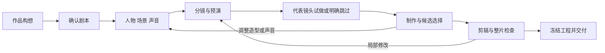

# 星桥娱乐作品制作：菜单、交互与业务重构方案

状态：2026-11-15 阶段 A 已实现并完成隔离回归；阶段 B/C/D 待实施。本文保留完整目标方案，当前数据库、接口、兼容处理与测试证据见[第一阶段交付记录](starbridge-studio-foundation-delivery.md)。

关联：[数据表与约束](starbridge-studio-data-design.md) · [开源参考、字段字典与 ER 图](starbridge-studio-schema-dictionary.md) · [现有双产品实现](starbridge-office-entertainment.md) · [五角色与 RBAC](starbridge-product-roles-and-menus.md) · [开发规范](../../apps/web-admin/AGENTS.md)。

## 1. 产品范围与关键决定

首期服务于“从想法或剧本做成可编辑、多角色配音的短片”。默认一部作品对应一个剪辑工程和多次交付；系列剧未来在作品上增加系列关系，角色素材已经能够跨作品复用，不提前引入季、集、拍摄组等组织体系。

- 侧栏解决跨作品查找；作品内部按八个阶段制作。平台和产品管理沿用同一套两级 RBAC 菜单。
- 新手从想法开始，已有剧本或素材的用户直接导入。阶段按内容和依赖给出下一步，不要求逐页重复填表。
- 关键创作决定由用户确认：剧本、人物与声音、分镜/试片、本次付费制作范围、最终交付。编辑自动保存，不把每个字段变成确认弹窗。
- 当前可编辑数据按业务实体存储；只读快照用于确认、生成、恢复和交付。视频和配音的实际采用结果以当前时间线为准。
- DSH 继续负责会话、模型推理和工具决策。沿用媒体任务执行器处理图片、视频、配音、预演和导出，不增加另一套 Agent 队列。
- 供应商、模型、音色、工具、技能和创作预设可配置。业务层依赖能力契约，不按模型名、供应商名或助手名称写流程分支。
- Office 继续作为可配置业务能力；旧 `apps/admin`、办公协议、已有部署入口保持独立。

## 2. 一、二级菜单

### 2.1 娱乐创作端

| 一级菜单   | 二级菜单   | 内容与主要操作                                                                     | 模块标识                   |
| ---------- | ---------- | ---------------------------------------------------------------------------------- | -------------------------- |
| 创作工作台 | 我的作品   | 默认首页；新建、继续制作、搜索、归档。卡片展示封面、制作进度、待处理事项和最近保存 | 保留 `studio.projects`     |
| 创作工作台 | 制作任务   | 跨作品查看进行中、失败和待核对任务；定位到具体人物、镜头、台词或导出               | 保留 `studio.tasks`        |
| 创作工作台 | 成片交付   | 查看已导出的影片、封面、输出规格及对应工程；预览、下载、返回编辑                   | 新增 `studio.deliveries`   |
| 素材中心   | 角色库     | 可复用人物设定、参考造型和声音方案；创建版本、试听、引用到作品                     | 新增 `studio.characters`   |
| 素材中心   | 场景与道具 | 场景环境、日夜/天气变体和可复用道具；预览、派生版本、查看使用位置                  | 新增 `studio.environments` |
| 素材中心   | 媒体素材   | 图片、视频、音频、音乐、音效；个人/项目筛选、上传、预览、引用与来源追踪            | 保留 `studio.library`      |

三个素材入口共用素材查询、版本与引用组件，用类型筛选呈现不同操作，不做三套上传或文件存储。角色声音放在角色卡中选择，已有音色目录作为选择器提供，不增加普通用户必须维护的“供应商音色管理”菜单。

作品首页不展示工程修订号、任务 ID 或模型 ID 作为主要信息。默认主操作是“继续制作”，准确回到待处理阶段。新作品封面先用标题与风格，确认画面后采用真实封面。

### 2.2 管理端与五种角色

| 一级菜单 | 二级菜单                                                                     | 可见范围                                   |
| -------- | ---------------------------------------------------------------------------- | ------------------------------------------ |
| 能力管理 | 智能体、知识库、技能、工具、默认模型、创作预设                               | 娱乐管理员、超管；创作预设仅在娱乐产品显示 |
| 产品管理 | 产品成员、菜单配置                                                           | 当前产品管理员、超管                       |
| 平台管理 | 平台总览、账号与角色、供应商与模型、扩展管理、设备运维、存储与服务、平台审计 | 超管                                       |
| 个人中心 | 账号资料、账号安全、外观设置、已有权限允许的个人模型                         | 当前用户                                   |

五种预置角色继续使用原身份：超管、办公管理员、娱乐管理员、办公用户、娱乐创作者。办公用户不出现娱乐菜单；娱乐管理员没有办公管理权；办公管理员兼娱乐创作者切到娱乐时只拥有创作端入口和本人资源。

管理员能配置产品能力，不自动获得查看别人私人剧本、角色素材或成片的权限。需要支持访问时另走显式授权与审计。

### 2.3 路由与旧入口

- 保留 `/#/entertainment`、`/#/entertainment/library`、`/#/entertainment/tasks`；新增 `/entertainment/deliveries`、`/entertainment/characters`、`/entertainment/environments`。
- 作品继续使用 `/#/entertainment/:project?section=<阶段>&shot=<稳定ID>`。新阶段键为 `brief/script/cast/storyboard/sample/production/edit/delivery`。
- 旧 `library` 页签映射到 `cast` 并展开项目素材；旧 `timeline` 映射到 `edit`；旧 `jobs` 映射到 `production`，保留项目与镜头定位。
- `studio.projects/library/tasks` 的模块 ID 保留。菜单升级合并用户自定义名称、排序和角色范围，不覆盖办公菜单；新增菜单使用模块注册目录派生默认授权。
- 作品阶段属于上下文导航，不创建第三层 RBAC 侧栏菜单。阶段内生成、编辑、导出等动作仍分别校验权限。

## 3. 作品工作台交互

顶部固定显示作品名称、当前画幅与目标时长、保存状态、待处理事项和当前主要动作。阶段导航显示“可继续、待确认、待更新、有阻塞”的简明状态。

主区域承载当前阶段的实际内容；导演助手作为可展开的右侧面板贯穿各阶段，自动携带当前作品和所选镜头。项目素材通过侧面板按需选用；制作进度以角标和任务抽屉随时可见。用户不必离开当前镜头才能查看该镜头任务。

桌面按可用空间展示内容、预览、属性；窄屏按“预览/内容—编辑—助手”切换，阶段使用下拉或可滚动步骤条，不把八个标签压成一排。沿用公共表格、卡片、表单、弹窗、间距和主题。

### 3.1 八阶段的输入、交互与完成条件

| 阶段       | 用户界面与主要操作                                            | 系统工作                                                     | 进入下一步的依据                                     |
| ---------- | ------------------------------------------------------------- | ------------------------------------------------------------ | ---------------------------------------------------- |
| 作品构想   | 一个描述框，可上传剧本和素材；确认画幅、目标时长、语言、风格  | 提取制作要求，补合理默认，名称自动建议；专业设置折叠         | 有可理解的创作目标及可用输出规格；未知项可保留为待定 |
| 故事剧本   | 梗概、场景顺序、人物关系、对白与旁白；按原文制作/允许改编     | 整理或创作剧本，估算长度；展示改编差异，关联原文             | 用户确认本次剧本；故事场景和台词身份建立             |
| 人物与场景 | 角色卡、造型候选、声音试听、场景/道具卡；复用个人库           | 提取设定，按配置生成或上传参考图；试听真实台词，记录选用版本 | 所需角色造型与声音、场景参考已确认；不适用项明确略过 |
| 分镜预演   | 每镜画面、动作、角色、对白、时长；可增删、拆分、复制、排序    | 将剧本转为镜头，生成分镜图；用草配音与静态画面组织可播放预演 | 用户看过本次分镜与节奏；缺素材或超时有明确定位       |
| 代表镜头   | 推荐有代表性的少量镜头，选择试做范围、比较并确认              | 验证新风格、人物动作与声音表现；成功结果可直接用于正式制作   | 已确认效果，或用户基于已验证设定明确跳过；记录理由   |
| 正式制作   | 缺失/待更新/失败/选中范围切换；每镜候选和每句配音直接审看采用 | 预检、冻结范围与用量、提交任务；恢复进度、定位失败           | 必需画面和声音已采用；允许先进入剪辑，缺项保持可见   |
| 剪辑成片   | 自动初剪、可拖动轨道、组合预览；对话与手工共用工程            | 按真实配音时长排时、字幕对齐、镜头衔接与音量处理             | 完整预览可播放；阻塞问题修正，创作提示由用户判断     |
| 检查交付   | 问题清单、封面、格式与字幕选项、最终预览、导出记录            | 校验源文件、采用结果、时序、画幅及音频；冻结工程并渲染       | 导出完成且媒体校验通过，下载入口可用；失败保留工程   |

确认是对当前内容的确认，不是禁止继续修改。无人物、无对白的作品自动略过相应要求；只完成部分素材也能继续编写和探索，正式生成和交付才检查相关硬依赖。

### 3.2 关键操作细节

1. **自动保存。** 输入防抖提交，展示保存中/已保存/失败。采用视频、配音和造型均为有明确回执的操作；保存失败保留本地内容并阻止依赖未保存内容的提交。切产品、退出及刷新有未保存保护。失败重试复用同一操作号。
2. **草案确认。** 展示新增、移除、修改、重排，逐字段比较场景、角色、台词、时长和素材。用户可按镜或字段选用；同一字段在草案产生后被手工修改时提示冲突，不能用旧草案直接覆盖。
3. **采用候选。** 单击只预览，明确采用才保存。视频和声音采用统一写入时间线来源；画面引用、裁剪和音轨关系在同一事务检查。可换回旧结果，但有意使用旧输入结果需要可见提示。
4. **生成范围。** 默认补未完成项，可切待更新、失败或手工选择。已在执行的相同内容显示现有任务；主动“再生成一个候选”属于独立制作意图，另行确认。静默重复点击不会增加费用。
5. **生成确认。** 列出具体对象、复用项、新增项、模型显示名和可获得的用量/费用区间；无法估价时明确未知。模型、音色、参考文件、权限和时长支持范围在提交前检查。
6. **时间线。** 四类基础轨道：画面、角色声音、字幕、音乐/音效。支持拖动顺序、入出点、声音起点、字幕区间与音量；显示秒或时间码，毫秒仅供精确编辑。自动安排只调整未锁定内容，不能覆盖用户手工裁剪和排时。
7. **预览。** 默认提供时间线组合预览，可用代理媒体和草配音；正式渲染用于导出。代理不支持的效果明确提示需渲染预览。字幕和裁剪计算使用同一时间线规则，代理不是另一份工程。
8. **任务定位。** 任一任务都能回到对应角色、镜头、台词或交付。失败按对象处理；已有结果可以继续使用。停止对话、取消尚未提交任务、申请取消供应商任务是不同操作，界面按真实能力说明。
9. **成片交付。** 展示封面、时长、画幅、文件规格、生成时间及对应工程快照。继续编辑不会修改已导出的文件；再次导出形成新的交付记录。首期交付是预览与下载，不自动发布外部平台。

## 4. 流程状态与依赖更新

### 4.1 三类状态分别表达

- 作品生命周期仅为 `active/archived`。已交付仍可继续修改，不能用一个线性的“制作中/已完成”覆盖全部状态。
- 阶段状态为 `not_started/in_progress/needs_review/confirmed/stale/skipped/blocked`。根据当前内容、确认指纹和依赖计算，确认记录只追加；用户回到前面阶段不会清空后续成果。
- 媒体任务使用独立状态机。前端显示来源于任务和候选，不能用工程阶段假装任务已完成。

### 4.2 修改影响规则

| 修改                    | 需要重新核对或生成                                 | 默认保留                         |
| ----------------------- | -------------------------------------------------- | -------------------------------- |
| 只校正字幕文字/字幕时间 | 字幕、当前预览和后续导出                           | 原配音、镜头、角色               |
| 改一句台词              | 该句配音、相关字幕与排时；语音依赖型视频才联动视频 | 其他台词、通常的视频画面         |
| 修改角色声音            | 所选作用范围内该角色的配音与排时                   | 人物造型、场景、普通视频         |
| 第三镜改雨夜            | 第三镜场景参考、分镜图和视频，相关预览/导出        | 台词、原配音、人物造型、其他镜头 |
| 改角色造型              | 明确选择引用范围后，相关参考图/视频提示待更新      | 其他作品的原版本、未选择镜头     |
| 重排镜头                | 时间线位置、预演与导出                             | 已生成画面、配音文件             |
| 手工裁剪镜头            | 本镜音画、字幕边界检查及导出                       | 原媒体，其他镜头的手工修改       |
| 改画幅或整体风格        | 展示受影响镜头，选择重新生成或可用的重构图策略     | 所有旧结果供比较，不直接抹除     |

每个任务冻结实际依赖对象及内容指纹；不能因作品修订号改变就让全部结果失效。候选“文件可用”和“与当前输入匹配”分别表达。用户可以明确保留旧结果，选择及理由进入检查与交付快照。

### 4.3 声音与时长

草配音提供节奏预估；正式采用配音后按实际媒体时长重新计算。每句有说话人、语气、停顿，字幕可拆为多个时间段并保持与原台词的关联。

默认顺序对白自动串接；重叠对白必须有明确编辑意图。声音超出镜头时提供延长画面、缩短台词、调整允许的语速或重新分镜等选择，不默认截断。手工锁定的时间段必须保留，自动排时产生建议供确认。

## 5. 后端业务用例

所有用例沿用 `controller → service → dao`，媒体供应商通过能力适配器接入。DSH 工具与 Web 调用同一 service；工具不直接写数据库，不提交任意整份工程覆盖。

### 5.1 创建、拆解、确认

1. 新建作品存作品构想、规格和预设版本，创建空时间线；无需启动 DSH 或模型任务。
2. 用户明确请求导演拆解后，DSH 读取作品及已授权能力目录，提交结构化草案。
3. 草案保存基础修订、对象身份和字段指纹；对比界面显示新增/修改/移除/重排及影响范围。
4. 用户选用变更；服务端重查基础对象，在一个事务内应用所选变更、保存审阅回执并更新工程修订。冲突返回逐字段信息，不覆盖当前值。接受一部分草案不等于确认整个阶段；明确确认阶段时才写阶段确认记录及快照。

### 5.2 预检、计划、生成

1. 选择对象与操作意图，生成一个持久制作计划；服务端解析权限、素材版本、能力、配置和音色。
2. 文件探测等慢工作在数据库写事务外完成；结果以输入指纹记录。计划展示逐项阻塞/提醒及用量。
3. 用户确认计划哈希；事务内复查输入未变、权限和配置当前可用，冻结条目并创建幂等任务。变化返回“计划需更新”，不能悄悄扩大范围或换模型。
4. 媒体执行器认领任务、写提交意图，再调用模型公开服务。回执和模型操作账本先持久化；任务重启后根据已知回执恢复，不自动重新提交不明结果。
5. 下载到临时文件，探测真实类型、时长、画幅和音轨；完整校验后原子转入公共文件存储，追加素材版本和候选。候选到达只更新候选列表，不自动覆盖时间线。

### 5.3 自动初剪、采用与导出

1. 创建镜头/台词时建立有稳定身份的时间线占位片段。采用视频/配音只更新对应片段来源，不重建整条时间线。
2. 初剪建议根据镜序、真实时长和台词关系生成；手工锁定的片段不可被自动排时覆盖。
3. 预览读取当前时间线；导出前执行可定位的问题检查。缺必需媒体、不可解码、越界或未解决的声音截断属于阻塞；创作节奏等作为提醒。
4. 用户确认输出设置与检查结果；事务内核对指纹并冻结包含精确时间线、媒体版本、字幕与规格的工程快照，创建导出任务。
5. 渲染只读冻结快照；成片媒体探测通过后创建交付记录与文件引用。用户同时继续编辑不会改变此次导出。

### 5.4 取消和受理未知

- 尚未提交：原子取消，执行器不得再认领。
- 已提交且供应商支持取消：记录取消申请；只有供应商确认后才显示远端取消成功。迟到结果保留来源记录并不自动采用。
- 已提交且供应商不支持取消：明确只能停止本地等待或不再采用，远端仍可能执行/计费；允许恢复查询。
- 受理未知：冻结重新提交。核对动作包括补充回执、确认未受理、保留待核对；保存依据和操作者。补录回执需要校验所属连接、模型、时间及可取得的请求证据，不能把任意外部结果直接挂到作品。
- 无法证实结果归属或未受理时继续待核对；用户主动承担潜在重复执行而新建制作意图时单独确认，原任务保持未知，不伪装成安全重试。
- 每类任务有可配置执行期限；超时后按提交阶段进入可恢复失败或待核对，不无限无提示轮询。

## 6. 权限、能力与扩展

新增细粒度操作授权：`studio.projects.read/write`、`studio.assets.read/write`、`studio.generate`、`studio.export`、`studio.jobs.cancel/reconcile`；仍同时校验 `products.entertainment`、文件/模型使用权与资源归属。取消、核对仅对本人有权处置的任务有效。

现有角色按原有效权限作声明式映射，保留历史创作能力，不自动补授原本没有的 `models.use` 或文件权限。角色名称仅用于显示，不能用于判断权限。

创作预设复用 `resources/resource_versions` 的发布与版本能力，新增注册的 `creation_preset` 类型及严格 Schema；需补对应管理授权和契约测试。预设声明默认画幅/风格、允许的阶段、角色与参考素材要求、能力映射和检查规则，不执行任意脚本，不含密钥，不在修改后强制覆盖已有作品。

图片生成、声音试听、视频生成、预演、媒体探测等作为注册能力/工具。当前只实现百炼的媒体适配时如实显示支持范围；扩展供应商通过统一能力、输入限制、回执与取消契约接入。模型配置仍来自后端 `config` 及公共管理，前端不内嵌供应商地址和默认 Key。

## 7. 代码与接口拆分

前端保留 `views/studio`，按 `directory/project/cast/storyboard/production/edit/delivery` 组织组件；API、composables、types、utils 使用同样领域名称。公共表单、任务状态、素材选择、候选对比、差异确认复用组件，不再把全部操作堆在 `StudioEditor.vue`。

后端保持一个创作域，controller/service/dao 内分别按 project、script、entity、storyboard、proposal、generation、timeline、validation、delivery 划分职责。只有确有业务边界的服务才拆出，禁止只做转发的空层。

主要无版本接口族：

| 用例           | 接口                                                                               |
| -------------- | ---------------------------------------------------------------------------------- |
| 构想/规格/剧本 | `GET/PATCH /api/studio/projects/{id}`，`GET/PATCH .../script`                      |
| 人物/场景/造型 | `.../entities`，`.../entities/{entity}/revisions`，`.../entities/{entity}/adopt`   |
| 分镜与台词     | `.../shots`，`.../shots/reorder`，`.../lines`                                      |
| 导演方案       | `.../proposals`，`.../proposals/{proposal}/review`                                 |
| 检查与确认     | `.../validations`，`.../stages/{stage}/confirm`                                    |
| 制作计划       | `.../generation-plans`，`.../generation-plans/{plan}/confirm`                      |
| 候选           | `.../candidates`，`.../candidates/{candidate}/adopt`                               |
| 任务处置       | `.../jobs/{job}/cancel`、`.../recover`、`.../reconcile`                            |
| 时间线         | `GET/PATCH .../timeline`，`POST .../timeline/auto-arrange`                         |
| 快照与导出     | `.../snapshots/{snapshot}/restore`，`.../exports`，跨作品 `/api/studio/deliveries` |

`...` 表示 `/api/studio/projects/{id}`。写请求带 `expectedRevision` 与操作幂等号；同号不同请求体返回冲突。对多对象操作使用一次领域命令和事务，不能由前端连续保存多次形成半成品。旧接口经过一处明确适配调用同一 service，兼容期有退出条件，不建立另一套业务实现。

个人设定库通过 `/api/studio/entities` 及其版本、引用和制作计划子资源使用同一 service；试听或生成角色参考图不强制创建作品。个人库写入使用设定自身修订，项目写入使用工程修订；所有操作仍校验能力权限及本人数据归属。

## 8. 实施顺序与验收

| 阶段          | 交付                                                        | 验收重点                                                           |
| ------------- | ----------------------------------------------------------- | ------------------------------------------------------------------ |
| A. 领域与入口 | 菜单、作品规格、结构化剧本/分镜、素材版本、权限与旧工程转换 | 五角色及组合角色；旧深链；旧镜头 ID、音频和剪辑不丢；自动保存冲突  |
| B. 创作准备   | 剧本/人物/声音确认、参考图生产、字段级草案、分镜预演与试片  | 从新剧本得到可听可看的方案；原文模式；局部改动不覆盖手工编辑       |
| C. 制作闭环   | 统一预检、分范围生成、依赖指纹、候选采用、恢复取消核对      | 同批部分失败、重复点击、进程重启、未知受理、候选待更新             |
| D. 剪辑与交付 | 自动排时、拖动剪辑、组合预览、成片检查和冻结导出            | 多句对白不默认重叠；裁剪不静默截音；预览与输出一致；交付版本可追溯 |

里程碑按可执行用户流程交付，计划条目需有测试证据才勾选。测试源码位于 `apps/web-admin/tests`；数据库、截图、音视频和日志置于 `.superdsh-work/web-admin-validation/<run-id>`，不写主代码目录，不读取真实凭据作为普通测试输入。

### 当前进度

- [x] A：两级菜单与作品内八步导航，保留旧深链。
- [x] A：作品规格、原文/改编意图、场次、稳定镜头与逐句台词持久化。
- [x] A：个人库与作品库按具体版本引用，项目造型独立派生，来源与使用位置可追溯。
- [x] A：结构化当前工程、时间线关联、历史快照及旧工程事务迁移。
- [x] A：细粒度读写授权、五角色及组合角色隔离、归档恢复。
- [x] A：自动保存、重复提交、结果未知后的原号重试、版本冲突与离开保护。
- [x] A：隔离数据库、浏览器与旧包保护检查；测试数据和临时服务清理。
- [x] B：作品内参考图与声音定稿、字段级草案对比、分镜预演与试片确认；详见[准备阶段交付记录](starbridge-studio-preparation-delivery.md)。
- [x] B 扩展：个人库独立生成、试听、候选采用与版本隔离；见[制作闭环交付记录](starbridge-studio-production-delivery.md)。
- [x] B 交互：剧本工作区采用原稿与场次目录，支持原文摘录建场、起草/拆解任务说明、建议定位与无冲突选择、内容审阅后确认；见[剧本编排交互交付记录](starbridge-studio-script-interaction.md)。
- [ ] 真实供应商造型、声音效果及真实计费验收（自动回归使用受控供应商）。
- [x] C：冻结制作计划、逐项预检、按缺失/失败筛选、输入指纹、原回执恢复、取消及人工受理核对；页面与接口共同交付。
- [ ] D：自动排时、拖动剪辑、组合预览、成片检查与完整导出规格。

完整验收从全新作品开始：输入两角色剧本 → 确认造型和声音 → 四镜分镜预演 → 试做 → 生成并采用 → 修改一句台词和第三镜雨夜 → 保留其他镜头及手工裁剪 → 处理时序冲突 → 整片预览 → 导出并人工核对声音、字幕、顺序、时长。两角色四镜是验收样例，不是业务限制。

覆盖 390/768/1280/1440px、明暗主题、键盘、断网恢复和权限撤销。真实导演、真实媒体供应商、受控供应商与浏览器合成接口的结果分开记录；单独调用 FFmpeg 成功不能记为完整用户流程通过。

## 9. 设计依据与当前产出

本方案基于本仓库当前 Vue、FastAPI、素材、任务与导出实现梳理，结合已确认的用户制作流程。产品参考仅用于组织创作步骤，不要求更换现有供应商：

- [Adobe：从剧本到镜头与制作细节](https://www.adobe.com/creativecloud/video/discover/shooting-script.html)。
- [Runway：角色与场景参考素材的复用](https://help.runwayml.com/hc/en-us/articles/40042718905875-Creating-with-Gen-4-Image-References)。
- [ElevenLabs Studio：剧本、媒体、声音与时间线协作](https://elevenlabs.io/docs/eleven-creative/products/studio)。

阶段 A 已修改新管理端的菜单、接口、结构化存储及 Vue 业务页面。数据库迁移在隔离环境中验证；未连接用户业务库执行升级。正常重启后端时由既有启动入口执行迁移，升级注意事项与阶段性取舍见[交付记录](starbridge-studio-foundation-delivery.md)。
