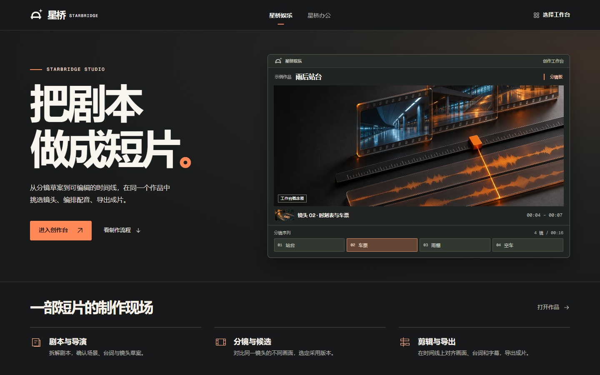
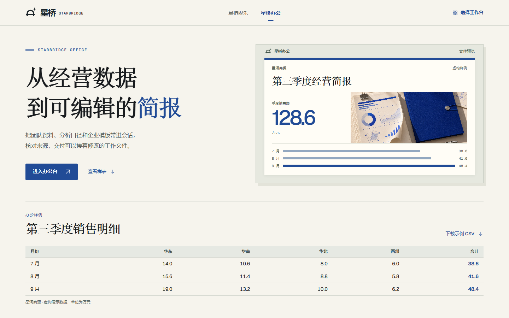
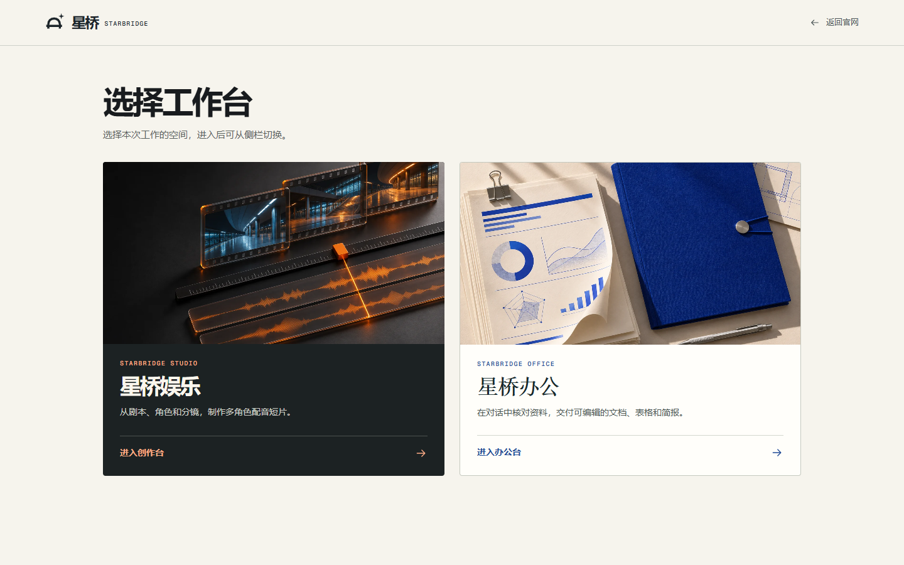
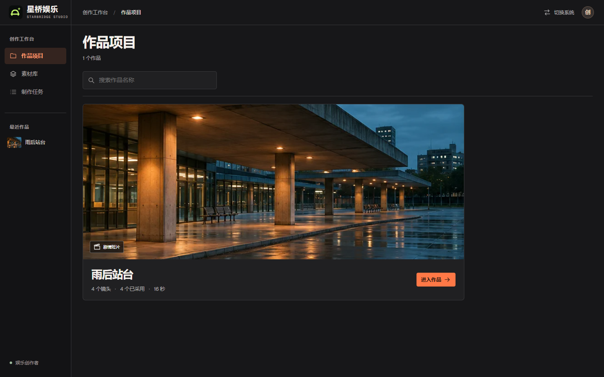
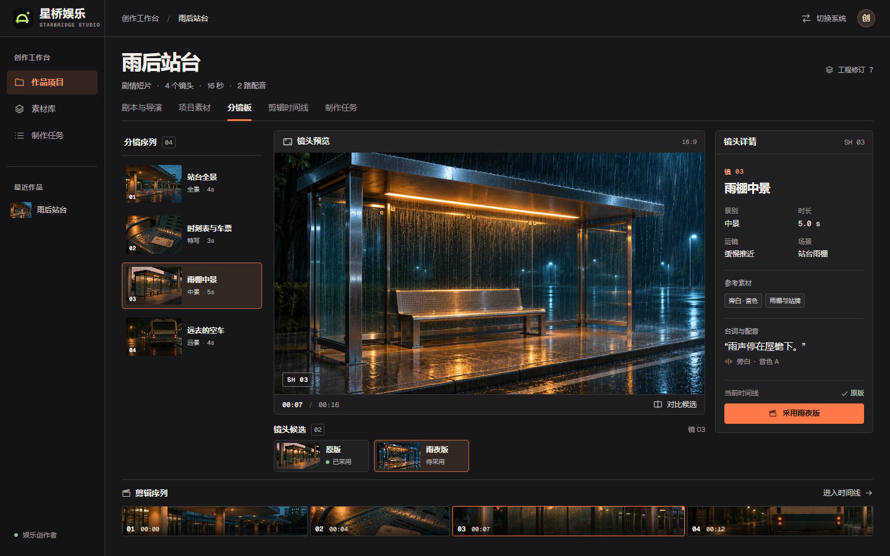
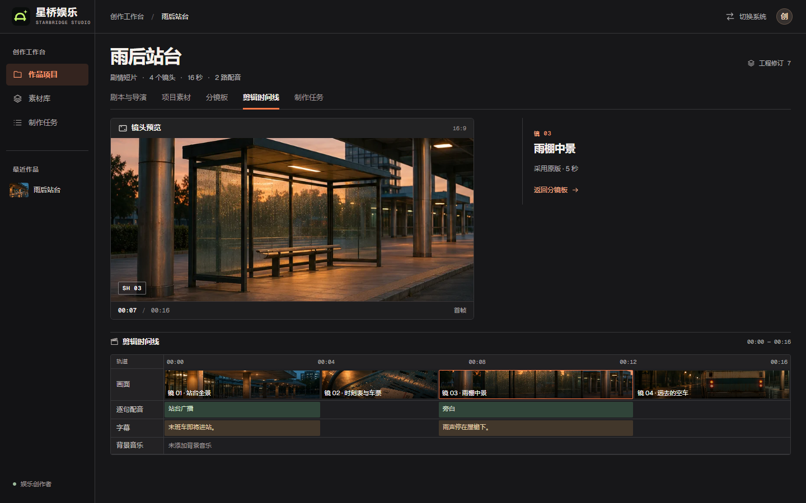
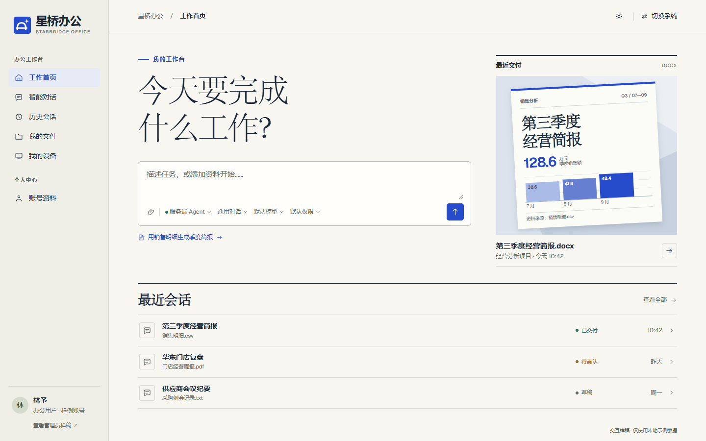
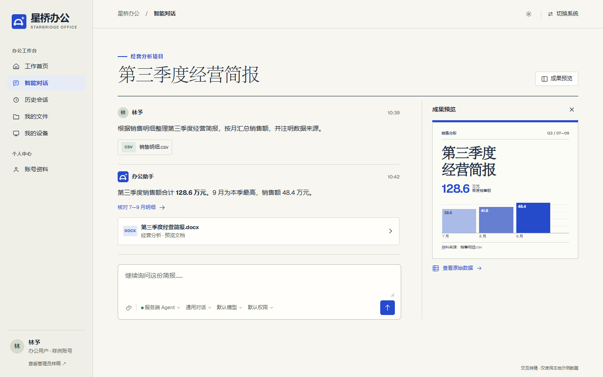
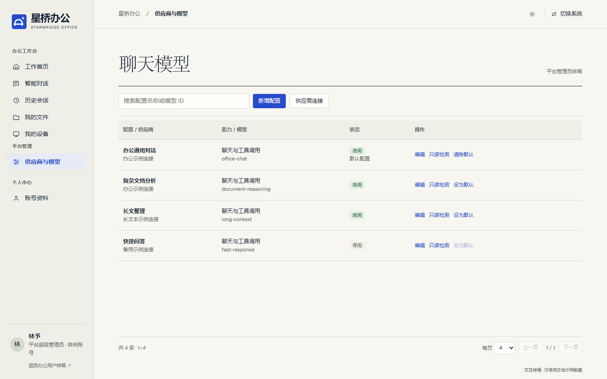

# 星桥官网、系统启动页与双产品 UI 设计方案

> 当前视觉已更新为[浅色娱乐与办公统一方案](../web-admin-light-design.md)：娱乐雾白与陶橙，办公珍珠白与钴蓝。下文旧样册保留产品流程与历史评审依据；原石墨娱乐、暖纸办公配色及展示字体不再作为新页面规范。正式 Vue 的配色与尺寸以新规范和 `tokens.css` 为准。

[打开交互样稿](website.html) · [翻阅 PDF 样册](星桥双产品界面设计.pdf) · [系统选择页](launch.html)

**官网默认展示娱乐，第二个入口是办公。** 访客看到的是产品能做什么。娱乐首屏可以选择一镜，办公首屏可以核对一份简报。两端都使用星桥的桥拱与星标。图像限定为软件界面、器物、建筑空镜、纸页和数据图表，全套样稿去除人物摄影、人物插画和肖像头像。

这是一套可离线打开的 Web 设计稿。四个 HTML 文件、字体、样表和图像均在本目录。局部交互使用示例数据，真实鉴权、任务执行、保存和文件生成继续走现有应用。桌面和 Android 本次沿用既有协议。正式 Web 路由使用下文的 Hash 地址，样稿用独立 HTML 文件方便评审。

## 1. 官网如何介绍两套产品

### 默认首屏 · 星桥娱乐

页眉从左到右是品牌、娱乐和办公切换、选择工作台。主标题“把剧本做成短片。”回答产品用途，主按钮“进入创作台”进入作品目录。“看制作流程”在本页下移到剧本、分镜、剪辑三步。右侧首屏以实体化时间线介绍工具；点选下方四个镜头，会切换成对应空镜预览，同时更新时间码和选中状态。官网演示使用公开样片《雨后站台》，无需登录即可操作。

向下先看制作流程，再看样例中第三镜“原版 / 雨夜版”的关系，最后放多端与帮助。移动端保留两个产品入口，上方看标题和进入按钮，下方看可点的样片。摄影仅用来解释一种能力，用户始终看得到产品名称、动作入口和具体界面。

### 切到星桥办公

页眉位置一致。正文换为暖纸色、蓝色墨线和文档版式。左侧“从经营数据到可编辑的简报”配“进入办公台”和“查看样表”；右侧直接看报告名称、季度合计及三个月的比较。向下紧接原始明细与 CSV 下载，然后展示资料进入会话、核对来源、预览交付的过程。

官网样表为仓库已有的公开示例。7、8、9 月销售额分别为 38.6、41.6、48.4 万元，季度合计 128.6 万元。图表、列表和对话使用同一口径，金额单位随数字显示。文件链接区分“下载示例”与实际工作区的私人文件。保留现有的中英文、隐私说明、跳至正文与多端入口。语言和隐私属于正式站的全局导航，独立样稿集中演示产品切换与核心操作。

## 2. 登录与系统选择

启动页采用中性底色。标题“选择工作台”，左卡星桥娱乐以分镜与时间线识别，右卡星桥办公以档案夹与纸页识别；手机上娱乐排在上面。整张卡可点击，焦点样式覆盖整卡。产品名称、用途和动作同时可见。登录表单沿用账号、密码、错误、原生授权和改密流程，品牌栏采用相同中性底色。登录错误放在对应输入处。

| 进入位置 | 用户预期 | 正式实现 |
| --- | --- | --- |
| 匿名访问官网 | 立即浏览娱乐，也可直接看办公 | 建议在现有 `/#/` 上增加公开查询态 `?product=office`；缺省娱乐。切换参与浏览器前进、后退，不触发鉴权或修改账号偏好。 |
| 点击某个产品“进入” | 去指定工作台 | 复用 `/#/entertainment`、`/#/office` 的守卫，登录后恢复合法目的地。已登录无此资格时提示并提供已授权工作台入口。 |
| 从中性入口登录 | 进入有权限的系统 | 双资格进入 `/#/products`；单资格直进对应首页；仅公共权限的账号按既有授权进入总览或个人资料。 |
| 从已有会话、作品、文件或原生授权返回 | 回到原来要做的事 | 校验站内目的地并保留作品 ID、页签和会话；原生 OAuth 沿用独立续接。公开分享继续走分享入口。 |
| 在系统里切换产品 | 保留当前工作进度 | 双资格账号才显示切换，草稿按现有保存状态处理；未保存的编辑提供保存或放弃。目标产品重新加载服务端菜单、模型和资源，进行中的媒体任务可回原作品查看。 |

## 3. 星桥娱乐 · 从作品到成片

**作品项目**是首页。入口为新建作品、继续制作和搜索。每个作品显示名称、镜头数、已采用数、修订和最近更新。目录封面建议取本作品已采用镜头，接口提供有权读取的缩略图后启用；没有可用画面的作品显示名称与状态。空目录保留“新建作品”，搜索无结果提供清除筛选。

**分镜板**采用左镜头序列、中画面与候选、右镜头详情。示例四镜为站台全景 4 秒、车票特写 3 秒、雨棚中景 5 秒、空车离站 4 秒。第三镜位于 00:07–00:12。点雨夜候选可以先看大图或并排比较；只有点“采用雨夜版”才替换时间线中这一镜的画面。旁白、站台广播、配音、字幕和其他镜头继续引用原对象。采用后可换回。窄屏按“选镜 → 看画面 → 比选 → 详情”阅读；重排同时提供前移和后移。

**剪辑时间线**分别展示画面、配音、字幕和背景音乐。总时长 16 秒，四段边界 00:00、00:04、00:07、00:12、00:16。采用候选后时间线立即反映当前画面。生产界面支持按现有契约填写入出点、调节音量、修改字幕和恢复版本；音频超出镜头时长，在轨道和相应台词旁标记冲突。导出绑定工程版本，展示已受理、可预览或失败的真实状态。

| 其他创作页面 | 信息与操作 |
| --- | --- |
| 剧本与导演 | 当前作品标题、剧本编辑区、导演对话和修改预览。重新拆分时列出新增、修改、移除的镜头，手工改过的字段由用户选择。 |
| 素材库 / 项目素材 | 个人库跨作品复用；项目页只看本片引用。按角色、场景、道具、图片、视频、配音和音乐筛选，列表显示来源、版本、使用镜头和采用状态。角色可用文字或物件参考；本套演示以两条声音区分说话者。 |
| 批量生成确认 | 明列选中镜头、总秒数、台词句数、字数和有效模型。单镜、单句都能单独提交。重复点击显示同一批任务。 |
| 制作任务 | 产品级列表可返回所属作品；作品页签只列本片任务。显示等待、提交中、生成中、下载中、完成、失败、待核对。能够安全重试的失败项提供重试，受理结果未知时提供核对入口。 |

## 4. 星桥办公 · 从资料到交付物

**首页**把任务输入放在首屏，旁边和下方留给最近会话与本人交付物。没有历史时显示真实空态及一条可点的示例任务。办公助手、Word、Excel、PPT 及知识源由已发布能力决定。用户选择通用对话时，读取有效的默认智能体模式、模型和权限即可发送，设置收在输入栏。

**对话**左侧保留历史会话省略号菜单，正文按任务、回复、待确认和结果排列。成果出现时提供“预览”，并能打开来源样表。“第三季度经营简报.docx”与“销售明细.csv”是两种不同对象，各自显示文件名与操作。正式工作区下载真实交付文件；质量检查未通过的成果标草稿。任务终止显示中断结果，保留已经完成的步骤和下一次可用操作。

| 办公页面 | 显示与交互 |
| --- | --- |
| 历史会话 | 记录展示标题、活动时间、运行状态。重命名、置顶、归档、删除收在行末省略号，删除需确认。打开历史后仍用同一个输入栏。 |
| 我的文件 / 预览 | 搜索、类型、来源与近期文件，支持版本、回收站、预览和获授权下载。引用资料能回到来源；无权限或链接失效时取消内容预览。 |
| 我的设备 | 仅列已绑定设备，标明在线、离线或正在连接。一台设备展开后显示可用操作。设备运维仍属于平台管理。 |
| 已发布智能体 | 通用对话在前，可按需选业务智能体。知识、技能和工具作为可配置资源；个人或产品默认模型有变化时在当前选择器反映。 |

## 5. 共享控制台、组件与权限

普通用户进入本人业务工作台与个人中心。产品管理员增加“能力管理”和“产品管理”；超管另有“平台管理”。管理样图中的模型目录采用超管视角。若办公管理员同时是娱乐创作者，切到娱乐后只呈现创作工作台与个人中心，娱乐管理深链仍由后端拒绝。

| 页面组 | 统一布局 |
| --- | --- |
| 能力与产品管理 | 智能体、知识库、技能、工具、产品默认模型；产品成员和菜单配置。页面标题只留名称。标题下同一工具栏放搜索、筛选、新建和页面动作。 |
| 平台管理 | 平台总览、账号与角色、供应商与模型、扩展管理、设备运维、存储与服务、平台审计。模型页顺序为搜索、新增配置、供应商连接。行操作直接展示，权限、禁用原因和危险确认沿用现有规范。 |
| 个人中心和公共入口 | 资料、安全、外观、已有权限的个人模型；登录、改密、授权回调、分享和文件预览沿用各自流程。公开页仅展示被允许公开的内容。 |
| 表格与弹窗 | 主列表独立滚动，分页固定在内容区底部；子列表独立分页。弹窗标题与操作区固定，正文主纵向滚动。短文本自动长高，长编辑器可展开。危险操作明确写出影响对象；失败保留输入和滚动位置。 |

角色细则与完整菜单以[已验收的五角色菜单方案](../starbridge-product-roles-and-menus.md)为准。菜单按产品与账号从同一后端取得，前端用同一套组件绘制。公共控件继承当前产品的主题，弹层和浮层也要继承。

## 6. 视觉、响应式与实施验收

| 设计项 | 娱乐 | 办公 |
| --- | --- | --- |
| 工作面 | 石墨黑 `#171719`、面板 `#202022`、正文 `#F5F1EC` | 暖纸 `#F7F6F0`、纸面 `#FFFEFA`、墨蓝正文 `#1B2738` |
| 主操作 | 时间线橙 `#FF7846` 搭配深色文字；橙色用于采用、选中和播放头 | 钴蓝 `#254BCB` 搭配白字；蓝色用于主按钮、引用和数据重点 |
| 排版 | 中文黑体、Geist、等宽时间码。画面保留原比例，镜头编号用于定位。 | 界面用黑体，官网与报告标题用系统宋体，长文按段落和来源组织，金额右对齐。 |
| 共用尺寸 | 两端以 8px 为主要间距，紧凑区使用 4px；工作区正文建议 14–16px。 | 表单、反馈和管理卡片保持同一层级。鼠标和触控均可访问主操作，移动热区至少 44px。 |

产品身份与用户的浅色、深色、跟随系统偏好独立。娱乐浅色用浅灰工作面，预览监视器保留深色衬底；办公深色用蓝灰工作面和浅钴蓝重点，文件预览保留纸面模式。错误、等待、完成都用文字与图形；颜色只作辅助。所有交互可用键盘，焦点可见，弹窗关闭后还焦，尊重减少动态设置。

| 390px | 768px | 1280 / 1440px |
| --- | --- | --- |
| 官网纵向阅读且产品切换常驻；双卡娱乐在上。分镜详情按需展开；办公保留输入与发送，其余选项放会话设置。 | 收起固定侧栏；优先保留当前画面或正文；资源检查器与文档预览可用抽屉。 | 官网双栏、娱乐多栏剪辑、办公对话与成果同屏。矮屏允许内容滚动，避免页脚盖住操作。 |

[手机娱乐官网](samples/site-mobile.png) · [手机启动页](samples/launch-mobile.png) · [手机分镜台](samples/studio-mobile.png) · [手机办公首页](samples/office-mobile.png)

**实施顺序**

1. 官网与启动页先行。将产品切换、主视觉和公开演示接入现有 Vue 官网；校验两个产品链接、站内锚点、语言切换、CSV 下载和登录续接。图片按最终尺寸交付 WebP，首屏只优先加载可见产品的图。
2. 以分镜板、会话输入与成果抽屉作为两端样板，再铺到目录、素材、时间线、文件和设备。每个可复用部件都接已有服务契约。目录缩略图、首页最近成果聚合等新投影优先从有权读取的数据派生；没有相应数据时显示空态。
3. 收束共享组件并回归。对照五种单角色和混合角色检查菜单、直达、切换、失效权限、草稿与长任务恢复。四档宽度、两种明暗偏好、键盘和减少动态均验收。以“第三镜换成雨夜，保留广播配音”和“从样表核对 128.6 万并预览可编辑简报”作为两条完整走查。

**评审边界。** 样册中的桌面 9 张和手机 4 张由同目录页面实际渲染。样稿可体验官网切换、选系统、镜头比选与采用、时间线切换、办公资料或成果预览及示例管理操作。正式登录、云端生成、全站明暗适配、真实模型目录和数据持久化属于 Vue 接入阶段。该目录不包含真实账号、密钥或私人文件。

## 7. 正式 Vue 实施记录 · 2026-11-13

| 交付 | 生产入口与验收 |
| --- | --- |
| 官网、启动与登录 | `/#/`、`/#/website` 默认娱乐，`/#/?product=office` 可分享办公首页。四个镜头可选。办公的图表、明细和下载都取自同一份公开 CSV，月度金额为 38.6、41.6、48.4 万元。浏览器验证了刷新、前进后退、键盘、语言切换、下载、站内深链和 OAuth 回调续接。双资格选择工作台，单资格直达。 |
| 娱乐工作台 | `/#/entertainment` 使用本人作品和当前修订的授权视频封面。素材详情列出引用该版本的作品和镜号，可以直接进入对应分镜。隔离工程使用 FFmpeg 视频候选和独立音轨，在真实 FastAPI 上采用第三镜、刷新、核对时间线并换回。修订从 2 递增到 4，保留原角色、台词、配音和第一镜裁剪。供应商受理状态未知时，有回执可恢复查询，无回执保留待核对。 |
| 办公工作台 | `/#/office` 与会话页共用草稿、附件、模型和权限。首次发送与 DSH 准备共用等待期限，重复点击只创建一个会话。最近交付按所有者、产品、文件权限和回收状态筛选。已知入库或收据完成时间的成果优先；可读的旧技能成果若无可靠时间则排在末尾。使用隔离账号上传公开 CSV，实际 DSH 和 Word 工具生成可编辑简报，LibreOffice 渲染 PDF。已核验正式交付状态、来源摘要、三个月明细、128.6 万元合计、首页预览和下载文件摘要。 |
| 共用控制台 | 页头可切工作台及浅色、深色、跟随系统。管理表格直接展示有权操作，分页置底。侧栏、弹窗、浮层与键盘焦点继承产品配色。真实登录验证五种角色及办公管理员兼娱乐创作者，分别检查菜单、管理深链和伪造 API 请求。 |

常规前端启动仍在 `apps/web-admin/fronted` 执行 `npm run dev`。后端在 `apps/web-admin/backend` 执行 `uv run python main.py`。两端分别启动的环境准备步骤见[部署与本地启动说明](../../../apps/web-admin/README.md)。

自动验收使用 390、768、1280、1440px 和明暗主题。合成浏览器用例负责布局、键盘与失败状态，真实账号、数据库、媒体解码和实际文件下载由隔离集成用例验证。旧包保护采用本轮开始和结束的源码指纹，同时保留历史基线校验结果。历史冻结清单与本轮开始时的旧包已有 12 项差异。

办公跨账号验收中，另一名办公成员的最近交付列表为空，仅娱乐用户访问办公交付目录返回 403，两者直接预览、下载他人成果均返回 404。跨作品、跨账号视频封面和素材使用位置也由后端拒绝。未登录打开带设备及路径的文件可登录后继续；一次性预览票据依然只能兑换一次。

本轮办公端采用本地确定性模型验证 DSH 工具调用；娱乐端使用隔离生成的媒体验证编辑与授权。云端模型当日可用性、桌面和手机原生 OAuth 客户端回调需在各自环境验证。对照样册时保留了官网原有导航、语言及隐私入口。

验收结果：Vue 单测 146 项、受影响的 FastAPI 回归 54 项通过。生产构建的 82 项浏览器案例中，首次通过 80 项，更新文件名断言和抽屉动画等待后，含两项原失败用例的 13 项专项全部通过。另在临时 PostgreSQL 上实测了匿名文件、作品和会话深链，登录后均能回到原资源。Vue 与测试类型、Prettier、Ruff、mypy 和目录所有权检查通过；Vite 提示部分构建分块超过 500 kB。旧包 746 个文件的本轮前后指纹一致。
