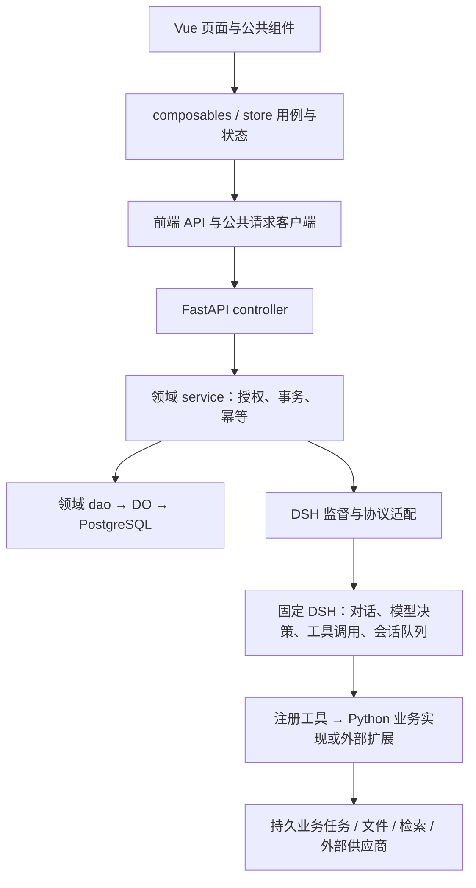

# 星桥整体架构

本文件是星桥办公、星桥娱乐及公共平台的架构入口，整理截至 2026-11-17 已落地的边界和后续约束。具体产品见[星桥办公需求与设计](星桥办公/需求与设计.md)、[星桥娱乐需求与设计](星桥娱乐/需求与设计.md)；视觉与组件见[页面设计](页面设计.md)，工程要求见[开发规范](开发规范.md)及具有代码约束效力的 [Web Admin AGENTS.md](../../apps/web-admin/AGENTS.md)。本文不替代逐轮测试和发布记录。

## 1. 产品与平台

星桥是一套公共平台上的两个产品：办公围绕“资料 → 会话 → 可编辑交付物”，娱乐围绕“构想 → 剧本与分镜 → 制作 → 成片”。两端有不同业务入口和品牌表达，共用账号、认证、控制台组件、管理后台、模型凭据、存储和部署。

| 层面           | 职责                                                       | 边界                                                         |
| -------------- | ---------------------------------------------------------- | ------------------------------------------------------------ |
| 官网与产品选择 | 公开介绍产品；根据资格进入或切换工作台                     | 公开演示与私人业务数据分开，不从官网自动发起任务             |
| 星桥办公       | 本人会话、资料、知识使用、设备及交付物                     | Word、Excel、PPT 是可配置能力，不固化为平台助手类型          |
| 星桥娱乐       | 本人作品、设定与素材版本、分镜、媒体任务、时间线及成片     | 以稳定对象和工程修订组织制作，不通过覆盖历史候选实现改片     |
| 公共管理       | 身份、产品成员、菜单、能力发布、模型连接、扩展、存储、审计 | 产品管理与平台管理分权；管理权不自动提供他人私有内容读取权   |
| 执行与基础设施 | 固定 DSH、工具实现、持久业务任务、数据库、检索和文件服务   | DSH 是唯一 Agent 执行内核，业务后台任务不是第二个 Agent 队列 |

当前主应用是 `apps/web-admin`。旧 `apps/admin` 是独立保留的 Next.js/Node 实现，不被新业务导入、代理或作为失败兜底。桌面和 Android 保持现有产品与协议边界；不因 Web 重写替换固定上游引擎或修改客户端身份。

## 2. 工程分层与调用方向

### Vue 3 + TypeScript

源码固定在 `apps/web-admin/fronted`，保留 `fronted` 拼写。按若依风格划分职责，在职责目录内按领域组织：

| 目录                                | 责任                                                            |
| ----------------------------------- | --------------------------------------------------------------- |
| `views/<domain>`                    | 页面装配与页面专属组件                                          |
| `components`                        | 通用表格、表单、弹窗、反馈、成果展示；通过明确 props/emits 交互 |
| `composables/<domain>`              | 请求状态、业务操作、订阅与生命周期                              |
| `api/<domain>`、`types/<domain>`    | 接口调用与传输适配、公共类型契约                                |
| `store/modules`                     | 有明确账号与产品作用域的共享状态                                |
| `utils/<domain>`                    | 无副作用的领域纯方法；请求、地址、错误适配另有集中基础模块      |
| `router`、`layout`、`assets/styles` | 路由、公共布局及统一主题                                        |

前端沿用根 Yarn 依赖和唯一锁文件；目录内 `package.json` 仅提供独立启动命令，不形成第二套依赖。页面不直接调用供应商、不保存密钥，也不把后端权限判断搬到按钮显示条件中代替服务端校验。

### Python + FastAPI

后端位于 `apps/web-admin/backend`，采用模块化单体。领域内严格 `controller → service → dao`：

- `controller`：协议、参数入口与依赖注入，只调用服务。
- `service`：业务校验、资源授权、事务、幂等、外部端口与用例协调。
- `dao`：本领域持久化，不提交事务，不编排跨领域业务。
- `entity/do`：SQLAlchemy 映射；`entity/vo`：Pydantic 请求与响应；需要时以 `entity/bo` 表达纯业务规则。
- 跨领域经公开 service 协作；基础设施归 `infrastructure`，DSH 适配归 `integrations/dsh`，具体工具归 `toolkits`。

业务服务使用 Python。固定 DSH 所需的 TypeScript 注册与传输适配独立放在 `engine-adapter/src`，预先编译后交付，不在业务执行时编译。保留 Node/Python/MCP 扩展契约不等于保留旧 Node 平台后端。

## 3. 五角色、产品权限与两级菜单

| 角色           | 稳定角色 ID             | 默认职责                                                 |
| -------------- | ----------------------- | -------------------------------------------------------- |
| 平台超级管理员 | `admin`                 | 两端使用与管理、全局账号角色、模型凭据、扩展、存储及审计 |
| 办公管理员     | `office_admin`          | 办公使用、本产品成员与菜单、本产品能力发布及默认模型     |
| 娱乐管理员     | `entertainment_admin`   | 娱乐使用、本产品成员与菜单、本产品能力发布及默认模型     |
| 办公用户       | `member`                | 本人办公会话、文件、设备及获授权的模型能力               |
| 娱乐创作者     | `entertainment_creator` | 本人作品、个人素材、制作任务与成片                       |

角色可以组合。服务端同时检查**产品资格、操作权限、资源归属/共享范围**。产品管理权限明确含产品标识，例如 `products.office.resources.manage`；不能因账号在办公有管理权，就允许其管理娱乐。最后一名有效超管继续受保护。

菜单来自 `backend/resources/navigation.json` 的统一模块目录，由 navigation 服务按产品生成并按账号过滤。一级是功能分组、二级是页面；作品中的步骤属于页面上下文，不扩展为全局三级菜单。

| 范围     | 一级菜单   | 当前默认二级菜单                                                             |
| -------- | ---------- | ---------------------------------------------------------------------------- |
| 办公     | 办公工作台 | 智能对话、历史会话、我的文件、我的设备                                       |
| 娱乐     | 创作工作台 | 我的作品、制作任务、成片交付                                                 |
| 娱乐     | 素材中心   | 角色库、场景与道具、媒体素材                                                 |
| 当前产品 | 能力管理   | 智能体、知识库、技能、工具、默认模型                                         |
| 当前产品 | 产品管理   | 产品成员、菜单配置                                                           |
| 平台     | 平台管理   | 平台总览、账号与角色、供应商与模型、扩展管理、设备运维、存储与服务、平台审计 |
| 账号     | 个人中心   | 账号资料、账号安全、外观设置、个人模型（须有对应权限）                       |

菜单可按产品修改名称、排序、分组、角色范围与可见性，使用独立修订和恢复。菜单隐藏只改变入口；撤销访问必须变更授权。平台受保护入口不能由产品管理员重组菜单绕过限制。产品管理员只能增减普通本产品成员资格，不能任免管理员、重置全局账号密码或读取供应商密钥。

双产品账号从中性入口登录后进入产品选择；单资格账号直接进入对应首页。已有合法会话、作品、文件深链优先恢复。切换产品重新读取目标菜单、模型和资源，取消旧页面请求并保护草稿；账号变化使旧异步结果失效。“办公管理员＋娱乐创作者”是必须持续回归的权限组合。

### 邮箱注册、默认角色与首笔创作点

本期实施会员计划中的注册流程。通用入口、办公工作台使用 `office`，娱乐官网和娱乐工作台使用 `entertainment`。服务端使用已有产品角色映射，各自只发放 `member` 或 `entertainment_creator`。沿用后台的公开注册开关和独立的 OAuth 注册开关。邮箱投递就绪后才接受站内验证码注册。

| 开发顺序          | 后端工作                                                                                                                  | 前端工作                                                               | 联调依据                                                                         |
| ----------------- | ------------------------------------------------------------------------------------------------------------------------- | ---------------------------------------------------------------------- | -------------------------------------------------------------------------------- |
| 1. 注册能力与入口 | `GET /api/auth/config` 返回 `registrationEmailAvailable`、`registrationGrant.points`、`validDays`                         | 登录／注册切换保留来源产品和返回地址，按实际能力显示注册权益和邮件状态 | 未开放注册可登录，邮件未配置时停留在注册页                                       |
| 2. 发送与验证     | `POST /api/auth/email-code` 按规范化邮箱和注册用途发码，沿用 10 分钟有效期、60 秒重发间隔、5 次错误上限                   | 输入邮箱后发码，显示倒计时，改变邮箱清除原验证码，发送失败保留草稿     | 邮箱收件器、过期、错误用途与限频均可独立验证                                     |
| 3. 新账号与权益   | `POST /api/auth/register` 接收邮箱、验证码、密码凭据、产品。验真、创建用户、钱包、批次、流水及注册审计共同提交            | 完成注册后沿用标准登录结果进入工作台，重复邮箱提示登录或找回           | 两个入口并发提交同一邮箱，成功一次，重复请求返回 409；入账故障后原验证码可以重试 |
| 4. 第三方注册     | OAuth 注册读取服务端保存的 userinfo。提供方明确验证了同一标准邮箱可直接注册，其余情况走站内验证码。首次绑定和赠点共同提交 | 需要补验时复用验证码组件；编辑已验邮箱后重新验证                       | 验证标志只用于页面提示，后端自行校验凭据和邮箱                                   |

数据库迁移 `02ce84b7dbf3` 从 `01bd73a6cae2` 升级。数据库存 UTC 带时区时间，创作点使用整数。实际表结构如下。

| 表                                                                  | 字段与关键约束                                                                                                                          | 用途                                                                             |
| ------------------------------------------------------------------- | --------------------------------------------------------------------------------------------------------------------------------------- | -------------------------------------------------------------------------------- |
| `users`（扩展）                                                     | 新增可空 `registration_product`，非空仅允许两个产品。沿用主键、唯一邮箱、`email_verified_at` 和 `roles`                                 | 新注册记录最初产品，后续授权独立维护。历史账号、人工创建及管理员初始化保留空来源 |
| `account_verification_codes`、`account_verification_limits`（复用） | 验证码按邮箱、用途、归属生成作用域，保存 HMAC、失效时间、消费时间和尝试数。限频表按邮箱摘要计数                                         | 失败尝试持久化，已使用凭据不能再次兑换                                           |
| `billing_wallets`（新增）                                           | `user_id` 主键且外键指向用户，另存 `created_at`                                                                                         | 一个用户共用一个钱包；按有效批次计算余额                                         |
| `billing_credit_lots`（新增）                                       | `id` 主键，`user_id` 关联钱包，`(user_id, source_key)` 唯一。记录 `granted/remaining/held`、创建与到期时间；约束 0 ≤ 占用 ≤ 剩余 ≤ 发放 | 注册来源键为 `registration`，发放 40 点，有效期 30 天。过期时间以验证成功时起算  |
| `billing_ledger_entries`（新增）                                    | `id` 主键，`(user_id, lot_id)` 联合外键限定本人批次，`(user_id, event_key, lot_id)` 唯一。记录类型、可用与占用变化、时间                | 首笔为 `registration_grant`，可用 +40、占用 0，可追溯原批次                      |

升级保留既有账号、授权和密码，历史数据无需推断注册来源或补发额度。计算可用点时仅汇总有效批次的 `remaining - held`。

本轮在隔离 PostgreSQL 中验证了上一个修订升级、同邮箱并发提交、入账失败回滚后重用原验证码、OAuth 验真邮箱及首位管理员兼容初始化。构建后的 Vue 注册页也连到隔离 FastAPI 和 PostgreSQL，分别用办公、娱乐邮箱完成注册、进入对应工作台和再次登录。邮件由受控收件器接收，OAuth 提供方使用合成响应；实际投递和外部账号授权待部署环境核验。

### 个人会员、额度与套餐

办公与娱乐共用个人中心下的「我的会员与额度」和「套餐与加购」。前者展示当前会员周期、下次发放时间（如有）、可用点、任务占用和未来 7 天到期的可用点。来源按到期顺序展示最近 20 个仍有可用或占用点的批次，流水支持按类型和时间过滤、翻页和追溯原批次。尚无钱包的账号显示零余额，查询不会创建钱包。

| 已接入的 GET 接口 | 数据范围 |
| --- | --- |
| `/api/me/billing` | 同一快照读取本人权益与余额。到期即排除可用点，已占用部分继续显示到结算或释放 |
| `/api/me/billing/entries` | 本人流水，按时间和主键倒序。支持 `kind`、带时区的 `since/until`、`cursor/limit` |
| `/api/me/billing/entries/{id}` | 单笔可用与占用变化、时间、批次来源、原始发放点数和到期时间 |
| `/api/billing/catalog` | 已生效且上架的商品版本、试行镜头估算和办理状态 |

迁移 `03df95c8ec04` 接续注册修订。新增 `billing_plan_versions`，按商品和修订唯一，记录人民币分、整数点数、期限单位、上架标志和生效时间。新增 `billing_subscriptions`，以用户为主键，引用具体会员版本并记录周期起止和可空的下次发放时间。既有两个产品的菜单继承账号资料入口的分组、可见性和角色范围。

目录展示轻享 29 元 / 300 点、创作 69 元 / 800 点、专业 199 元 / 2,600 点三档月卡，以及 19 元 / 180 点、有效期一年的加购包。页面按试行的 720P 五秒镜头 100 点帮助比较额度。内测期间由运营办理，自助收银待接入。

验收在独立 PostgreSQL 和 FastAPI 上运行。Edge 使用受控邮件验证码完成注册，再给同一合成账号授予另一产品访问资格，核对两端显示相同的 40 点和原始流水编号。页面在 390、768、1280、1440px 下检查了余额、来源批次和套餐布局，并核对了深浅外观及手机流水弹窗。筛选、前后翻页、错误重试和空态另由浏览器回归覆盖。

### 后台人工会员办理

「平台管理 → 会员记录与办理」按账号、套餐、会员状态及到期区间筛选。运营可在同一行查历史办理、开通、同档续期和加额。「用户管理」对具备账务查看权限的操作者增加会员、到期日及可用余额，也能直接打开办理弹窗。

| 资源 | 用途 |
| --- | --- |
| `GET /api/admin/billing/subscriptions` | 分页查账号及会员摘要，支持即将到期筛选 |
| `GET /api/admin/billing/accounts/{user}/summary` | 查询该账号当前的会员周期、余额、任务占用及批次 |
| `GET /api/admin/billing/subscriptions/{user}/operations` | 分页查已确认的办理单、原因、办理人、金额与生效时间 |
| `POST /api/admin/billing/operation-previews` | 校验资格与权限，按商品版本和当前账本生成有效期 15 分钟的预览 |
| `POST /api/admin/billing/subscriptions` | 使用预览号确认会员开通或同档续期 |
| `POST /api/admin/billing/adjustments` | 使用预览号确认赠送、补偿或已收款加购 |

迁移 `04ae16d9fa15` 接续个人会员目录修订。新增 `billing_operations` 保存业务号、办理人、冻结请求与金额、登记时间、确认时间、实收凭证；每位办理人的业务号唯一，已确认凭证全局唯一。新增 `billing_periods` 关联办理单、用户、商品版本、周期起止及发放批次，单个用户同一开始时间只有一个周期。原单、批次、流水、会员周期在同一事务提交。

开通当期立即到账。提前续期延长会员截止时间，下期批次与流水随办理单预排，二者的 `created_at` 表示生效时刻。所有余额、批次与个人流水查询均按服务端 UTC 有效时间过滤，到下期起点才可见。后续接入消费时须在同一条件下选择可用批次，即 `created_at <= now < expires_at` 且 `remaining > held`。月度结算保留首次开通的日期锚点，月底按目标月份最后一天截取。

查看账务、办理会员、加额及登记实收各有独立权限，写入须有查看权限和对应操作权限。线下实收另需收款登记权限、匹配商品价的金额与凭证。补偿生成独立发放流水，既有消费流水保留。非活动账号、无产品资格、过期预览和变化后的余额或会员周期都会阻止确认。不同办理人不能代为确认预览。

本阶段在隔离 FastAPI、PostgreSQL 和 Edge 中完成开通、提前续期、用户行内加额以及线下凭证登记。合成账号的可用余额依次为 300、300、400、580 点，最后通过本人接口核对。人工办理页在 390、768、1280、1440px 下检查，历史弹窗另检查了 560px 高窗口的底栏。验收使用合成收款凭证。

### 会员换档预约与撤销

运营在「平台管理 → 会员记录与办理」选择账号，核对当前档位、最后一个已购周期的档位和已购截止时间，再选择目标版本并填写原因。在「办理记录 → 换档记录」可查预约人、撤销人、原因、时间和关联办理单。用户在「个人中心 → 我的会员与额度」可见自己的预约、已购档位与发放时间。换档日期按北京时间展示。

| 接口 | 用途 |
| --- | --- |
| `POST /api/admin/billing/subscriptions/{user}/changes` | 预约首个未购周期，校验在售会员版本、权限、业务号和会员修订号 |
| `DELETE /api/admin/billing/subscriptions/{user}/changes/{change}` | 撤销预约，保存原因；如果新档已办理且尚未开始，为首个未购周期登记恢复原档 |
| `GET /api/admin/billing/subscriptions/{user}/changes` | 按登记时间倒序分页查询该账号的预约和撤销记录 |

每一段已购周期按办理时的商品版本、金额和额度履约。例如，轻享已买到 3 月 1 日，2 月申请转创作，最早从 3 月 1 日换档。预约只登记意向；运营确认下一笔续期后，新档的创作点在新周期起点可用。到期仍未办理时，预约显示「已到期，待办理」，重新开通时按实际办理时间起算。已办理的新档若尚未开始，撤回只影响其后的未购周期；已经开始的档位可重新预约未来周期。预约写入与续期确认使用同一个账号事务锁，重复提交同一业务号返回对应记录。

迁移 `05bf27eafb26` 接续 `04ae16d9fa15`，为既有会员记录增加修订号，并建立 `billing_subscription_changes`。表记录账号、原档和目标版本、预约起点、办理人与原因、关联续期单、撤销信息和恢复原档的对应预约。每个账号同时最多一条待办理预约。预约、撤销、恢复原档均不产生收款或额度流水。

隔离 FastAPI、PostgreSQL 和无头 Edge 的联调覆盖了两期轻享后预约创作、撤销未办理预约、以合成凭证提前办理创作、撤回后恢复轻享。办理过程中当期余额维持 300 点，会员页可同时查看已经买下的创作周期和恢复轻享的日期。预约弹窗已核对 390、768、1280、1440px 及深浅外观，撤销弹窗另核对了 560px 高窗口的确认按钮。

### 后台套餐版本管理

「平台管理 → 套餐版本管理」按商品编码查看会员与加购包。每行展示当前生效的价格、创作点和期限，以及待生效版本的条款与北京时间。运营可创建商品、核对新旧条款、立即或定时发布、上下架、撤回待生效版本并分页查看历史。个人中心的套餐目录只展示生效且在售的商品，按商品的实际期限展示月费与年费。

| 接口 | 用途 |
| --- | --- |
| `GET /api/admin/billing/plans` | 按商品编码筛选并分页查看当前版本、待生效版本与最新修订号 |
| `GET /api/admin/billing/plans/{sku}/versions` | 按修订倒序查看价格、权益、发布时间、操作人、原因与撤回信息 |
| `POST /api/admin/billing/plans/{sku}/versions` | 新增商品或发布新版本，附最新修订号、业务号、原因及可选的带时区生效时间 |
| `POST /api/admin/billing/plans/{sku}/versions/{revision}/withdraw` | 撤回指定的待生效版本，记录原因和办理人 |

每个商品同一时间最多有一条待生效的发布。下架也发布新版本；只有尚未生效的版本可撤回，历史条款和已购权益均保留。发布与办理确认使用同一商品锁，遇到调价时重新预览。未付款的换档预约仍绑定登记时的目标版本，版本失效后由运营撤销并重新核对，已购周期继续按购买时的版本履约。发布和撤回支持按操作人及业务号重试。

迁移 `06d14b7ac927` 扩展现有 `billing_plan_versions` 表，保留旧版本的原主键、生效时间及账务关联。原有记录的操作人和发布原因留空。读取需要 `billing.read`，写入同时需要 `billing.plans.manage`。升级只为内置平台管理员补充发布权限，自定义角色按原授权运行。已保存菜单中的新入口沿用会员办理入口的分组、可见性与角色范围。

隔离 PostgreSQL、FastAPI 和 Edge 验收覆盖了创建年费会员、个人目录展示、定时调价、撤回、立即下架和版本追溯。后端回归验证了调价后原购买金额及点数、过期预览拒绝确认、旧版预约重新办理、并发发布冲突以及只读权限。浏览器核对了 390、768、1280、1440px 的目录布局、深浅外观和 560px 高窗口的历史弹窗。

### 商品草稿、模型费率与任务报价

套餐管理可保存完整商品草稿，在「商品草稿」恢复或另存修订。发布使用最后核对的草稿，服务端同时检查草稿修订和来源商品版本。「模型扣点价目」可查看生效费率、草稿、定时发布和历史修订。试算展示取整后的组数、现价、草稿价和差额。查看需要 `billing.read`，套餐和费率写入分别需要 `billing.plans.manage` 和 `billing.rates.manage`。

| 设计项 | HTTP 接口（前缀 `/api`） | 行为 |
| --- | --- | --- |
| N18 | `POST /admin/billing/plan-versions` | 保存商品编码、来源版本、草稿修订和完整条款。相同业务号可安全重试 |
| 草稿办理 | `GET /admin/billing/plan-versions`、`POST /admin/billing/plan-versions/{id}/publish` | 分页恢复草稿，按修订发布到既有商品目录 |
| N20、N21 | `GET /admin/billing/rate-versions`、`POST /admin/billing/rate-versions` | 按产品、模型、能力、规格、承担方及状态查询，保存新草稿 |
| N22、N23 | `POST /admin/billing/rate-previews`、`POST /admin/billing/rate-versions/{id}/publish` | 试算单项与现价之差，立即或定时发布。相同条件只能有一个待生效版本 |
| N35 | `POST /billing/usage-quotes`、`GET /billing/usage-quotes/{id}` | 按本人产品权限生成和读取逐项报价。独立询价用于比较；正式任务由服务端从已核验的业务输入生成专属报价 |

迁移 `07f392be164c` 在现有商品目录之上增加 `billing_pricing_versions` 和 `billing_usage_quotes`。模型优先匹配配置编号及修订，其次匹配同配置通用修订，最后匹配同产品、能力、规格和承担方的通用模型费率。每项按整组向上取整。720P 默认每秒 20 点，本人凭据项目为零点，未建价的条件会提示补充费率。

快速视频、作品镜头与配音、个人素材生成共用同一制作计划。预检时快照保存每项数量、费率版本、组价与点数。报价有效 15 分钟，在有效期内按预检原价确认；账务锁价和任务入队在同一事务内完成，重复确认返回原回执。已确认的任务在费率变更后仍可以原报价号查询。升级前尚未确认的计划需重新预检。钱包预留、实际扣点、故障退点及办公工具确认接入留待后续阶段。

2026-11-25 在隔离 PostgreSQL、FastAPI 和无头浏览器完成验收。41 个后端用例覆盖迁移、权限、并发发布、费率匹配和任务锁价。4 条浏览器流程覆盖商品发布与撤回、草稿恢复与试算、快速视频和个人素材及批量制作。媒体供应商使用受控响应。报告与截图位于 `.superdsh-work/web-admin-validation/pricing-quotes/`。

## 4. 配置、工具和 DSH

能力组合关系是：**扩展来源 → 带版本工具实现 → 工具配置 → 技能/知识/资料 → 已发布智能体 → 会话冻结绑定**。

平台认识能力契约、输入输出、权限、确认、证据和成果；Office、媒体制作等业务由已注册工具分发。工具可被不同技能和智能体复用。默认示例可编辑、复制、停用和删除，初始化幂等且不恢复用户已删除的示例。平台不得根据助手名称、示例 ID 或文件后缀选择写死流程。

DSH 保留模型调用决策、Agent loop、用户问题、审批、工具调用和原会话队列。每个用户拥有受管 Home 与 workspace，通过 PostgreSQL 租约和所有权栅栏避免重复接管。登录与浏览普通管理页不启动 Agent；需要执行时准备，失败给出诊断与重试。受管同用户进程不是操作系统或容器隔离。

LangGraph 仅在能简化局部技能或工具内部步骤时选用；不新增模型循环、第二执行队列或强制图编辑器。业务记录、确认与副作用收据由平台领域服务持有。

模型连接、能力配置、产品默认与个人选择分开管理。新会话解析当前可用默认，显式选择与既有冻结绑定优先；配置缺失、停用、撤权或工具摘要变化明确报错，不静默换供应商或放宽摘要检查。需要更新绑定时走明确的校验/刷新入口，保护用户定制内容。只读连接检测不等于生成能力验收。

## 5. 数据、一致性和异步任务

| 数据域     | 保存内容                                                          | 一致性要求                                                                           |
| ---------- | ----------------------------------------------------------------- | ------------------------------------------------------------------------------------ |
| 身份与导航 | 账号、角色、产品资格、登录状态、菜单及修订                        | 变更与审计同事务，撤权使旧登录/请求授权失效                                          |
| 能力与模型 | 配置、资源版本、来源摘要、发布状态、凭据                          | 凭据后端加密；冻结引用与当前授权同时校验                                             |
| 办公会话   | 项目、会话、消息、事件游标、执行记录、来源和成果                  | 快照与事件去重，迟到结果不串账号/会话；删除保留必要幂等防重放身份                    |
| 娱乐工程   | 作品规格、场次、设定版本、稳定镜头、台词、候选、时间线及修订      | 结构化当前工程为写入源，不可变修订用于对照、恢复和导出；恢复产生新修订               |
| 系列组织   | 整剧、稳定分集身份、故事修订、全剧设定版本、AI 待审建议及结构方案 | 整剧与单集工程分别校验修订；集序变更不改变工程身份，锁定与历史只读由共享服务强制执行 |
| 文件与知识 | 文件元数据、归属与引用、存储对象、解析/索引状态、引用定位         | 上传、引用及清理有明确事务/收据；预览下载重新鉴权                                    |
| 外部操作   | 输入摘要、操作号、冻结模型、受理回执、状态、取消与核对            | 结果未知不自动重发；重启依原回执核对，避免重复计费或重复副作用                       |

耗时解析、生成、下载与渲染不能持有长数据库事务。媒体任务是可恢复的业务工作：DSH 提交后可以继续交互；用户关闭网页不丢进度。批量制作先只读预检、冻结计划、用户确认，再创建任务；部分失败保留成功结果，候选到达不自动采用。

快速视频是现有作品的创建模式，快速草稿与公共正文镜像同事务保存，复用生成计划和媒体任务。转入分镜保留作品身份与候选历史。系列短剧是多份单集工程的组织层；分集故事确认才写单集正文，DSH 建议工具只写待审记录，不能代替用户采用。统一作品目录由服务端跨模式查询、排序和分页；单集不在顶层重复列出。新增迁移顺序为 `00895f4a6c12 → 00a0c71e9f22 → 00a1d82fa733 → 00a2e93fb844`，旧作品默认为分镜模式，无需回写原正文或媒体。

取消意图与远端实际结果分别记录。远端是否受理未知时保留待核对，不把本地停止显示为远端已取消。可收费请求和有副作用操作按稳定操作号/请求摘要幂等；不同内容不能复用同一操作号。工程、菜单、资源等写操作用修订条件拒绝覆盖并保留用户草稿。

## 6. 运行、部署和协议边界

- 开发后端使用 `uv run python main.py`，负责配置加载、迁移与热重载；前端在 `fronted` 使用 `npm run dev`。首次准备和数据库依赖见[启动文档](../../apps/web-admin/README.md)，日常预览不隐式构建全部产物。
- 根 `compose.yml` 装配新 Vue/FastAPI 部署，生产前端为静态资源和 Nginx，后端承载 API、DSH 监督与业务任务。PostgreSQL、Redis、Qdrant、MinIO、检索模型服务按现有部署声明提供基础能力。旧部署由 `compose.legacy.yml` 独立保留。
- 部署更新保留数据库、配置密钥、文件、运行目录及存储卷；先备份和核对迁移链，再迁移。新应用初建可用空库，不代表以后升级或导入可以清空真实数据。
- 原生后端默认读 `backend/config/model-defaults.json`；生产把显式宿主机配置只读挂载到相同容器路径。真实文件排除 Git 与镜像，库中凭据加密。发布版本、镜像工具链、依赖与引擎来源分别取权威元数据，不复制版本字面量或改成浮动安装。
- 新业务 HTTP/WS 无版本路径；历史入口只由 `deployment/compatibility-routes.json` 按方法、路径和传输映射到同一用例。桌面/Android 的 OAuth、回调身份、票据、Cookie、事件序列及文件授权语义继续保留。
- Python 字节码及运行缓存归 `.superdsh-work`；测试源码归 `apps/web-admin/tests`，截图、报告、测试 Home 和临时文件归 `.superdsh-work/web-admin-validation`，不进生产代码或运行镜像。

## 7. 已有证据与未关闭验收

| 范围               | 已有记录支持的结论                                                                      | 不能扩大为                                           |
| ------------------ | --------------------------------------------------------------------------------------- | ---------------------------------------------------- |
| 新管理端底座与功能 | 三阶段记录包含独立启动、迁移、类型/分层检查、真实数据库、浏览器和新 Docker 生命周期验证 | 每次后续修改自动继承全量通过                         |
| 五角色与产品切换   | 五种真实登录、两级菜单及组合角色越权拒绝已有实测                                        | 超管或产品管理员可随意读取他人私人资料               |
| DSH 与外部模型     | 固定真实 Host 的隔离恢复/取消证据；另有配置模型短请求和代表性办公流程实测               | 所有供应商、参数矩阵、长期运行和收费能力均已验证     |
| 办公成果           | 原生文件结构、公式/图表、真实 LibreOffice 渲染及代表性 PPT 生成链路已有证据             | Word、Excel、PowerPoint 桌面客户端完整验收           |
| 双产品及娱乐       | 作品与素材版本、结构化流程、媒体任务有阶段交付与代表性实网记录                          | 较早四镜成片即可覆盖后来所有制作流程改造             |
| 新旧差异           | 计划三选定自动范围通过，记录 `automaticScopePassed=true`                                | `fullParity=true` 或全路由所有输入、最新视觉完全等价 |

继续开放：Android 真机登录、系统权限与签名环境；桌面完整 GUI；Word/Excel/PowerPoint 原生客户端；缺真实账号环境的外部 OAuth/邮件等验证。当前旧 Next/Tailwind 完整构建及剩余视觉证据有明确边界。历史清理受阻项与后续成功清理分别记账，不能用一次清理成功消除原例外。

旧包保护按本轮工作区与冻结基线分别核对。三阶段早期指纹通过、后续角色阶段发现的 12 项既有提交差异是不同时间点的证据；保留原基线和原因，不自动重写基线，也不把历史差异记成本轮修改。

### 历史清理待核对清单

以下是原计划尚无关闭证据的清理例外，本次文档整理没有重新探测或删除它们。相对目录均位于 `.superdsh-work/web-admin-validation`；是否仍存在需结合原报告和精确路径复核，不能直接批量删除验证根目录、用户数据或持久卷。

| 来源                 | 仍需核对的记录                                                                                                                                                                                                                                                                                                                  |
| -------------------- | ------------------------------------------------------------------------------------------------------------------------------------------------------------------------------------------------------------------------------------------------------------------------------------------------------------------------------- |
| 基础阶段及独立启动   | `backend-first`、`backend-final`、`dsh-p1`、`dsh-protocol`、`dsh-closure`、`fronted-commands`、`fronted-e2e`、`fronted-e2e-final`、`fronted-e2e-mobile`、`fronted-live`、`fronted-tests`、`build`、迁出的 `legacy-cache`，以及启动补充记录中的 `native-dev-config`                                                              |
| 功能阶段             | 中止的 `check-1794045747388-7c59c1db`、`check-1794187879404-d995c794` 及各自隔离 PostgreSQL/Redis 容器；`richtext-browser`、`workbench-final-browser`、`workbench-final-tests`、`workbench-final-mypy`                                                                                                                          |
| 差异阶段             | `phase-three-terminal` 下 `pytest`、`pytest-rerun`、`pytest-final`、`pytest-response`、`pytest-verified`；`phase-three-ui/current-source-components` 下 `runtime`、`vite-cache`；`phase-three-ui/current-vite/vite-cache`；`check-1794214798164-fde0e3c1` 及同轮 `web-admin-check-1794214798164-fde0e3c1-pg/redis` 两个停止容器 |
| 会话/PPT 追加验收    | `session-lifecycle` 内两轮 `live-ppt-a08f5a30-fe7d-43f4-a89c-3dc15703a3a3`、`live-ppt-21b194a9-17e3-4c9c-b87e-730b6ab56236` 对应成果、物理文件及保留的临时账号关联记录；登录已撤销、DSH 已停止，不等于全部文件已回收                                                                                                            |
| 启动故障诊断追加验收 | `development-connection-diagnostic-20261110/summary.json` 记录的两个 pytest 临时目录，原记录未列出目录名，应从报告定位                                                                                                                                                                                                          |

原拒绝原因是 `blocked by policy`，没有更细原因。成功完成的后续检查只关闭其自己持有的资源，不自动关闭以上历史例外。

## 8. 来源与冲突处理

- Git 历史中的 `web-admin-01-foundation.md`、`web-admin-02-function-and-interaction.md`、`web-admin-03-parity-validation.md`：保留原验收范围与未关闭事项；任务定义和早期交接状态不等同最新完成状态。
- Git 历史中的 `starbridge-office-entertainment.md`、`starbridge-product-roles-and-menus.md`、`starbridge-studio-foundation-delivery.md`：保留角色职责；娱乐早期“三菜单、五页签”已由基础交付和当前菜单资源的“六菜单、八步骤”替代。
- Git 历史中的 `starbridge-web-design/README.md`：流程仍可参考；旧深色娱乐、暖纸办公色值由当前[页面设计](页面设计.md)替代。
- [应用 README](../../apps/web-admin/README.md)、[菜单资源](../../apps/web-admin/backend/resources/navigation.json)、[角色清单](../../apps/web-admin/backend/app/modules/identity/entity/bo/product_roles.py)和 [Compose](../../compose.web-admin.yml)：用于核对当前目录、命令、部署与权限。基础计划早期“不建前端 manifest”已由后续独立启动要求修订，当前只保留命令 manifest 和根依赖锁。

可持续运行的入口包括[五角色浏览器测试](../../apps/web-admin/tests/e2e/product-roles-live.spec.ts)、[产品菜单测试](../../apps/web-admin/tests/backend/test_product_navigation.py)、[产品能力测试](../../apps/web-admin/tests/backend/test_product_capabilities.py)、[差异验证入口](../../apps/web-admin/tests/tooling/parity.ts)与[生产生命周期检查](../../apps/web-admin/tests/tooling/deployment.ts)。测试源码存在不等于本轮已执行。

历史实际结果在验证根目录的 `phase-three-final-verification.json`、`parity-1794274094351-e2d09d53/parity-report.json`、`check-report-1794275197144-d6b1433a/summary.json`、`deployment-1794273930660-68ea51ae/results.json` 等报告；可能属于本地归档，不能假定新克隆包含这些文件。旧文本可从 Git 历史追溯。遇到冲突先区分历史方案、现行规范、实际实现和验收结论，不以整理文档替代代码修复或补做验收。

## 2026-11-18 线上 Agent 执行记录恢复

线上办公入口出现 `runtime_recovery_required`，实查为管理员账号的执行栅栏仍指向已不存在的旧容器及 PID 命名空间；当前后端容器只有 Python 服务，没有 DSH 子进程。办公和短剧导演按用户共用同一 Host，因此该账号的两套 AI 入口均受影响；作品读取、已有成片播放与独立媒体 worker 不等同于 Agent 就绪。基础健康检查只能证明监督器可用，不能替代逐账号实际准备检查。

新增显式 `runtime-recovery` 运维入口，命令统一见 [Web Admin 运行说明](../../apps/web-admin/README.md)。默认只读；管理员核实旧执行者退出后，必须提供原 generation、machine、pid 完整快照。释放过程和 Host 使用同一个用户运行锁，在同一连接事务内条件删除；活进程、锁冲突、记录变化、断连或提交失败均不能报告恢复成功。正常准备流程仍拒绝跨机自动抢占，不重发未知命令，不删除会话、作品和用户运行目录。

本轮新增真实隔离 PostgreSQL 回归 8 项通过，包含双向锁互斥、快照变化、活进程保护、回滚及持锁连接中断。定向 Python 类型、格式与分层检查通过，临时测试资源已回收。前端生产类型、测试类型、ESLint、44 项单测及生产构建通过；本轮素材库、官网样式隔离和迁移修复的既有回归证据一并纳入发布检查。

应用提交 `469c3a6d27` 已推送并部署同版前后端镜像，线上迁移至 `00895f4a6c12`。服务器直连 GitHub 超时，使用校验过的 Git bundle 快进到同一提交；没有以复制工作区替代提交核验。升级前备份数据库和部署配置，保留旧镜像；已核实失效的那一条执行栅栏经新命令显式释放。

线上真实 HTTP 验证办公准备为 `running`，DSH 返回模型和权限目录；临时空作品的导演准备与办公指向同一个运行实例。正常停止后该账号栅栏数量为零，重新启动并准备成功，未再次触发恢复保护。公网 17 个关键前端文件哈希与构建产物一致。临时作品及会话已清理、验证登录已撤销；两份原作品修订仍为 13 和 15，39 个媒体任务仍为已完成。此次验证未发送模型消息或生成媒体，不作为供应商生成验收。

发布、恢复、正常重启及两产品核验记录集中于 `.superdsh-work/web-admin-validation/runtime-release-20261118/`，服务器保留本次专属备份目录。旧 `apps/admin` 无变更。异常断电、数据库持续断连等仍必须核实旧执行者后显式恢复，不能把正常停启复验推广为所有崩溃情形的自动接管保证。
