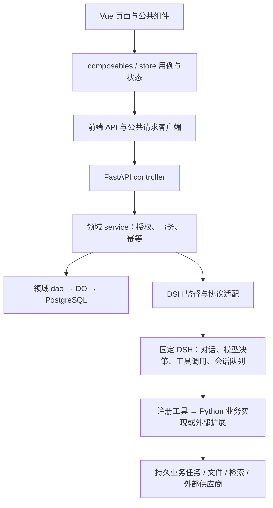

# 星桥整体架构

本文件是星桥办公、星桥娱乐及公共平台的架构入口，整理截至 2026-11-17 已落地的边界和后续约束。具体产品见[星桥办公需求与设计](星桥办公/需求与设计.md)、[星桥娱乐需求与设计](星桥娱乐/需求与设计.md)；视觉与组件见[页面设计](页面设计.md)，工程要求见[开发规范](开发规范.md)及具有代码约束效力的 [Web Admin AGENTS.md](../../apps/web-admin/AGENTS.md)。本文不替代逐轮测试和发布记录。

## 1. 产品与平台

星桥是一套公共平台上的两个产品：办公围绕“资料 → 会话 → 可编辑交付物”，娱乐围绕“构想 → 剧本与分镜 → 制作 → 成片”。两端有不同业务入口和品牌表达，共用账号、认证、控制台组件、管理后台、模型凭据、存储和部署。

| 层面           | 职责                                                       | 边界                                                         |
| -------------- | ---------------------------------------------------------- | ------------------------------------------------------------ |
| 官网与产品选择 | 公开介绍产品；根据资格进入或切换工作台                     | 公开演示与私人业务数据分开，不从官网自动发起任务             |
| 星桥办公       | 本人会话、资料、知识使用、设备及交付物                     | Word、Excel、PPT 是可配置能力，不固化为平台助手类型          |
| 星桥娱乐       | 本人作品、设定与素材版本、分镜、媒体任务、时间线及成片     | 以稳定对象和工程修订组织制作，不通过覆盖历史候选实现改片     |
| 公共管理       | 身份、产品成员、菜单、能力发布、模型连接、扩展、存储、审计 | 产品管理与平台管理分权；管理权不自动提供他人私有内容读取权   |
| 执行与基础设施 | 固定 DSH、工具实现、持久业务任务、数据库、检索和文件服务   | DSH 是唯一 Agent 执行内核，业务后台任务不是第二个 Agent 队列 |

当前主应用是 `apps/web-admin`。旧 `apps/admin` 是独立保留的 Next.js/Node 实现，不被新业务导入、代理或作为失败兜底。桌面和 Android 保持现有产品与协议边界；不因 Web 重写替换固定上游引擎或修改客户端身份。

## 2. 工程分层与调用方向

### Vue 3 + TypeScript

源码固定在 `apps/web-admin/fronted`，保留 `fronted` 拼写。按若依风格划分职责，在职责目录内按领域组织：

| 目录                                | 责任                                                            |
| ----------------------------------- | --------------------------------------------------------------- |
| `views/<domain>`                    | 页面装配与页面专属组件                                          |
| `components`                        | 通用表格、表单、弹窗、反馈、成果展示；通过明确 props/emits 交互 |
| `composables/<domain>`              | 请求状态、业务操作、订阅与生命周期                              |
| `api/<domain>`、`types/<domain>`    | 接口调用与传输适配、公共类型契约                                |
| `store/modules`                     | 有明确账号与产品作用域的共享状态                                |
| `utils/<domain>`                    | 无副作用的领域纯方法；请求、地址、错误适配另有集中基础模块      |
| `router`、`layout`、`assets/styles` | 路由、公共布局及统一主题                                        |

前端沿用根 Yarn 依赖和唯一锁文件；目录内 `package.json` 仅提供独立启动命令，不形成第二套依赖。页面不直接调用供应商、不保存密钥，也不把后端权限判断搬到按钮显示条件中代替服务端校验。

### Python + FastAPI

后端位于 `apps/web-admin/backend`，采用模块化单体。领域内严格 `controller → service → dao`：

- `controller`：协议、参数入口与依赖注入，只调用服务。
- `service`：业务校验、资源授权、事务、幂等、外部端口与用例协调。
- `dao`：本领域持久化，不提交事务，不编排跨领域业务。
- `entity/do`：SQLAlchemy 映射；`entity/vo`：Pydantic 请求与响应；需要时以 `entity/bo` 表达纯业务规则。
- 跨领域经公开 service 协作；基础设施归 `infrastructure`，DSH 适配归 `integrations/dsh`，具体工具归 `toolkits`。

业务服务使用 Python。固定 DSH 所需的 TypeScript 注册与传输适配独立放在 `engine-adapter/src`，预先编译后交付，不在业务执行时编译。保留 Node/Python/MCP 扩展契约不等于保留旧 Node 平台后端。

## 3. 五角色、产品权限与两级菜单

| 角色           | 稳定角色 ID             | 默认职责                                                 |
| -------------- | ----------------------- | -------------------------------------------------------- |
| 平台超级管理员 | `admin`                 | 两端使用与管理、全局账号角色、模型凭据、扩展、存储及审计 |
| 办公管理员     | `office_admin`          | 办公使用、本产品成员与菜单、本产品能力发布及默认模型     |
| 娱乐管理员     | `entertainment_admin`   | 娱乐使用、本产品成员与菜单、本产品能力发布及默认模型     |
| 办公用户       | `member`                | 本人办公会话、文件、设备及获授权的模型能力               |
| 娱乐创作者     | `entertainment_creator` | 本人作品、个人素材、制作任务与成片                       |

角色可以组合。服务端同时检查**产品资格、操作权限、资源归属/共享范围**。产品管理权限明确含产品标识，例如 `products.office.resources.manage`；不能因账号在办公有管理权，就允许其管理娱乐。最后一名有效超管继续受保护。

菜单来自 `backend/resources/navigation.json` 的统一模块目录，由 navigation 服务按产品生成并按账号过滤。一级是功能分组、二级是页面；作品中的步骤属于页面上下文，不扩展为全局三级菜单。

| 范围     | 一级菜单   | 当前默认二级菜单                                                             |
| -------- | ---------- | ---------------------------------------------------------------------------- |
| 办公     | 办公工作台 | 智能对话、历史会话、我的文件、我的设备                                       |
| 娱乐     | 创作工作台 | 我的作品、制作任务、成片交付                                                 |
| 娱乐     | 素材中心   | 角色库、场景与道具、媒体素材                                                 |
| 当前产品 | 能力管理   | 智能体、知识库、技能、工具、默认模型                                         |
| 当前产品 | 产品管理   | 产品成员、菜单配置                                                           |
| 平台     | 平台管理   | 平台总览、账号与角色、供应商与模型、扩展管理、设备运维、存储与服务、平台审计 |
| 账号     | 个人中心   | 账号资料、账号安全、外观设置、个人模型（须有对应权限）                       |

菜单可按产品修改名称、排序、分组、角色范围与可见性，使用独立修订和恢复。菜单隐藏只改变入口；撤销访问必须变更授权。平台受保护入口不能由产品管理员重组菜单绕过限制。产品管理员只能增减普通本产品成员资格，不能任免管理员、重置全局账号密码或读取供应商密钥。

双产品账号从中性入口登录后进入产品选择；单资格账号直接进入对应首页。已有合法会话、作品、文件深链优先恢复。切换产品重新读取目标菜单、模型和资源，取消旧页面请求并保护草稿；账号变化使旧异步结果失效。“办公管理员＋娱乐创作者”是必须持续回归的权限组合。

## 4. 配置、工具和 DSH

能力组合关系是：**扩展来源 → 带版本工具实现 → 工具配置 → 技能/知识/资料 → 已发布智能体 → 会话冻结绑定**。

平台认识能力契约、输入输出、权限、确认、证据和成果；Office、媒体制作等业务由已注册工具分发。工具可被不同技能和智能体复用。默认示例可编辑、复制、停用和删除，初始化幂等且不恢复用户已删除的示例。平台不得根据助手名称、示例 ID 或文件后缀选择写死流程。

DSH 保留模型调用决策、Agent loop、用户问题、审批、工具调用和原会话队列。每个用户拥有受管 Home 与 workspace，通过 PostgreSQL 租约和所有权栅栏避免重复接管。登录与浏览普通管理页不启动 Agent；需要执行时准备，失败给出诊断与重试。受管同用户进程不是操作系统或容器隔离。

LangGraph 仅在能简化局部技能或工具内部步骤时选用；不新增模型循环、第二执行队列或强制图编辑器。业务记录、确认与副作用收据由平台领域服务持有。

模型连接、能力配置、产品默认与个人选择分开管理。新会话解析当前可用默认，显式选择与既有冻结绑定优先；配置缺失、停用、撤权或工具摘要变化明确报错，不静默换供应商或放宽摘要检查。需要更新绑定时走明确的校验/刷新入口，保护用户定制内容。只读连接检测不等于生成能力验收。

## 5. 数据、一致性和异步任务

| 数据域     | 保存内容                                                     | 一致性要求                                                             |
| ---------- | ------------------------------------------------------------ | ---------------------------------------------------------------------- |
| 身份与导航 | 账号、角色、产品资格、登录状态、菜单及修订                   | 变更与审计同事务，撤权使旧登录/请求授权失效                            |
| 能力与模型 | 配置、资源版本、来源摘要、发布状态、凭据                     | 凭据后端加密；冻结引用与当前授权同时校验                               |
| 办公会话   | 项目、会话、消息、事件游标、执行记录、来源和成果             | 快照与事件去重，迟到结果不串账号/会话；删除保留必要幂等防重放身份      |
| 娱乐工程   | 作品规格、场次、设定版本、稳定镜头、台词、候选、时间线及修订 | 结构化当前工程为写入源，不可变修订用于对照、恢复和导出；恢复产生新修订 |
| 文件与知识 | 文件元数据、归属与引用、存储对象、解析/索引状态、引用定位    | 上传、引用及清理有明确事务/收据；预览下载重新鉴权                      |
| 外部操作   | 输入摘要、操作号、冻结模型、受理回执、状态、取消与核对       | 结果未知不自动重发；重启依原回执核对，避免重复计费或重复副作用         |

耗时解析、生成、下载与渲染不能持有长数据库事务。媒体任务是可恢复的业务工作：DSH 提交后可以继续交互；用户关闭网页不丢进度。批量制作先只读预检、冻结计划、用户确认，再创建任务；部分失败保留成功结果，候选到达不自动采用。

取消意图与远端实际结果分别记录。远端是否受理未知时保留待核对，不把本地停止显示为远端已取消。可收费请求和有副作用操作按稳定操作号/请求摘要幂等；不同内容不能复用同一操作号。工程、菜单、资源等写操作用修订条件拒绝覆盖并保留用户草稿。

## 6. 运行、部署和协议边界

- 开发后端使用 `uv run python main.py`，负责配置加载、迁移与热重载；前端在 `fronted` 使用 `npm run dev`。首次准备和数据库依赖见[启动文档](../../apps/web-admin/README.md)，日常预览不隐式构建全部产物。
- 根 `compose.yml` 装配新 Vue/FastAPI 部署，生产前端为静态资源和 Nginx，后端承载 API、DSH 监督与业务任务。PostgreSQL、Redis、Qdrant、MinIO、检索模型服务按现有部署声明提供基础能力。旧部署由 `compose.legacy.yml` 独立保留。
- 部署更新保留数据库、配置密钥、文件、运行目录及存储卷；先备份和核对迁移链，再迁移。新应用初建可用空库，不代表以后升级或导入可以清空真实数据。
- 原生后端默认读 `backend/config/model-defaults.json`；生产把显式宿主机配置只读挂载到相同容器路径。真实文件排除 Git 与镜像，库中凭据加密。发布版本、镜像工具链、依赖与引擎来源分别取权威元数据，不复制版本字面量或改成浮动安装。
- 新业务 HTTP/WS 无版本路径；历史入口只由 `deployment/compatibility-routes.json` 按方法、路径和传输映射到同一用例。桌面/Android 的 OAuth、回调身份、票据、Cookie、事件序列及文件授权语义继续保留。
- Python 字节码及运行缓存归 `.superdsh-work`；测试源码归 `apps/web-admin/tests`，截图、报告、测试 Home 和临时文件归 `.superdsh-work/web-admin-validation`，不进生产代码或运行镜像。

## 7. 已有证据与未关闭验收

| 范围               | 已有记录支持的结论                                                                      | 不能扩大为                                           |
| ------------------ | --------------------------------------------------------------------------------------- | ---------------------------------------------------- |
| 新管理端底座与功能 | 三阶段记录包含独立启动、迁移、类型/分层检查、真实数据库、浏览器和新 Docker 生命周期验证 | 每次后续修改自动继承全量通过                         |
| 五角色与产品切换   | 五种真实登录、两级菜单及组合角色越权拒绝已有实测                                        | 超管或产品管理员可随意读取他人私人资料               |
| DSH 与外部模型     | 固定真实 Host 的隔离恢复/取消证据；另有配置模型短请求和代表性办公流程实测               | 所有供应商、参数矩阵、长期运行和收费能力均已验证     |
| 办公成果           | 原生文件结构、公式/图表、真实 LibreOffice 渲染及代表性 PPT 生成链路已有证据             | Word、Excel、PowerPoint 桌面客户端完整验收           |
| 双产品及娱乐       | 作品与素材版本、结构化流程、媒体任务有阶段交付与代表性实网记录                          | 较早四镜成片即可覆盖后来所有制作流程改造             |
| 新旧差异           | 计划三选定自动范围通过，记录 `automaticScopePassed=true`                                | `fullParity=true` 或全路由所有输入、最新视觉完全等价 |

继续开放：Android 真机登录、系统权限与签名环境；桌面完整 GUI；Word/Excel/PowerPoint 原生客户端；缺真实账号环境的外部 OAuth/邮件等验证。当前旧 Next/Tailwind 完整构建及剩余视觉证据有明确边界。历史清理受阻项与后续成功清理分别记账，不能用一次清理成功消除原例外。

旧包保护按本轮工作区与冻结基线分别核对。三阶段早期指纹通过、后续角色阶段发现的 12 项既有提交差异是不同时间点的证据；保留原基线和原因，不自动重写基线，也不把历史差异记成本轮修改。

### 历史清理待核对清单

以下是原计划尚无关闭证据的清理例外，本次文档整理没有重新探测或删除它们。相对目录均位于 `.superdsh-work/web-admin-validation`；是否仍存在需结合原报告和精确路径复核，不能直接批量删除验证根目录、用户数据或持久卷。

| 来源                 | 仍需核对的记录                                                                                                                                                                                                                                                                                                                  |
| -------------------- | ------------------------------------------------------------------------------------------------------------------------------------------------------------------------------------------------------------------------------------------------------------------------------------------------------------------------------- |
| 基础阶段及独立启动   | `backend-first`、`backend-final`、`dsh-p1`、`dsh-protocol`、`dsh-closure`、`fronted-commands`、`fronted-e2e`、`fronted-e2e-final`、`fronted-e2e-mobile`、`fronted-live`、`fronted-tests`、`build`、迁出的 `legacy-cache`，以及启动补充记录中的 `native-dev-config`                                                              |
| 功能阶段             | 中止的 `check-1794045747388-7c59c1db`、`check-1794187879404-d995c794` 及各自隔离 PostgreSQL/Redis 容器；`richtext-browser`、`workbench-final-browser`、`workbench-final-tests`、`workbench-final-mypy`                                                                                                                          |
| 差异阶段             | `phase-three-terminal` 下 `pytest`、`pytest-rerun`、`pytest-final`、`pytest-response`、`pytest-verified`；`phase-three-ui/current-source-components` 下 `runtime`、`vite-cache`；`phase-three-ui/current-vite/vite-cache`；`check-1794214798164-fde0e3c1` 及同轮 `web-admin-check-1794214798164-fde0e3c1-pg/redis` 两个停止容器 |
| 会话/PPT 追加验收    | `session-lifecycle` 内两轮 `live-ppt-a08f5a30-fe7d-43f4-a89c-3dc15703a3a3`、`live-ppt-21b194a9-17e3-4c9c-b87e-730b6ab56236` 对应成果、物理文件及保留的临时账号关联记录；登录已撤销、DSH 已停止，不等于全部文件已回收                                                                                                            |
| 启动故障诊断追加验收 | `development-connection-diagnostic-20261110/summary.json` 记录的两个 pytest 临时目录，原记录未列出目录名，应从报告定位                                                                                                                                                                                                          |

原拒绝原因是 `blocked by policy`，没有更细原因。成功完成的后续检查只关闭其自己持有的资源，不自动关闭以上历史例外。

## 8. 来源与冲突处理

- Git 历史中的 `web-admin-01-foundation.md`、`web-admin-02-function-and-interaction.md`、`web-admin-03-parity-validation.md`：保留原验收范围与未关闭事项；任务定义和早期交接状态不等同最新完成状态。
- Git 历史中的 `starbridge-office-entertainment.md`、`starbridge-product-roles-and-menus.md`、`starbridge-studio-foundation-delivery.md`：保留角色职责；娱乐早期“三菜单、五页签”已由基础交付和当前菜单资源的“六菜单、八步骤”替代。
- Git 历史中的 `starbridge-web-design/README.md`：流程仍可参考；旧深色娱乐、暖纸办公色值由当前[页面设计](页面设计.md)替代。
- [应用 README](../../apps/web-admin/README.md)、[菜单资源](../../apps/web-admin/backend/resources/navigation.json)、[角色清单](../../apps/web-admin/backend/app/modules/identity/entity/bo/product_roles.py)和 [Compose](../../compose.web-admin.yml)：用于核对当前目录、命令、部署与权限。基础计划早期“不建前端 manifest”已由后续独立启动要求修订，当前只保留命令 manifest 和根依赖锁。

可持续运行的入口包括[五角色浏览器测试](../../apps/web-admin/tests/e2e/product-roles-live.spec.ts)、[产品菜单测试](../../apps/web-admin/tests/backend/test_product_navigation.py)、[产品能力测试](../../apps/web-admin/tests/backend/test_product_capabilities.py)、[差异验证入口](../../apps/web-admin/tests/tooling/parity.ts)与[生产生命周期检查](../../apps/web-admin/tests/tooling/deployment.ts)。测试源码存在不等于本轮已执行。

历史实际结果在验证根目录的 `phase-three-final-verification.json`、`parity-1794274094351-e2d09d53/parity-report.json`、`check-report-1794275197144-d6b1433a/summary.json`、`deployment-1794273930660-68ea51ae/results.json` 等报告；可能属于本地归档，不能假定新克隆包含这些文件。旧文本可从 Git 历史追溯。遇到冲突先区分历史方案、现行规范、实际实现和验收结论，不以整理文档替代代码修复或补做验收。
