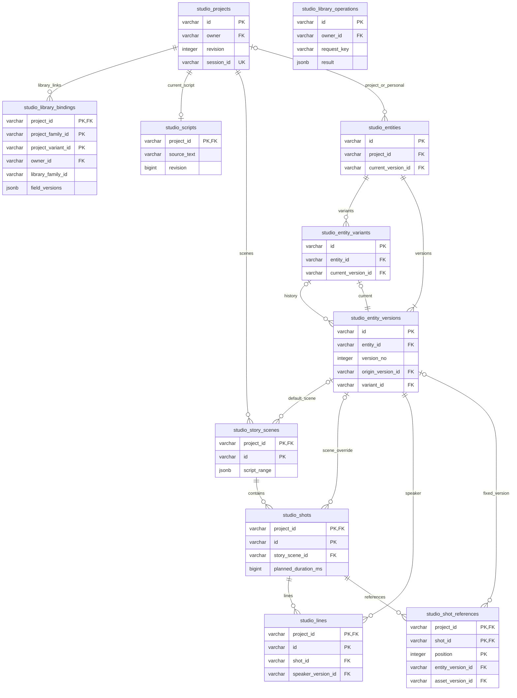
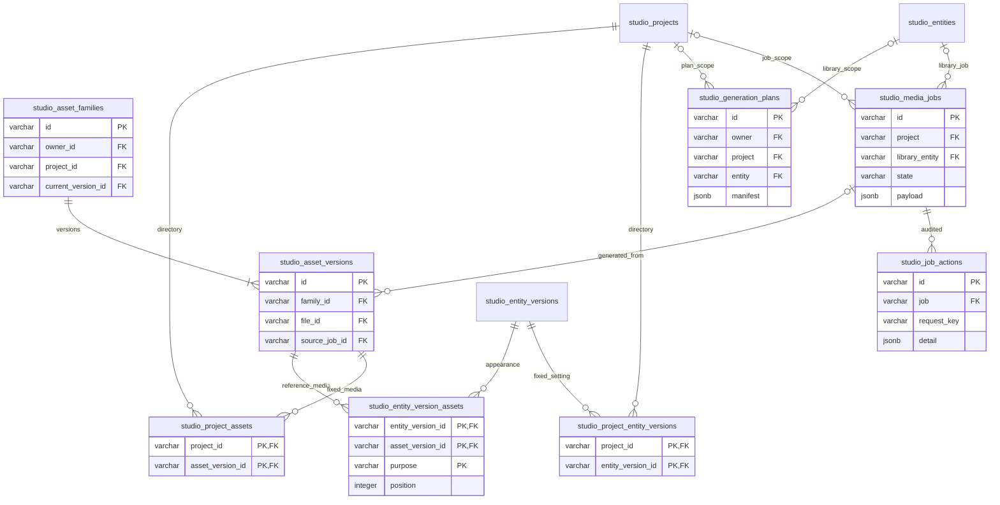
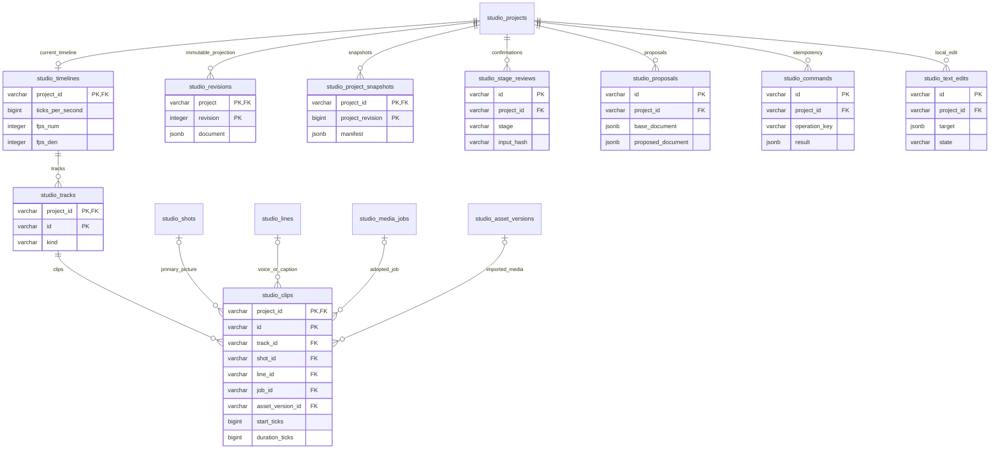
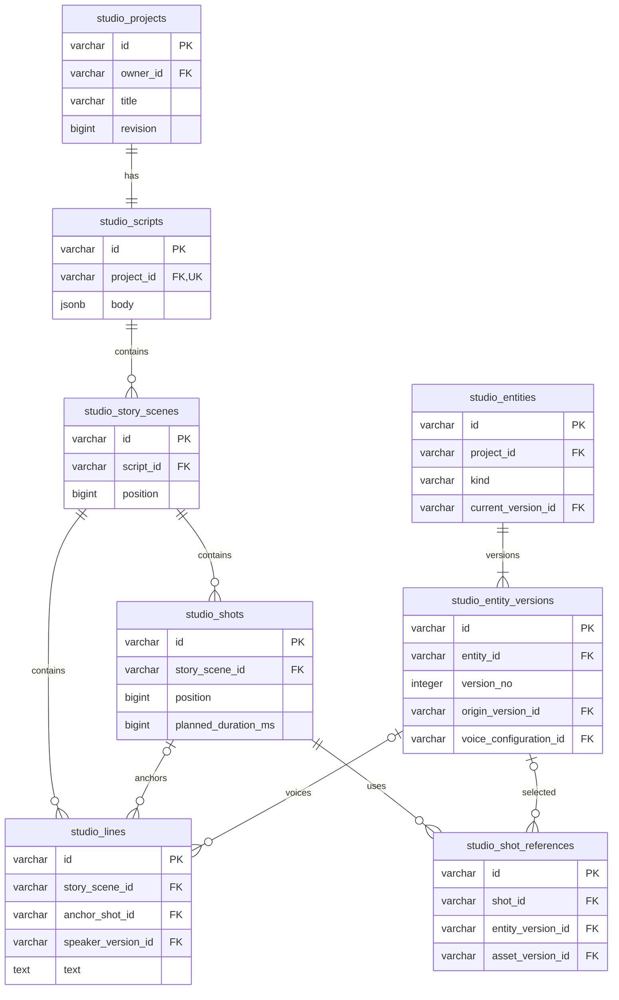
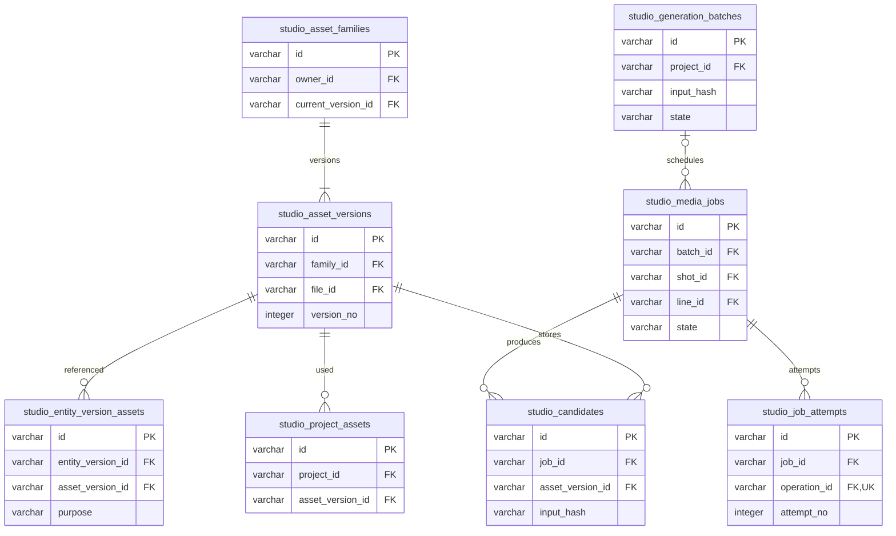
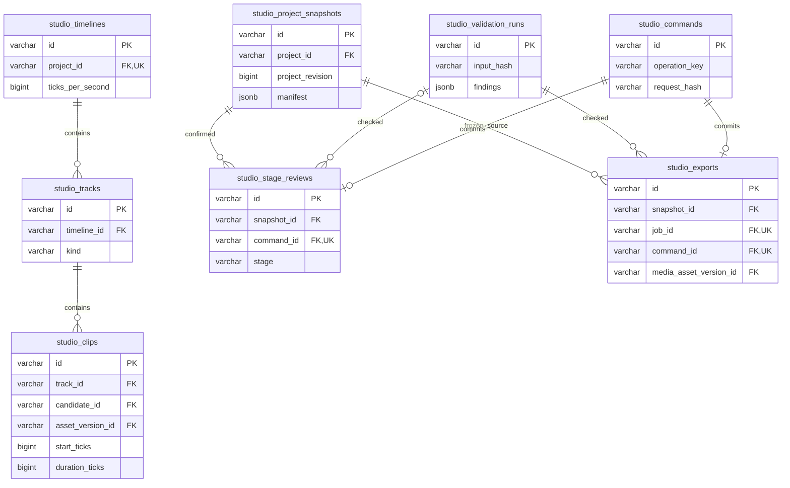

# 星桥娱乐：数据字典

代码核对基准：2026-11-18，仓库 Alembic head 为 `00895f4a6c12`。本文的实际结构指已实现的迁移与业务代码，具体实例是否完成升级须结合 `alembic_version`、实际结构与读取验证，不据此宣称已部署。下半部分保留**后续目标设计**，不能据此假定数据库已经存在这些目标列、表或接口。用户流程、API 与验收边界见[需求与设计](需求与设计.md)；公共规范见[整体架构](../整体架构.md)、[开发规范](../开发规范.md)、[页面设计](../页面设计.md)。

导航：[当前结构](#一当前结构与演进基准) · [实际字段](#二实际字段与约束) · [JSON 与公共关联](#三兼容对象json-契约与公共关联) · [当前关系图](#四当前物理关系图) · [实际与目标差异](#五实际与目标的差异及有效设计取舍) · [迁移与验收](#六迁移留存与验收依据) · [完整目标](#七完整目标字段与关系尚未全部落库) · [来源](#八固定源码参考与历史来源)

## 一、当前结构与演进基准

当前创作域有 28 张业务表，另有只读兼容视图 `studio_assets`、迁移来源表 `studio_assets_legacy`。这不是旧“25 张目标领域表”全部建成：当前增加了项目设定引用、制作计划、任务处置、局部 AI 编辑，以及素材库造型、来源绑定和操作收据，目标中的候选、尝试、检查、正式交付规范化表尚未建立。

| 演进           | 实际落点                                                                                             |
| -------------- | ---------------------------------------------------------------------------------------------------- |
| `d593ef192aae` | 作品、修订、原素材、媒体任务及旧娱乐默认模型表                                                       |
| `f28d6419b037` | 娱乐默认迁入公共 `product_model_defaults` 后删除 `studio_model_defaults`；产品能力与素材边界共用平台 |
| `fa619c2d804e` | 新增 17 张结构化基础表；作品规格/幂等创建；旧素材改名并建立兼容视图；旧工程事务转换                  |
| `fb720de395af` | 阶段确认、三方导演提案；素材视图补声音配置与试听投影                                                 |
| `fc830ef406bc` | 项目/个人库制作计划、任务处置；任务增加 owner/library_entity/cancel_requested                        |
| `fd940fa517cd` | AI 局部编辑记录；场次增加正文 `script_range`                                                         |
| `fea51b0628de` | 独立造型、作品与库来源绑定、字段采用基线、幂等收据、媒体实测属性；试听与参考图分开投影               |
| `ffb62c1739ef` | 场次默认场景、镜头场景覆盖；独立音效轨与片段身份                                                     |
| `00673d284af0` | 素材中心场景库、道具库菜单与既有角色授权；不增加创作业务表                                           |
| `00784e395b01` | 补齐早期开发库的媒体属性、音效引用、逐字段基线和素材视图；保留既有值                                 |
| `00895f4a6c12` | 补齐作品造型绑定身份及三列主键；按已绑定版本回填，不重写作品                                         |

证据源：[DO](../../../apps/web-admin/backend/app/modules/studio/entity/do)、[冻结基础 DDL](../../../apps/web-admin/backend/migrations/data/studio_foundation_schema.json)、[增量迁移](../../../apps/web-admin/backend/migrations/versions)、[文档转换](../../../apps/web-admin/backend/app/modules/studio/dao/document_dao.py)。实际字段以下列迁移落库类型、可空性与约束为准，不能仅按 ORM 的 Python 注解猜数据库类型；应用默认值也不等于 SQL DEFAULT。

当前可编辑工程由结构化表承载，`studio_revisions` 与 `studio_project_snapshots` 是不可变投影/快照。当前保存仍每次追加修订及快照，不是旧目标“仅关键动作建快照”已经切换。当前 DAO 在同事务替换引用/片段行，场次/镜头/台词保留 ID 并归档移除项；聚合修订是并发控制单位，不存在给每个子表都加独立 revision 的通用机制。

实际表约束读法：PK 为主键；UK 为唯一约束；FK 为物理外键。未显式列出的删除/更新动作为 PostgreSQL 默认 NO ACTION，不宣称全部历史关联都配置了 RESTRICT。普通 FK 证明存在性，跨账号/跨作品/资源类型仍由 service 验证；不要把目标中的 scope_key 复合外键当成已落库。

## 二、实际字段与约束

下面列出全部 28 张当前业务表的有效字段。列“默认”分别标记 DB（数据库）和 ORM（调用方省略时的应用默认）；“—”表示无默认，必须由服务提供或明确为空。所有时间戳均为带时区 UTC；API 的文本长度、ID 字符集、范围限制比部分 VARCHAR 列更严格，见现有 VO。

### 2.1. `studio_projects` — 作品与制作规格

映射：[DO](../../../apps/web-admin/backend/app/modules/studio/entity/do/models.py)。

| 字段                 | PostgreSQL 类型            | 可空 | 默认                        | 含义与关系                                |
| -------------------- | -------------------------- | ---- | --------------------------- | ----------------------------------------- |
| `id`                 | `VARCHAR`                  | 否   | —                           | 稳定身份；不随排序或名称变化；PK          |
| `owner`              | `VARCHAR`                  | 否   | —                           | 所属账号，来自授权上下文；FK → `users.id` |
| `title`              | `VARCHAR`                  | 否   | —                           | 用户可读名称                              |
| `revision`           | `INTEGER`                  | 否   | —                           | 当前工程聚合修订，保存/采用等用例递增     |
| `proposal`           | `JSONB`                    | 是   | —                           | 旧草案兼容投影；正式三方提案另表保存      |
| `session_id`         | `VARCHAR`                  | 是   | —                           | 导演会话逻辑关联；当前没有物理会话 FK     |
| `brief`              | `TEXT`                     | 否   | DB 空字符串；ORM `''`       | 创作构想/目的                             |
| `lifecycle`          | `VARCHAR`                  | 否   | DB `active`；ORM `'active'` | active / archived                         |
| `aspect_width`       | `INTEGER`                  | 是   | —                           | 画幅比例宽，与高度同时为空或同时为正      |
| `aspect_height`      | `INTEGER`                  | 是   | —                           | 画幅比例高，非实际像素高度                |
| `target_duration_ms` | `BIGINT`                   | 是   | —                           | 目标毫秒，不等于实测成片时长              |
| `language`           | `VARCHAR`                  | 是   | —                           | 语言标记                                  |
| `style_brief`        | `TEXT`                     | 否   | DB 空字符串；ORM `''`       | 视觉风格说明                              |
| `creation_key`       | `VARCHAR`                  | 是   | —                           | 幂等新建请求号                            |
| `creation_hash`      | `VARCHAR`                  | 是   | —                           | 新建请求内容摘要                          |
| `archived_at`        | `TIMESTAMP WITH TIME ZONE` | 是   | —                           | 归档时间；保留历史身份                    |
| `created_at`         | `TIMESTAMP WITH TIME ZONE` | 否   | DB `now()`                  | 创建时间                                  |
| `updated`            | `TIMESTAMP WITH TIME ZONE` | 否   | DB `now()`                  | 最后更新时间                              |

实际约束：

- CHECK `(aspect_width IS NULL AND aspect_height IS NULL) OR (aspect_width IS NOT NULL AND aspect_height IS NOT NULL AND aspect_width > 0 AND aspect_height > 0)`。
- CHECK `lifecycle IN ('active', 'archived')`。
- CHECK `target_duration_ms IS NULL OR target_duration_ms > 0`。
- FK `(owner)` → `(users.id)`。
- PK `(id)`。
- UK `(id, owner)`。
- UK `(owner, creation_key)`。
- UK `(session_id)`。
- 索引 `(owner)`。

### 2.2. `studio_revisions` — 不可变工程修订投影

映射：[DO](../../../apps/web-admin/backend/app/modules/studio/entity/do/models.py)。

| 字段       | PostgreSQL 类型 | 可空 | 默认 | 含义与关系                                    |
| ---------- | --------------- | ---- | ---- | --------------------------------------------- |
| `project`  | `VARCHAR`       | 否   | —    | 所属作品，非空；PK；FK → `studio_projects.id` |
| `revision` | `INTEGER`       | 否   | —    | 此不可变文档对应的工程修订；PK                |
| `document` | `JSONB`         | 否   | —    | 不可变兼容 Document 投影                      |
| `label`    | `VARCHAR`       | 否   | —    | 用户可读修订/快照说明                         |

实际约束：

- FK `(project)` → `(studio_projects.id)`。
- PK `(project, revision)`。

### 2.3. `studio_scripts` — 当前原稿

映射：[DO](../../../apps/web-admin/backend/app/modules/studio/entity/do/foundation_do.py)。

| 字段              | PostgreSQL 类型 | 可空 | 默认             | 含义与关系                                           |
| ----------------- | --------------- | ---- | ---------------- | ---------------------------------------------------- |
| `project_id`      | `VARCHAR`       | 否   | —                | 所属作品范围；PK；FK → `studio_projects.id`          |
| `source_text`     | `VARCHAR`       | 否   | ORM `''`         | 当前编辑原稿；当前尚无 source_text/body 两份独立正文 |
| `adaptation_mode` | `VARCHAR(20)`   | 否   | ORM `'original'` | original / adapt；导演原文保护                       |
| `revision`        | `BIGINT`        | 否   | ORM `1`          | 原稿或改编模式变化时递增的剧本修订                   |

实际约束：

- CHECK `adaptation_mode IN ('original','adapt')`。
- FK `(project_id)` → `(studio_projects.id)`。
- PK `(project_id)`。

### 2.4. `studio_story_scenes` — 叙事场次

映射：[DO](../../../apps/web-admin/backend/app/modules/studio/entity/do/foundation_do.py)。

| 字段             | PostgreSQL 类型            | 可空 | 默认     | 含义与关系                                                                                  |
| ---------------- | -------------------------- | ---- | -------- | ------------------------------------------------------------------------------------------- |
| `project_id`     | `VARCHAR`                  | 否   | —        | 所属作品范围；PK；FK → `studio_projects.id`                                                 |
| `id`             | `VARCHAR`                  | 否   | —        | 稳定身份；不随排序或名称变化；PK                                                            |
| `title`          | `VARCHAR`                  | 否   | —        | 用户可读名称                                                                                |
| `synopsis`       | `VARCHAR`                  | 否   | ORM `''` | 叙事场次摘要，不等于可复用环境设定                                                          |
| `script_range`   | `JSONB`                    | 是   | —        | 可空 {start,end} Unicode 正文范围，绑定当前原稿                                             |
| `scene_asset_id` | `VARCHAR`                  | 是   | —        | 本场默认场景的固定版本；FK → `studio_entity_versions.id`，service 验证 scene 类型及作品引用 |
| `position`       | `BIGINT`                   | 否   | —        | 父范围内顺序；不是对象身份                                                                  |
| `archived_at`    | `TIMESTAMP WITH TIME ZONE` | 是   | —        | 归档时间；保留历史身份                                                                      |

实际约束：

- FK `(project_id)` → `(studio_projects.id)`。
- PK `(project_id, id)`。

### 2.5. `studio_shots` — 稳定分镜

映射：[DO](../../../apps/web-admin/backend/app/modules/studio/entity/do/foundation_do.py)。

| 字段                  | PostgreSQL 类型            | 可空 | 默认     | 含义与关系                                                                         |
| --------------------- | -------------------------- | ---- | -------- | ---------------------------------------------------------------------------------- |
| `project_id`          | `VARCHAR`                  | 否   | —        | 所属作品范围；PK；FK → `studio_story_scenes.project_id`；FK → `studio_projects.id` |
| `id`                  | `VARCHAR`                  | 否   | —        | 稳定身份；不随排序或名称变化；PK                                                   |
| `story_scene_id`      | `VARCHAR`                  | 否   | —        | 本作品所属叙事场次；FK → `studio_story_scenes.id`                                  |
| `scene_asset_id`      | `VARCHAR`                  | 是   | —        | 本镜明确覆盖的场景版本；为空时沿用场次默认；FK → `studio_entity_versions.id`       |
| `position`            | `BIGINT`                   | 否   | —        | 父范围内顺序；不是对象身份                                                         |
| `action`              | `VARCHAR`                  | 否   | —        | 本镜动作和事件要求                                                                 |
| `scene`               | `VARCHAR`                  | 否   | ORM `''` | 可读地点/场景描述，不能填写场次 ID 代替                                            |
| `camera`              | `VARCHAR`                  | 否   | ORM `''` | 当前镜头语言描述                                                                   |
| `framing`             | `VARCHAR`                  | 否   | ORM `''` | 景别/画面取景描述                                                                  |
| `movement`            | `VARCHAR`                  | 否   | ORM `''` | 运镜描述                                                                           |
| `planned_duration_ms` | `BIGINT`                   | 否   | —        | 计划镜头毫秒时长                                                                   |
| `archived_at`         | `TIMESTAMP WITH TIME ZONE` | 是   | —        | 归档时间；保留历史身份                                                             |

实际约束：

- CHECK `planned_duration_ms > 0`。
- FK `(project_id)` → `(studio_projects.id)`。
- FK `(project_id, story_scene_id)` → `(studio_story_scenes.project_id, studio_story_scenes.id)`。
- PK `(project_id, id)`。

### 2.6. `studio_lines` — 逐句台词

映射：[DO](../../../apps/web-admin/backend/app/modules/studio/entity/do/foundation_do.py)。

| 字段                 | PostgreSQL 类型            | 可空 | 默认     | 含义与关系                                                                  |
| -------------------- | -------------------------- | ---- | -------- | --------------------------------------------------------------------------- |
| `project_id`         | `VARCHAR`                  | 否   | —        | 所属作品范围；PK；FK → `studio_projects.id`；FK → `studio_shots.project_id` |
| `id`                 | `VARCHAR`                  | 否   | —        | 稳定身份；不随排序或名称变化；PK                                            |
| `shot_id`            | `VARCHAR`                  | 否   | —        | 稳定镜头关联；FK → `studio_shots.id`                                        |
| `position`           | `BIGINT`                   | 否   | —        | 父范围内顺序；不是对象身份                                                  |
| `speaker_version_id` | `VARCHAR`                  | 否   | —        | 说话角色的具体设定版本；FK → `studio_entity_versions.id`                    |
| `text`               | `VARCHAR`                  | 否   | —        | 台词原文；不是独立字幕覆盖文本                                              |
| `voice`              | `VARCHAR`                  | 否   | ORM `''` | 单句音色覆盖；空时从所用角色版本解析                                        |
| `archived_at`        | `TIMESTAMP WITH TIME ZONE` | 是   | —        | 归档时间；保留历史身份                                                      |

实际约束：

- FK `(project_id)` → `(studio_projects.id)`。
- FK `(project_id, shot_id)` → `(studio_shots.project_id, studio_shots.id)`。
- FK `(speaker_version_id)` → `(studio_entity_versions.id)`。
- PK `(project_id, id)`。

### 2.7. `studio_entities` — 角色/场景/道具身份

映射：[DO](../../../apps/web-admin/backend/app/modules/studio/entity/do/asset_do.py)。

| 字段                 | PostgreSQL 类型            | 可空 | 默认       | 含义与关系                                                                |
| -------------------- | -------------------------- | ---- | ---------- | ------------------------------------------------------------------------- |
| `id`                 | `VARCHAR`                  | 否   | —          | 稳定身份；不随排序或名称变化；PK；FK → `studio_entity_versions.entity_id` |
| `owner_id`           | `VARCHAR(80)`              | 否   | —          | 所属账号，来自授权上下文；FK → `users.id`                                 |
| `project_id`         | `VARCHAR`                  | 是   | —          | 所属作品范围；FK → `studio_projects.id`                                   |
| `kind`               | `VARCHAR(20)`              | 否   | —          | 领域类型；有效取值见下文状态与 JSON 契约                                  |
| `name`               | `VARCHAR`                  | 否   | —          | 用户可读名称，不用作存储路径                                              |
| `current_version_id` | `VARCHAR`                  | 否   | —          | 当前目录版本；须同身份/素材族；FK → `studio_entity_versions.id`           |
| `position`           | `INTEGER`                  | 否   | ORM `0`    | 父范围内顺序；不是对象身份                                                |
| `archived_at`        | `TIMESTAMP WITH TIME ZONE` | 是   | —          | 归档时间；保留历史身份                                                    |
| `revision`           | `INTEGER`                  | 否   | ORM `1`    | 设定聚合修订，个人库写入的并发依据                                        |
| `updated_at`         | `TIMESTAMP WITH TIME ZONE` | 否   | DB `now()` | 最后更新时间                                                              |

实际约束：

- CHECK `kind IN ('character','scene','prop')`。
- FK `(id, current_version_id)` → `(studio_entity_versions.entity_id, studio_entity_versions.id)`；DEFERRABLE INITIALLY DEFERRED。
- FK `(owner_id)` → `(users.id)`。
- FK `(project_id)` → `(studio_projects.id)`。
- PK `(id)`。
- 索引 `(owner_id)`。
- 索引 `(project_id)`。

### 2.8. `studio_entity_versions` — 不可变造型与声音版本

映射：[DO](../../../apps/web-admin/backend/app/modules/studio/entity/do/asset_do.py)。

| 字段                           | PostgreSQL 类型            | 可空 | 默认                | 含义与关系                                                                                       |
| ------------------------------ | -------------------------- | ---- | ------------------- | ------------------------------------------------------------------------------------------------ |
| `id`                           | `VARCHAR`                  | 否   | —                   | 稳定身份；不随排序或名称变化；PK                                                                 |
| `entity_id`                    | `VARCHAR`                  | 否   | —                   | 设定稳定身份；FK → `studio_entities.id`                                                          |
| `version_no`                   | `INTEGER`                  | 否   | —                   | 身份内正整数版本号                                                                               |
| `origin_version_id`            | `VARCHAR`                  | 是   | —                   | 来源/派生设定版本；FK → `studio_entity_versions.id`                                              |
| `variant_id`                   | `VARCHAR`                  | 是   | —                   | 所属独立造型/变体；FK → `studio_entity_variants.id`；迁移为旧版本补默认变体，新建由 service 指定 |
| `name`                         | `VARCHAR`                  | 否   | —                   | 用户可读名称，不用作存储路径                                                                     |
| `description`                  | `VARCHAR`                  | 否   | ORM `''`            | 此版本的描述                                                                                     |
| `voice_id`                     | `VARCHAR`                  | 否   | ORM `''`            | 角色默认音色 ID                                                                                  |
| `voice_configuration_id`       | `VARCHAR(100)`             | 是   | —                   | 声音模型配置 ID，配修订保存；FK → `model_configuration_versions.configuration_id`                |
| `voice_configuration_revision` | `INTEGER`                  | 是   | —                   | 声音模型配置具体修订；FK → `model_configuration_versions.revision`                               |
| `voice_parameters`             | `JSONB`                    | 否   | ORM `{} / 调用生成` | 已验证声音参数；previewJob 为兼容试听来源                                                        |
| `created_at`                   | `TIMESTAMP WITH TIME ZONE` | 否   | DB `now()`          | 创建时间                                                                                         |

实际约束：

- CHECK `num_nonnulls(voice_configuration_id, voice_configuration_revision) IN (0,2)`。
- CHECK `version_no > 0`。
- FK `(entity_id)` → `(studio_entities.id)`。
- FK `(origin_version_id)` → `(studio_entity_versions.id)`。
- FK `(variant_id)` → `(studio_entity_variants.id)`；索引 `(variant_id)`。
- FK `(voice_configuration_id, voice_configuration_revision)` → `(model_configuration_versions.configuration_id, model_configuration_versions.revision)`。
- PK `(id)`。
- UK `(entity_id, id)`。
- UK `(entity_id, version_no)`。
- 索引 `(entity_id)`。

### 2.9. `studio_entity_version_assets` — 设定多参考媒体关联

映射：[DO](../../../apps/web-admin/backend/app/modules/studio/entity/do/asset_do.py)。

| 字段                | PostgreSQL 类型 | 可空 | 默认 | 含义与关系                                                                           |
| ------------------- | --------------- | ---- | ---- | ------------------------------------------------------------------------------------ |
| `entity_version_id` | `VARCHAR`       | 否   | —    | 具体角色/场景/道具版本；PK；FK → `studio_entity_versions.id`                         |
| `asset_version_id`  | `VARCHAR`       | 否   | —    | 具体媒体素材版本，不是素材族当前指针；PK；FK → `studio_asset_versions.id`            |
| `purpose`           | `VARCHAR(40)`   | 否   | —    | `reference` 造型参考、`voice-preview` 声音试听等引用用途；PK；音频不参与角色封面选择 |
| `position`          | `INTEGER`       | 否   | —    | 父范围内顺序；不是对象身份                                                           |

实际约束：

- FK `(asset_version_id)` → `(studio_asset_versions.id)`。
- FK `(entity_version_id)` → `(studio_entity_versions.id)`。
- PK `(entity_version_id, asset_version_id, purpose)`。
- UK `(entity_version_id, purpose, position)`。

### 2.10. `studio_asset_families` — 媒体素材族

映射：[DO](../../../apps/web-admin/backend/app/modules/studio/entity/do/asset_do.py)。

| 字段                 | PostgreSQL 类型            | 可空 | 默认 | 含义与关系                                                               |
| -------------------- | -------------------------- | ---- | ---- | ------------------------------------------------------------------------ |
| `id`                 | `VARCHAR`                  | 否   | —    | 稳定身份；不随排序或名称变化；PK；FK → `studio_asset_versions.family_id` |
| `owner_id`           | `VARCHAR(80)`              | 否   | —    | 所属账号，来自授权上下文；FK → `users.id`                                |
| `project_id`         | `VARCHAR`                  | 是   | —    | 所属作品范围；FK → `studio_projects.id`                                  |
| `kind`               | `VARCHAR(20)`              | 否   | —    | 领域类型；有效取值见下文状态与 JSON 契约                                 |
| `name`               | `VARCHAR`                  | 否   | —    | 用户可读名称，不用作存储路径                                             |
| `current_version_id` | `VARCHAR`                  | 否   | —    | 当前目录版本；须同身份/素材族；FK → `studio_asset_versions.id`           |
| `archived_at`        | `TIMESTAMP WITH TIME ZONE` | 是   | —    | 归档时间；保留历史身份                                                   |

实际约束：

- FK `(id, current_version_id)` → `(studio_asset_versions.family_id, studio_asset_versions.id)`；DEFERRABLE INITIALLY DEFERRED。
- FK `(owner_id)` → `(users.id)`。
- FK `(project_id)` → `(studio_projects.id)`。
- PK `(id)`。
- 索引 `(owner_id)`。
- 索引 `(project_id)`。

### 2.11. `studio_asset_versions` — 不可变媒体版本

映射：[DO](../../../apps/web-admin/backend/app/modules/studio/entity/do/asset_do.py)。

| 字段                | PostgreSQL 类型            | 可空 | 默认       | 含义与关系                                                             |
| ------------------- | -------------------------- | ---- | ---------- | ---------------------------------------------------------------------- |
| `id`                | `VARCHAR`                  | 否   | —          | 稳定身份；不随排序或名称变化；PK                                       |
| `family_id`         | `VARCHAR`                  | 否   | —          | 媒体素材族身份；FK → `studio_asset_families.id`                        |
| `version_no`        | `INTEGER`                  | 否   | —          | 身份内正整数版本号                                                     |
| `parent_version_id` | `VARCHAR`                  | 是   | —          | 来源/派生媒体版本；FK → `studio_asset_versions.id`                     |
| `file_id`           | `VARCHAR(100)`             | 是   | —          | 公共文件；当前允许为空，不能当作可预览文件；FK → `web_file_entries.id` |
| `name`              | `VARCHAR`                  | 否   | —          | 用户可读名称，不用作存储路径                                           |
| `description`       | `VARCHAR`                  | 否   | ORM `''`   | 此版本的描述                                                           |
| `source_job_id`     | `VARCHAR`                  | 是   | —          | 生成来源任务；FK → `studio_media_jobs.id`                              |
| `duration_ms`       | `INTEGER`                  | 是   | —          | 实测媒体毫秒时长，未知为空；按需探测缓存，不能填计划镜头时长           |
| `width`             | `INTEGER`                  | 是   | —          | 已知的媒体像素宽，未知为空                                             |
| `height`            | `INTEGER`                  | 是   | —          | 已知的媒体像素高，未知为空                                             |
| `created_at`        | `TIMESTAMP WITH TIME ZONE` | 否   | DB `now()` | 创建时间                                                               |

实际约束：

- CHECK `version_no > 0`。
- FK `(family_id)` → `(studio_asset_families.id)`。
- FK `(file_id)` → `(web_file_entries.id)`。
- FK `(parent_version_id)` → `(studio_asset_versions.id)`。
- FK `(source_job_id)` → `(studio_media_jobs.id)`。
- PK `(id)`。
- UK `(family_id, id)`。
- UK `(family_id, version_no)`。
- 索引 `(family_id)`。

### 2.12. `studio_project_assets` — 项目媒体引用

映射：[DO](../../../apps/web-admin/backend/app/modules/studio/entity/do/foundation_do.py)。

| 字段               | PostgreSQL 类型 | 可空 | 默认 | 含义与关系                                                                |
| ------------------ | --------------- | ---- | ---- | ------------------------------------------------------------------------- |
| `project_id`       | `VARCHAR`       | 否   | —    | 所属作品范围；PK；FK → `studio_projects.id`                               |
| `asset_version_id` | `VARCHAR`       | 否   | —    | 具体媒体素材版本，不是素材族当前指针；PK；FK → `studio_asset_versions.id` |
| `position`         | `INTEGER`       | 否   | —    | 父范围内顺序；不是对象身份                                                |

实际约束：

- FK `(asset_version_id)` → `(studio_asset_versions.id)`。
- FK `(project_id)` → `(studio_projects.id)`。
- PK `(project_id, asset_version_id)`。

### 2.13. `studio_project_entity_versions` — 项目设定版本引用

映射：[DO](../../../apps/web-admin/backend/app/modules/studio/entity/do/foundation_do.py)。

| 字段                | PostgreSQL 类型 | 可空 | 默认 | 含义与关系                                                   |
| ------------------- | --------------- | ---- | ---- | ------------------------------------------------------------ |
| `project_id`        | `VARCHAR`       | 否   | —    | 所属作品范围；PK；FK → `studio_projects.id`                  |
| `entity_version_id` | `VARCHAR`       | 否   | —    | 具体角色/场景/道具版本；PK；FK → `studio_entity_versions.id` |
| `position`          | `INTEGER`       | 否   | —    | 父范围内顺序；不是对象身份                                   |

实际约束：

- FK `(entity_version_id)` → `(studio_entity_versions.id)`。
- FK `(project_id)` → `(studio_projects.id)`。
- PK `(project_id, entity_version_id)`。

### 2.14. `studio_shot_references` — 镜头参考

映射：[DO](../../../apps/web-admin/backend/app/modules/studio/entity/do/foundation_do.py)。

| 字段                | PostgreSQL 类型 | 可空 | 默认 | 含义与关系                                                            |
| ------------------- | --------------- | ---- | ---- | --------------------------------------------------------------------- |
| `project_id`        | `VARCHAR`       | 否   | —    | 所属作品范围；PK；FK → `studio_shots.project_id`                      |
| `shot_id`           | `VARCHAR`       | 否   | —    | 稳定镜头关联；PK；FK → `studio_shots.id`                              |
| `position`          | `INTEGER`       | 否   | —    | 父范围内顺序；不是对象身份；PK                                        |
| `entity_version_id` | `VARCHAR`       | 是   | —    | 具体角色/场景/道具版本；FK → `studio_entity_versions.id`              |
| `asset_version_id`  | `VARCHAR`       | 是   | —    | 具体媒体素材版本，不是素材族当前指针；FK → `studio_asset_versions.id` |

实际约束：

- CHECK `num_nonnulls(entity_version_id, asset_version_id) = 1`。
- FK `(asset_version_id)` → `(studio_asset_versions.id)`。
- FK `(entity_version_id)` → `(studio_entity_versions.id)`。
- FK `(project_id, shot_id)` → `(studio_shots.project_id, studio_shots.id)`。
- PK `(project_id, shot_id, position)`。

### 2.15. `studio_timelines` — 当前工程时基

映射：[DO](../../../apps/web-admin/backend/app/modules/studio/entity/do/timeline_do.py)。

| 字段                | PostgreSQL 类型    | 可空 | 默认                  | 含义与关系                                  |
| ------------------- | ------------------ | ---- | --------------------- | ------------------------------------------- |
| `project_id`        | `VARCHAR`          | 否   | —                     | 所属作品范围；PK；FK → `studio_projects.id` |
| `ticks_per_second`  | `BIGINT`           | 否   | —                     | 工程每秒 tick 数，正整数                    |
| `fps_num`           | `INTEGER`          | 否   | —                     | 工程帧率分子                                |
| `fps_den`           | `INTEGER`          | 否   | —                     | 工程帧率分母                                |
| `audio_sample_rate` | `INTEGER`          | 否   | —                     | 工程音频采样率 Hz                           |
| `music_gain`        | `DOUBLE PRECISION` | 否   | DB `0.25`；ORM `0.25` | 音乐线性倍数，非 dB                         |

实际约束：

- CHECK `ticks_per_second > 0 AND fps_num > 0 AND fps_den > 0 AND audio_sample_rate > 0`。
- FK `(project_id)` → `(studio_projects.id)`。
- PK `(project_id)`。

### 2.16. `studio_tracks` — 当前轨道

映射：[DO](../../../apps/web-admin/backend/app/modules/studio/entity/do/timeline_do.py)。

| 字段         | PostgreSQL 类型 | 可空 | 默认 | 含义与关系                                           |
| ------------ | --------------- | ---- | ---- | ---------------------------------------------------- |
| `project_id` | `VARCHAR`       | 否   | —    | 所属作品范围；PK；FK → `studio_timelines.project_id` |
| `id`         | `VARCHAR`       | 否   | —    | 稳定身份；不随排序或名称变化；PK                     |
| `kind`       | `VARCHAR`       | 否   | —    | 领域类型；有效取值见下文状态与 JSON 契约             |
| `position`   | `INTEGER`       | 否   | —    | 父范围内顺序；不是对象身份                           |

实际约束：

- FK `(project_id)` → `(studio_timelines.project_id)`。
- PK `(project_id, id)`。
- UK `(project_id, position)`；可延迟，初始 DEFERRED。

### 2.17. `studio_clips` — 当前采用与剪辑片段

映射：[DO](../../../apps/web-admin/backend/app/modules/studio/entity/do/timeline_do.py)。

| 字段                    | PostgreSQL 类型    | 可空 | 默认           | 含义与关系                                                                                                                                          |
| ----------------------- | ------------------ | ---- | -------------- | --------------------------------------------------------------------------------------------------------------------------------------------------- |
| `project_id`            | `VARCHAR`          | 否   | —              | 所属作品范围；PK；FK → `studio_tracks.project_id`；FK → `studio_media_jobs.project`；FK → `studio_shots.project_id`；FK → `studio_lines.project_id` |
| `id`                    | `VARCHAR`          | 否   | —              | 稳定身份；不随排序或名称变化；PK                                                                                                                    |
| `track_id`              | `VARCHAR`          | 否   | —              | 同作品轨道 ID；FK → `studio_tracks.id`                                                                                                              |
| `shot_id`               | `VARCHAR`          | 是   | —              | 稳定镜头关联；FK → `studio_shots.id`                                                                                                                |
| `line_id`               | `VARCHAR`          | 是   | —              | 稳定台词关联；FK → `studio_lines.id`                                                                                                                |
| `effect_id`             | `VARCHAR`          | 是   | —              | 独立音效稳定身份，回写 `Document.soundEffects[].id`；非任务 ID，无物理 FK                                                                           |
| `role`                  | `VARCHAR`          | 否   | —              | primary_video / primary_voice / subtitle / free_media                                                                                               |
| `job_id`                | `VARCHAR`          | 是   | —              | 当前采用来源媒体任务；当前没有 candidate_id；FK → `studio_media_jobs.id`；FK → `studio_media_jobs.id`                                               |
| `asset_version_id`      | `VARCHAR`          | 是   | —              | 具体媒体素材版本，不是素材族当前指针；FK → `studio_asset_versions.id`                                                                               |
| `start_ticks`           | `BIGINT`           | 否   | —              | 工程中片段起点                                                                                                                                      |
| `duration_ticks`        | `BIGINT`           | 否   | —              | 工程片段时长，当前允许零长占位                                                                                                                      |
| `source_start_ticks`    | `BIGINT`           | 否   | ORM `0`        | 源片段起点，当前沿用工程时基                                                                                                                        |
| `source_duration_ticks` | `BIGINT`           | 是   | —              | 源片段长度，可空；独立源时基尚未落列                                                                                                                |
| `subtitle_text`         | `VARCHAR`          | 是   | —              | 字幕文案覆盖，空值按兼容契约处理                                                                                                                    |
| `gain`                  | `DOUBLE PRECISION` | 否   | ORM `1`        | 线性音量，非目标 gain_db                                                                                                                            |
| `timing_mode`           | `VARCHAR`          | 否   | ORM `'manual'` | auto / manual 表达默认边界或手工边界，尚无完整 auto-arrange 用例                                                                                    |
| `anchor_offset_ticks`   | `BIGINT`           | 否   | ORM `0`        | 相对镜头/台词锚点的位置                                                                                                                             |
| `subtitle_follow_voice` | `BOOLEAN`          | 否   | ORM `True`     | 字幕是否跟随台词起点                                                                                                                                |

实际约束：

- CHECK `num_nonnulls(job_id, asset_version_id) <= 1`。
- CHECK `start_ticks >= 0 AND duration_ticks >= 0 AND source_start_ticks >= 0`。
- FK `(asset_version_id)` → `(studio_asset_versions.id)`。
- FK `(job_id)` → `(studio_media_jobs.id)`。
- FK `(project_id, job_id)` → `(studio_media_jobs.project, studio_media_jobs.id)`。
- FK `(project_id, line_id)` → `(studio_lines.project_id, studio_lines.id)`。
- FK `(project_id, shot_id)` → `(studio_shots.project_id, studio_shots.id)`。
- FK `(project_id, track_id)` → `(studio_tracks.project_id, studio_tracks.id)`。
- PK `(project_id, id)`。

### 2.18. `studio_commands` — 写入幂等回执

映射：[DO](../../../apps/web-admin/backend/app/modules/studio/entity/do/foundation_do.py)。

| 字段            | PostgreSQL 类型            | 可空 | 默认       | 含义与关系                                  |
| --------------- | -------------------------- | ---- | ---------- | ------------------------------------------- |
| `id`            | `VARCHAR`                  | 否   | —          | 稳定身份；不随排序或名称变化；PK            |
| `owner_id`      | `VARCHAR(80)`              | 否   | —          | 所属账号，来自授权上下文；FK → `users.id`   |
| `project_id`    | `VARCHAR`                  | 否   | —          | 所属作品范围；FK → `studio_projects.id`     |
| `operation_key` | `VARCHAR(160)`             | 否   | —          | 稳定写操作号，同号不同请求冲突              |
| `request_hash`  | `VARCHAR(64)`              | 否   | —          | 规范化请求摘要                              |
| `command_type`  | `VARCHAR(50)`              | 否   | —          | 注册写用例，例如保存/采用/阶段确认/参考准备 |
| `result`        | `JSONB`                    | 否   | —          | 已提交结果回执；网络重试复用                |
| `created_at`    | `TIMESTAMP WITH TIME ZONE` | 否   | DB `now()` | 创建时间                                    |

实际约束：

- FK `(owner_id)` → `(users.id)`。
- FK `(project_id)` → `(studio_projects.id)`。
- PK `(id)`。
- UK `(owner_id, project_id, operation_key)`。

### 2.19. `studio_project_snapshots` — 工程快照

映射：[DO](../../../apps/web-admin/backend/app/modules/studio/entity/do/foundation_do.py)。

| 字段               | PostgreSQL 类型            | 可空 | 默认       | 含义与关系                                  |
| ------------------ | -------------------------- | ---- | ---------- | ------------------------------------------- |
| `project_id`       | `VARCHAR`                  | 否   | —          | 所属作品范围；PK；FK → `studio_projects.id` |
| `project_revision` | `BIGINT`                   | 否   | —          | 冻结/确认时工程修订；PK                     |
| `manifest`         | `JSONB`                    | 否   | —          | 受 Schema 约束的冻结内容；具体语义见下文    |
| `manifest_hash`    | `VARCHAR(64)`              | 否   | —          | 快照规范内容摘要                            |
| `label`            | `VARCHAR`                  | 否   | —          | 用户可读修订/快照说明                       |
| `created_at`       | `TIMESTAMP WITH TIME ZONE` | 否   | DB `now()` | 创建时间                                    |

实际约束：

- FK `(project_id)` → `(studio_projects.id)`。
- PK `(project_id, project_revision)`。

### 2.20. `studio_stage_reviews` — 准备阶段确认

映射：[DO](../../../apps/web-admin/backend/app/modules/studio/entity/do/preparation_do.py)。

| 字段               | PostgreSQL 类型            | 可空 | 默认       | 含义与关系                              |
| ------------------ | -------------------------- | ---- | ---------- | --------------------------------------- |
| `id`               | `VARCHAR`                  | 否   | —          | 稳定身份；不随排序或名称变化；PK        |
| `project_id`       | `VARCHAR`                  | 否   | —          | 所属作品范围；FK → `studio_projects.id` |
| `stage`            | `VARCHAR`                  | 否   | —          | script / cast / storyboard / sample     |
| `project_revision` | `INTEGER`                  | 否   | —          | 冻结/确认时工程修订                     |
| `input_hash`       | `VARCHAR`                  | 否   | —          | 相关输入内容指纹，不等于工程修订        |
| `decision`         | `VARCHAR`                  | 否   | —          | confirmed / skipped                     |
| `reason`           | `VARCHAR`                  | 否   | —          | 略过/核对等明确理由                     |
| `selections`       | `JSONB`                    | 否   | —          | 确认选择：waived 检查项、shots 试片镜头 |
| `actor_id`         | `VARCHAR`                  | 否   | —          | 本次确认操作者；FK → `users.id`         |
| `created_at`       | `TIMESTAMP WITH TIME ZONE` | 否   | DB `now()` | 创建时间                                |

实际约束：

- CHECK `decision IN ('confirmed','skipped')`。
- CHECK `project_revision > 0`。
- CHECK `stage IN ('script','cast','storyboard','sample')`。
- FK `(actor_id)` → `(users.id)`。
- FK `(project_id)` → `(studio_projects.id)`。
- PK `(id)`。
- 索引 `(project_id)`。

### 2.21. `studio_proposals` — 三方导演提案

映射：[DO](../../../apps/web-admin/backend/app/modules/studio/entity/do/preparation_do.py)。

| 字段                | PostgreSQL 类型            | 可空 | 默认            | 含义与关系                                      |
| ------------------- | -------------------------- | ---- | --------------- | ----------------------------------------------- |
| `id`                | `VARCHAR`                  | 否   | —               | 稳定身份；不随排序或名称变化；PK                |
| `project_id`        | `VARCHAR`                  | 否   | —               | 所属作品范围；FK → `studio_projects.id`         |
| `base_revision`     | `INTEGER`                  | 否   | —               | 建议产生时工程修订                              |
| `request_key`       | `VARCHAR`                  | 否   | —               | 一次操作/计划稳定请求号                         |
| `request_hash`      | `VARCHAR`                  | 否   | —               | 规范化请求摘要                                  |
| `base_document`     | `JSONB`                    | 否   | —               | 三方比较的不可变原工程                          |
| `proposed_document` | `JSONB`                    | 否   | —               | DSH 提交的不可变建议工程                        |
| `state`             | `VARCHAR`                  | 否   | ORM `'pending'` | 实际状态码，见下文；没有 CHECK 的状态由服务校验 |
| `resolution`        | `JSONB`                    | 是   | —               | 所选字段与显式覆盖结果，可空                    |
| `created_at`        | `TIMESTAMP WITH TIME ZONE` | 否   | DB `now()`      | 创建时间                                        |

实际约束：

- CHECK `base_revision > 0`。
- CHECK `state IN ('pending','reviewed')`。
- FK `(project_id)` → `(studio_projects.id)`。
- PK `(id)`。
- UK `(project_id, request_key)`。
- 索引 `(project_id)`。

### 2.22. `studio_generation_plans` — 冻结制作计划

映射：[DO](../../../apps/web-admin/backend/app/modules/studio/entity/do/production_do.py)。

| 字段           | PostgreSQL 类型            | 可空 | 默认          | 含义与关系                                                  |
| -------------- | -------------------------- | ---- | ------------- | ----------------------------------------------------------- |
| `id`           | `VARCHAR`                  | 否   | —             | 稳定身份；不随排序或名称变化；PK                            |
| `owner`        | `VARCHAR`                  | 否   | —             | 所属账号，来自授权上下文；FK → `users.id`                   |
| `project`      | `VARCHAR`                  | 是   | —             | 所属作品；与 entity 恰有一个非空；FK → `studio_projects.id` |
| `entity`       | `VARCHAR`                  | 是   | —             | 个人库设定；与项目恰一非空；FK → `studio_entities.id`       |
| `revision`     | `INTEGER`                  | 否   | —             | 计划创建时作品或个人设定修订                                |
| `request_key`  | `VARCHAR`                  | 否   | —             | 一次操作/计划稳定请求号                                     |
| `request_hash` | `VARCHAR`                  | 否   | —             | 规范化请求摘要                                              |
| `plan_hash`    | `VARCHAR`                  | 否   | —             | 冻结预检清单摘要，确认必须一致                              |
| `intent`       | `JSONB`                    | 否   | —             | 本次模式、范围、模型选择及风险确认输入                      |
| `manifest`     | `JSONB`                    | 否   | —             | 受 Schema 约束的冻结内容；具体语义见下文                    |
| `state`        | `VARCHAR`                  | 否   | ORM `'draft'` | 实际状态码，见下文；没有 CHECK 的状态由服务校验             |
| `result`       | `JSONB`                    | 是   | —             | 已提交结果回执；网络重试复用                                |
| `created_at`   | `TIMESTAMP WITH TIME ZONE` | 否   | DB `now()`    | 创建时间                                                    |

实际约束：

- CHECK `num_nonnulls(project, entity) = 1`。
- FK `(entity)` → `(studio_entities.id)`。
- FK `(owner)` → `(users.id)`。
- FK `(project)` → `(studio_projects.id)`。
- PK `(id)`。
- UK `(owner, request_key)`。
- 索引 `(owner)`。

### 2.23. `studio_media_jobs` — 持久媒体任务

映射：[DO](../../../apps/web-admin/backend/app/modules/studio/entity/do/models.py)。

| 字段               | PostgreSQL 类型            | 可空 | 默认                    | 含义与关系                                                             |
| ------------------ | -------------------------- | ---- | ----------------------- | ---------------------------------------------------------------------- |
| `id`               | `VARCHAR`                  | 否   | —                       | 稳定身份；不随排序或名称变化；PK                                       |
| `project`          | `VARCHAR`                  | 是   | —                       | 所属作品；空时 owner 与 library_entity 必填；FK → `studio_projects.id` |
| `owner`            | `VARCHAR`                  | 是   | —                       | 所属账号，来自授权上下文；FK → `users.id`                              |
| `library_entity`   | `VARCHAR`                  | 是   | —                       | 个人库任务设定身份；FK → `studio_entities.id`                          |
| `cancel_requested` | `BOOLEAN`                  | 否   | DB `false`；ORM `False` | 停止本地处理意图，不等于远端已取消                                     |
| `request_key`      | `VARCHAR`                  | 否   | —                       | 一次操作/计划稳定请求号                                                |
| `subject`          | `VARCHAR`                  | 否   | —                       | 任务目标稳定 ID；导出为特殊目标，类型由 service 验证                   |
| `kind`             | `VARCHAR`                  | 否   | —                       | 领域类型；有效取值见下文状态与 JSON 契约                               |
| `revision`         | `INTEGER`                  | 否   | —                       | 提交时作品/设定修订；不是状态变化计数                                  |
| `state`            | `VARCHAR`                  | 否   | —                       | 实际状态码，见下文；没有 CHECK 的状态由服务校验                        |
| `payload`          | `JSONB`                    | 否   | —                       | 冻结输入、绑定、依赖、输出与恢复信息；不向前端泄露凭据                 |
| `provider_id`      | `VARCHAR`                  | 是   | —                       | 供应商任务号或加密下载回执；跨实例不能直接复用密文                     |
| `error`            | `VARCHAR`                  | 是   | —                       | 脱敏失败/待核对说明                                                    |
| `updated`          | `TIMESTAMP WITH TIME ZONE` | 否   | DB `now()`              | 最后更新时间                                                           |

实际约束：

- CHECK `project IS NOT NULL OR (owner IS NOT NULL AND library_entity IS NOT NULL)`。
- FK `(library_entity)` → `(studio_entities.id)`。
- FK `(owner)` → `(users.id)`。
- FK `(project)` → `(studio_projects.id)`。
- PK `(id)`。
- UK `(project, id)`。
- UK `(project, request_key, subject)`。
- 唯一部分索引 `(owner, request_key, subject)` WHERE `project IS NULL`。
- 索引 `(owner)`。
- 索引 `(project)`。
- 索引 `(state)`。

### 2.24. `studio_job_actions` — 任务处置审计

映射：[DO](../../../apps/web-admin/backend/app/modules/studio/entity/do/production_do.py)。

| 字段           | PostgreSQL 类型            | 可空 | 默认       | 含义与关系                                  |
| -------------- | -------------------------- | ---- | ---------- | ------------------------------------------- |
| `id`           | `VARCHAR`                  | 否   | —          | 稳定身份；不随排序或名称变化；PK            |
| `owner`        | `VARCHAR`                  | 否   | —          | 所属账号，来自授权上下文；FK → `users.id`   |
| `job`          | `VARCHAR`                  | 否   | —          | 被处置媒体任务；FK → `studio_media_jobs.id` |
| `request_key`  | `VARCHAR`                  | 否   | —          | 一次操作/计划稳定请求号                     |
| `request_hash` | `VARCHAR`                  | 否   | —          | 规范化请求摘要                              |
| `kind`         | `VARCHAR`                  | 否   | —          | 领域类型；有效取值见下文状态与 JSON 契约    |
| `detail`       | `JSONB`                    | 否   | —          | 处置理由、供应商核对状态及确认事实          |
| `result`       | `JSONB`                    | 否   | —          | 已提交结果回执；网络重试复用                |
| `created_at`   | `TIMESTAMP WITH TIME ZONE` | 否   | DB `now()` | 创建时间                                    |

实际约束：

- FK `(job)` → `(studio_media_jobs.id)`。
- FK `(owner)` → `(users.id)`。
- PK `(id)`。
- UK `(owner, request_key)`。
- 索引 `(job)`。

### 2.25. `studio_text_edits` — AI 局部编辑

映射：[DO](../../../apps/web-admin/backend/app/modules/studio/entity/do/text_edit_do.py)。

| 字段            | PostgreSQL 类型            | 可空 | 默认            | 含义与关系                                       |
| --------------- | -------------------------- | ---- | --------------- | ------------------------------------------------ |
| `id`            | `VARCHAR`                  | 否   | —               | 稳定身份；不随排序或名称变化；PK                 |
| `project_id`    | `VARCHAR`                  | 否   | —               | 所属作品范围；FK → `studio_projects.id`          |
| `request_key`   | `VARCHAR`                  | 否   | —               | 一次操作/计划稳定请求号                          |
| `request_hash`  | `VARCHAR`                  | 否   | —               | 规范化请求摘要                                   |
| `base_revision` | `INTEGER`                  | 否   | —               | 建议产生时工程修订                               |
| `target`        | `JSONB`                    | 否   | —               | scope/sceneId/start/end/label/sessionId 冻结范围 |
| `base_text`     | `VARCHAR`                  | 否   | —               | 请求时完整原稿，用于范围重定位与冲突判断         |
| `instruction`   | `VARCHAR`                  | 否   | —               | 用户局部改写要求                                 |
| `suggestion`    | `VARCHAR`                  | 是   | —               | 未采用或已返回的建议文本                         |
| `state`         | `VARCHAR`                  | 否   | ORM `'waiting'` | 实际状态码，见下文；没有 CHECK 的状态由服务校验  |
| `applied`       | `JSONB`                    | 是   | —               | 实际采用内容及逆向撤回定位信息                   |
| `created_at`    | `TIMESTAMP WITH TIME ZONE` | 否   | DB `now()`      | 创建时间                                         |

实际约束：

- CHECK `state IN ('waiting','ready','applied','discarded','undone')`。
- FK `(project_id)` → `(studio_projects.id)`。
- PK `(id)`。
- UK `(project_id, request_key)`。
- 索引 `(project_id)`。

### 2.26. `studio_entity_variants` — 同一设定的独立造型与变体

映射：[DO](../../../apps/web-admin/backend/app/modules/studio/entity/do/asset_do.py)。造型是可并存的分支，历史版本是该造型的修订；新增雨夜场景不会使白天场景自动切换。

| 字段                 | PostgreSQL 类型 | 可空 | 默认 | 含义与关系                                                                            |
| -------------------- | --------------- | ---- | ---- | ------------------------------------------------------------------------------------- |
| `id`                 | `VARCHAR`       | 否   | —    | 稳定造型/变体身份；PK                                                                 |
| `entity_id`          | `VARCHAR`       | 否   | —    | 所属角色/场景/道具身份；FK → `studio_entities.id`                                     |
| `name`               | `VARCHAR(120)`  | 否   | —    | 造型/变体名称，与 entity_id 组成 UK                                                   |
| `current_version_id` | `VARCHAR`       | 否   | —    | 此变体当前不可变版本；FK → `studio_entity_versions.id`，DEFERRABLE INITIALLY DEFERRED |

索引 `(entity_id)`；service 检查当前版本属于此实体和变体。升级为每个旧实体创建默认造型或默认设定并归入其历史版本；身份由稳定 ID 推导，不能靠重名合并实体。

### 2.27. `studio_library_bindings` — 作品与个人库的来源及字段基线

映射：[DO](../../../apps/web-admin/backend/app/modules/studio/entity/do/library_do.py)。来源链回答“从哪版派生”，绑定回答“这个作品造型与哪个库条目交换更新”；二者用途不同。

| 字段                   | PostgreSQL 类型 | 可空 | 默认         | 含义与关系                                                                  |
| ---------------------- | --------------- | ---- | ------------ | --------------------------------------------------------------------------- |
| `project_id`           | `VARCHAR`       | 否   | —            | 作品；PK；FK → `studio_projects.id`                                         |
| `project_family_id`    | `VARCHAR`       | 否   | —            | 本片实体/媒体族；PK；多态逻辑关联由 service 校验                            |
| `project_variant_id`   | `VARCHAR`       | 否   | ORM 空字符串 | 本片变体；PK；媒体使用空字符串                                              |
| `owner_id`             | `VARCHAR`       | 否   | —            | 所属账号；FK → `users.id`                                                   |
| `library_family_id`    | `VARCHAR`       | 否   | —            | 同账号个人库实体/媒体族；不是当前版本别名                                   |
| `imported_version_id`  | `VARCHAR`       | 是   | —            | 首次引用或所有字段共同确认的来源版本；局部采用不能整体前移                  |
| `published_version_id` | `VARCHAR`       | 是   | —            | 最近明确收藏/更新回个人库的版本                                             |
| `project_version_id`   | `VARCHAR`       | 否   | —            | 最近执行库同步操作时的本片版本                                              |
| `field_versions`       | `JSONB`         | 否   | ORM `{}`     | name/description/appearance/voice 各字段已采用的库版本 ID；非角色没有 voice |
| `revision`             | `INTEGER`       | 否   | ORM `1`      | 绑定变更计数，不替代工程 expectedRevision 并发校验                          |

索引 `(owner_id)`、`(library_family_id)`。实体和媒体共用身份字段，因此 family/version 指针没有伪造的跨表 FK；service 强制归属、类型、方向。部分采用仅推进已选字段；库未修改但本片修改的字段不是待更新项。未选差异继续显示，不因引用整体基线移动而丢失。读旧工程时沿真实版本链追溯来源，不补写绑定或按名称猜测。

### 2.28. `studio_library_operations` — 素材操作幂等收据

映射：[DO](../../../apps/web-admin/backend/app/modules/studio/entity/do/library_do.py)。

| 字段           | PostgreSQL 类型            | 可空 | 默认       | 含义与关系                                |
| -------------- | -------------------------- | ---- | ---------- | ----------------------------------------- |
| `id`           | `VARCHAR`                  | 否   | —          | 收据 ID；PK                               |
| `owner_id`     | `VARCHAR`                  | 否   | —          | 操作账号；FK → `users.id`                 |
| `request_key`  | `VARCHAR(100)`             | 否   | —          | 客户端一次意图的稳定请求号                |
| `request_hash` | `VARCHAR(64)`              | 否   | —          | 规范化操作/参数摘要；同号异参返回冲突     |
| `result`       | `JSONB`                    | 否   | —          | 已提交结果；同号重试返回同一资产/工程修订 |
| `created_at`   | `TIMESTAMP WITH TIME ZONE` | 否   | DB `now()` | 收据创建时间                              |

UK `(owner_id,request_key)`。事务级锁串行化同号请求，收据与领域写入一起提交；收藏、引用、更新、归档和新界面编辑使用同一幂等边界。工程修改同时检查 `expectedRevision`；编辑已有造型及更新库版本检查该造型 `expectedVersionId`。本操作账本不提交供应商生成任务。

## 三、兼容对象、JSON 契约与公共关联

### 3.1 只读视图与保留旧表

| 对象/字段              | 实际定义                                                  | 用途与限制                                                                                                         |
| ---------------------- | --------------------------------------------------------- | ------------------------------------------------------------------------------------------------------------------ |
| `studio_assets.id`     | VARCHAR，投影设定/媒体版本 ID                             | ORM 声明主键只用于读取映射，数据库视图没有物理 PK                                                                  |
| `family`               | VARCHAR，投影 entity/family ID                            | 同一身份的多个版本                                                                                                 |
| `owner`                | VARCHAR，来自身份所有者                                   | 资源授权仍由 service 检查                                                                                          |
| `project`              | 可空 VARCHAR                                              | 空表示个人库；不是公共共享                                                                                         |
| `parent`               | 可空 VARCHAR                                              | 来源设定/素材版本                                                                                                  |
| `definition`           | JSONB                                                     | 兼容素材形状，见下表；不允许直接 INSERT/UPDATE                                                                     |
| `studio_assets_legacy` | 原表的同名六列：id/family/owner/project/parent/definition | id PK、owner→users、project→projects、parent→旧素材自身；family/owner 原索引保留。作为升级来源保留，不参与当前写入 |

`studio_assets` 由 `studio_entity_versions JOIN studio_entities` 与媒体版本/族 UNION ALL 形成。角色投影的 fileId 只取 `purpose=reference` 按 position 排序的首个参考媒体；`voicePreviewAssetId` 独立取 `purpose=voice-preview` 的音频版本，不能让 WAV 变成角色封面。这只是兼容主图显示，多参考关系仍在关联表，不能从视图反推只有一张图。视图的 ORM FK 声明不是数据库视图外键。

`studio_model_defaults(capability,configuration_id)` 已在产品能力迁移中删除，其值进入公共 `product_model_defaults(product,capability,configuration_id)`；不得再次创建一份娱乐私有默认表。

### 3.2 当前 JSON 与协议字段

| 存储/契约                       | 有效内容                                                                                                                                                                                                                                    | 权威来源与边界                                                                                                     |
| ------------------------------- | ------------------------------------------------------------------------------------------------------------------------------------------------------------------------------------------------------------------------------------------- | ------------------------------------------------------------------------------------------------------------------ |
| `Document`                      | script、adaptationMode、scenes、assets、shots、music、musicVolume、soundEffects                                                                                                                                                             | HTTP/DSH 兼容工程；由结构化表投影，不是第二份可变存储                                                              |
| `scenes[]`                      | id、title、synopsis、scriptRange `{start,end}`、sceneAssetId                                                                                                                                                                                | sceneAssetId 为本场默认场景版本；原稿范围为 Unicode 码点                                                           |
| `shots[]`                       | id、action、scene、sceneId、sceneAssetId、camera、framing、movement、duration、references、lines、candidate、videoAssetId、trimStart、trimEnd                                                                                               | sceneId 为叙事场次；sceneAssetId 明确覆盖场次默认；candidate 与 videoAssetId 互斥                                  |
| `lines[]`                       | id、role、text、voice、subtitle、subtitleStart、start、end、audio、audioAssetId、volume                                                                                                                                                     | role 为角色版本；audio 与 audioAssetId 互斥；字幕覆盖与原台词分开                                                  |
| `soundEffects[]`                | id、assetId、shotId、start、volume、trimStart、trimEnd                                                                                                                                                                                      | 独立音效引用固定音频版本，shotId 可空；与逐句配音、背景音乐分开                                                    |
| 素材 definition                 | kind、name、description、voice、fileId、sourceJob、entityId、version；角色含 voiceBinding、voicePreviewJob、voicePreviewAssetId                                                                                                             | voiceBinding 为 configurationId/revision/capability，非密钥；归档不删除引用文件                                    |
| 库/工程素材 API 增补            | variantId、variantName、origin、voicePreviewAssetId、durationMs、width、height                                                                                                                                                              | service 批量补充；origin 包含 family/versionId/currentVersionId/name/hasUpdates；hasUpdates 按字段基线与当前值派生 |
| `LibraryBinding.field_versions` | name/description/appearance/voice → 库内不可变版本 ID                                                                                                                                                                                       | 首次引用记录全部字段基线；部分采用只更新所选字段，避免隐式撤销本片修改                                             |
| `ProjectSnapshot.manifest`      | document、brief、clock                                                                                                                                                                                                                      | brief 含当时规格，clock 为工程 tick/帧率/采样率；恢复生成新修订                                                    |
| `GenerationPlan.intent`         | revision、requestKey、mode、shots、lines、video、referenceVideo、speech、allowDuplicate、reason；个人意图使用 kind/configuration/prompt/text/voice/useReference                                                                             | 实际 mode 为 missing/failed/selected/all；个人 kind 为 reference/voice；不接收 export                              |
| `GenerationPlan.manifest`       | revision、items、issues；item 有 target/shot/kind/label/selected/status/job/model/seconds/characters/voice/references/payload 等                                                                                                            | item.payload 为后台冻结真实输入；前端 plan_view 去掉 payload，费用 estimatedCost 当前可空                          |
| `MediaJob.payload`              | 根据 kind 冻结 binding、prompt/images/seconds/aspect/resolution 或 text/voice；owner、planId、inputHash、fingerprint；准备任务含 purpose/sourceVersion，结果含 duration 等；恢复含 failures/recoveryState/replacementPlan/replacementReason | 当前并未拆成目标 manifest/attempt/candidate 列；导出冻结 document/aspect/music，不能读当前工程替换它               |
| `StageReview.selections`        | waived、shots                                                                                                                                                                                                                               | 确认内容和允许略过项；理由独立保存                                                                                 |
| `StudioProposal.resolution`     | 已选字段与明确冲突覆盖结果                                                                                                                                                                                                                  | 当前以完整 base/proposed_document 三方比较，不是目标 operations 日志                                               |
| `StudioTextEdit.target`         | scope、sceneId、start、end、label、sessionId                                                                                                                                                                                                | 请求时范围与会话逻辑身份；编辑范围 1～12000 字，原稿最多 100000 字                                                 |
| `StudioTextEdit.applied`        | text、start、end、before                                                                                                                                                                                                                    | 实际采用后的全文与局部区间、被替换文本；用于局部逆向撤回，不覆盖后来无关修改                                       |
| `JobAction.detail`              | reason、remoteStatus、acknowledged                                                                                                                                                                                                          | 记录用户结论和供应商核对状态，不接受任意任务号认领                                                                 |
| `StudioCommand.result`          | 对应用例的已提交结果；导演参考包含解析/来源及新增素材结果                                                                                                                                                                                   | 作用域 owner＋project＋operation_key；原号重取仍须授权                                                             |

API 标识符为 1～100 位 `[a-zA-Z0-9_-]`，新作品名称 1～120 字，画幅宽高 1～100 且成对，目标时长 1 秒～1 小时；镜头计划 1～120 秒。VO 的数量、文本与时序限制是应用契约，不是每项都已存在 SQL CHECK。[VO 入口](../../../apps/web-admin/backend/app/modules/studio/entity/vo)、[投影转换](../../../apps/web-admin/backend/app/modules/studio/entity/bo/document_projection.py)。

当前视频 clip 自动串接镜序；auto/manual 表示默认长度/边界还是明确裁剪。声音实际长度参与片段 duration，输入起点仍由现有 line.start 提供。当前转换并未实现多句自动分配开始时间。字幕可独立起止，只有当前跟随标记，没有目标的多段字幕字符范围和 basis_hash。音量使用线性倍数，不是分贝；输出帧率仍由现有渲染能力固定，不能因表中有 fps_num 就宣称任意帧率可导出。

### 3.3 状态分别解释

| 对象         | 当前实际值                                                                             | 约束与更新语义                                                             |
| ------------ | -------------------------------------------------------------------------------------- | -------------------------------------------------------------------------- |
| 作品         | active / archived                                                                      | DB CHECK；交付成功不自动归档                                               |
| 准备阶段     | script/cast/storyboard/sample                                                          | DB CHECK；导航八步不等于八种确认已建表                                     |
| 确认决定     | confirmed/skipped                                                                      | DB CHECK；当前仅 sample 整阶段可跳过且须理由；可选素材逐项略过             |
| 页面阶段状态 | blocked/needs_review/confirmed/skipped/stale                                           | 当前输入哈希与确认记录比较派生，不保存一个总进度状态                       |
| 导演方案     | pending/reviewed                                                                       | DB CHECK；未选字段保持当前值，当前不使用五状态提案模型                     |
| 生成计划     | draft/confirmed                                                                        | service 管理；失效由重新预检冲突表达，当前无对应 DB CHECK                  |
| 媒体种类     | image/video/speech/export                                                              | 当前准备目的另外在 payload，voice_preview 等不是实际 kind 枚举             |
| 媒体任务     | queued/submitting/polling/downloading/ready/failed/unknown/paused/cancelled/unaccepted | service 状态机；worker 仅认领可执行状态；submitting 中断转 unknown，不重放 |
| 依赖匹配     | missing/outdated/active/ready/failed/recoverable/uncertain                             | 按实际输入指纹与任务派生，不写入任务 state                                 |
| 任务动作     | cancel/resume/receipt/unaccepted/keep；另有个人采用审计                                | 原号幂等；停止本地不等于供应商确认取消                                     |
| AI 局部编辑  | waiting/ready/applied/discarded/undone                                                 | 迁移有 DB CHECK（当前 DO 未重复声明）；采用与撤回通过项目命令回执提交      |

目标状态中的 cancel_requested 是后续独立状态方案；当前实现用 `cancel_requested boolean＋paused` 保留本地停止意图。`unaccepted` 为人工核对记录，不能用它自动新建收费请求。媒体任务 revision 是提交时工程/设定修订，不是每次状态变化自动递增的乐观锁版本。

### 3.4 公共表与权限落点

| 公共表                       | 当前关联                                                             | 业务要求                                                           |
| ---------------------------- | -------------------------------------------------------------------- | ------------------------------------------------------------------ |
| users                        | 作品 owner、实体/素材 owner_id、计划/动作 owner、确认 actor_id 的 FK | 从登录态确定，改 owner 只能走显式迁移，不信任客户端                |
| web_file_entries             | AssetVersion.file_id FK                                              | 文件读取、预览、Range、下载均重新鉴权；文件键不是下载授权          |
| web_file_references          | 文件留存的 file_id/kind/resource_id                                  | 部分关联没有物理 FK，迁移工具另校验文件、前版本和资源闭包          |
| model_configuration_versions | EntityVersion 的声音 ID＋revision 复合 FK                            | 模型及音色可用性通过公共 capability catalog/resolve 检查           |
| model_operations             | 参考资料 AI 的 owner＋scope＋binding＋request_hash 收据              | 成功读图可按确切输入复用，联网不以无时效旧结果当新查询；未知不重放 |
| web_conversations            | StudioProject.session_id 逻辑关联，当前无物理 FK                     | 导演/局部编辑复用 DSH；跨实例迁移清空旧会话关联，懒创建新会话      |
| product_model_defaults       | product＋capability 选择配置                                         | 用户/产品权限、默认与平台回退由公共模型服务处理                    |
| resources/resource_versions  | 已发布智能体、工具、技能                                             | 当前尚未将创作预设版本作为作品 FK 列保存                           |

## 四、当前物理关系图

下图只画当前表和物理关联，列中的复合主键成员均标 PK；相关业务类型和归属仍需 service 检查。JSON 内引用不是数据库 FK。后续目标 ER 图在第七节，不能与这里混用。

plan 与 job 当前通过 `payload.planId` 逻辑关联，没有目标 batch/item 的物理 FK；视频/配音候选就是相应 ready job，尚无独立候选表。

当前阶段确认只有 project_revision 和 input_hash，没有直接 snapshot_id FK；导出通过媒体 job.revision＋payload.document/aspect 冻结来源，没有 studio_exports 表。两个表间“同一次业务动作”关系不能伪画成已经存在的外键。

## 五、实际与目标的差异及有效设计取舍

| 领域       | 已落地                                                                                             | 保留目标或明确取舍                                                                                                                                |
| ---------- | -------------------------------------------------------------------------------------------------- | ------------------------------------------------------------------------------------------------------------------------------------------------- |
| 通用字段   | 各表按实际需要设置 owner、时间、修订；保留旧列名 owner/updated                                     | 下半部 B/M/S 公共字段组是目标，当前没有统一 scope_key、created_by、updated_by 或每子对象 revision                                                 |
| 作品       | 明确规格列、创建幂等、active/archived                                                              | output_preferences、预设 resource/version 待做；session_id 当前仅唯一逻辑关联，未建会话 FK/SET NULL                                               |
| 剧本/场次  | 一作品一原稿，复合身份场次，Unicode script_range；局部编辑绑定基线                                 | 文档树 body、source_kind/file、稳定段落节点/指纹、场次独立 script FK 尚未落地；source_anchor 不能冒充当前 script_range                            |
| 设定/素材  | 稳定身份、独立变体、不可变版本与当前指针；明确收藏/引用/更新；逐字段三方比较；时长与尺寸可空实测列 | 目标 environment 当前用 scene；definition/visual_hash/voice_hash/content_hash 和完整编解码元数据未全部拆列                                        |
| 分镜/台词  | `(project_id,id)` 主键，台词必须属于镜头和具体角色版本                                             | 保留兼容复合身份；目标台词可独立于镜头、对白/旁白 kind、delivery 与单句配置 FK 待做；无人物旁白暂无独立 narrator 契约                             |
| 采用/候选  | clip.job_id 指向 ready job，或 asset_version_id 指向库内固定媒体版本；来源与裁剪同事务保存         | 独立 candidates、过时采用例外、主片段部分 UK 等目标未齐；不可当成已建约束                                                                         |
| 计划与处置 | generation_plans、job_actions；作用域 XOR、输入摘要、幂等确认                                      | 目标 generation_batches 由当前 plans 承接基本功能，不能仅为旧名字再建一表；job_attempts、独立租约/deadline 列与 model_operations 全映射待设计实施 |
| 状态       | 当前实际枚举见第三节                                                                               | 目标提案五状态/计划五状态/任务 cancel_requested 不可混发给现有 API                                                                                |
| 时间线     | 工程 tick、视频/配音/字幕/音乐/音效、线性音量、锚点偏移；库媒体源与实测时长                        | 独立 source_timebase、多段字幕、gain_db、muted/use_source_audio、锁定/自由轨道/自动排时待做；当前允许零长占位                                     |
| 交付/检查  | 冻结导出 job，真实 MP4 与范围下载                                                                  | validation_runs/exports、代理组合预览、规则快照、独立字幕/封面及全面编码规格待做                                                                  |
| 归属与顺序 | 部分作品复合 FK、轨道延迟排序 UK、版本同父指针                                                     | 目标所有者复合 FK、场次/镜头位置唯一、主片段 UK 并未全部落地；授权和排序由当前 service/事务确保                                                   |
| 快照与命令 | 每次保存都有修订投影/快照；项目命令 owner/project/key 唯一；素材库操作收据 owner/key 唯一          | 关键动作快照合并、命令墓碑/压缩、统一 scope 命令为后续；任务处置仍用 JobAction                                                                    |

旧数据设计中的 `scope` 可由 project/owner 推导，完整目标字典已改为 scope_key；旧身份表 `source_entity_id` 与版本 `origin_version_id` 重复，派生来源以版本链为准。新增 LibraryBinding 保存作品与库的同步关系及逐字段采用基线，不替代来源链，不自动跟随最新版本。旧抽象 `metadata` 在完整目标中细化实测列，当前先交付 duration_ms/width/height，不以未知值零填充。

需要重点回归的不变量：两个作品引用同角色后单独换装、镜序变更保留台词/音轨、只改字幕不重做声音、单句重配不影响其他镜头、迟到候选不自动采用、同号确认只有一次任务、未知回执不重发、采用音频刷新仍在、导出中编辑不改变冻结结果、组合角色与跨账号媒体拒绝。

## 六、迁移、留存与验收依据

- 当前补齐迁移为 `00673d284af0 → 00784e395b01 → 00895f4a6c12`。针对已运行早期开发迁移但账本已在旧 head 的库，补齐媒体属性、音效引用、字段基线、造型绑定列/三列主键和素材视图；不重建、不更换现有作品或媒体。对应 `test_studio_library_repair_migration.py` 验证不完整及完整结构的保留与幂等升级。

- 基础迁移在 PostgreSQL 事务中创建结构、转换素材/工程、建立只读视图并升级菜单；与媒体执行器争用同一迁移锁。异常必须回滚，不跳过未知数据或伪造来源/指纹。
- 原 ID、来源版本、文件、供应商回执和旧修订保留。来源不能重建时保留未知状态；重启不把 submitting 全部改回 queued。不可变版本引用修改必须创建新版本。
- 当前所有者隔离和素材方向由业务 service 检查，不能只靠 FK。没有物理 FK 的 web_file_entries.previous_file_id、web_file_references.file_id/resource_id 在作品迁移时单独检查闭包。
- 受限单作品迁移仅导入已确认清单和 ready 任务，映射目标 owner、校验模型版本/主外键/哈希/路径，拒绝覆盖同 ID。不导 users/RBAC/密码/密钥，旧实例密文与队列不能当远端可恢复运行状态。历史导演过程和 unknown 操作保留为证据。
- 当前噜噜生产验收为工程修订 13、四镜/四句正式旁白、10 个 ready 任务（含试听及导出），导入 24 张表/98 行/11 个文件。导入清单不是全部 schema 表数：它还包含公共文件两表，排除命令、计划、文本编辑和会话队列等执行记录。原压缩包保留 31 表历史投影，执行状态不因此全部恢复。
- [迁移测试](../../../apps/web-admin/tests/backend/test_studio_foundation_migration.py)、[作品转移安全测试](../../../apps/web-admin/tests/backend/test_studio_project_transfer.py)、[受限导入测试](../../../apps/web-admin/tests/backend/test_studio_project_import.py)提供隔离数据库回滚、归属映射、文件闭包与取消故障验证。完整本地与远端媒体验收见[需求与设计](需求与设计.md)。
- [素材库闭环测试](../../../apps/web-admin/tests/backend/test_studio_library.py)覆盖收藏去重、固定版本复用、同造型并发、局部采用与本片编辑保护、归档恢复、权限及试听不污染封面；新增用例的实际运行结果以本轮需求与设计的验收记录为准，不能把测试源码存在视为已通过。此轮迁移为旧实体补默认变体，作品引用 ID 和旧文件不重写；数据库与文件同步需完整保留新增来源绑定及变体闭包。
- 设计目标的后续加法迁移必须先在隔离副本验证；升级后产生新结构写入不能直接启动旧写逻辑。备份恢复需数据库、文件与服务版本一致，不把切版本开关当无损回退。

## 七、完整目标字段与关系（尚未全部落库）

以下保留经过设计评审的 25 张目标表、242 个专属字段定义、公共字段组、关联矩阵及三张目标 ER 图。**整个第七节为目标设计**；表名与当前相同也不表示每个字段已实现，差异以第五节为准。版本化、来源与时间精度要求继续有效，当前已经交付的 plans/job_actions/text_edits 需在后续演进中保留功能和历史，不能为机械套表删除。

本节所说“第 2、28、29 节”等均指本节内的目标编号。状态描述需结合前面的实际值阅读：目标任务状态允许 queued/submitting/polling/downloading/ready/failed/unknown/cancel_requested/cancelled/paused，其中 cancel_requested 为未来明确状态建模，不能直接发送给当前服务。

### 目标 2. 数据字典读法

下列每张表均明确声明公共字段组，再列专属字段。**公共字段组是目标实现字段，实施相应目标时不能省略；当前数据库是否具有该列仍以第二节为准**。共 25 张目标领域表；不含复用的公共表。

#### 2.1 公共字段组

| 组  | 字段         | PostgreSQL 类型 | 可空 / 默认       | 约束与含义                                                                              |
| --- | ------------ | --------------- | ----------------- | --------------------------------------------------------------------------------------- |
| B   | `id`         | `varchar`       | 否 / service 生成 | PK；沿用当前创作域无定长 ID，旧 ID 不截断、不重新编号                                   |
| B   | `created_at` | `timestamptz`   | 否 / `now()`      | UTC 创建时间                                                                            |
| B   | `created_by` | `varchar(80)`   | 否 / 当前操作主体 | FK → `users.id`；后台任务保留发起人，不伪造公共用户                                     |
| M   | `revision`   | `bigint`        | 否 / `1`          | 可编辑对象并发修订，`>=0` 兼容旧初始修订；M 同时包含 B                                  |
| M   | `updated_at` | `timestamptz`   | 否 / `now()`      | service 成功修改时更新                                                                  |
| M   | `updated_by` | `varchar(80)`   | 否 / 当前操作主体 | FK → `users.id`                                                                         |
| S   | `owner_id`   | `varchar(80)`   | 否 / 授权上下文   | FK → `users.id`；从登录态和父资源确定，不信任请求体                                     |
| S   | `project_id` | `varchar`       | 见各表 / 无       | FK → `studio_projects.id`；可空仅表示个人库，不表示公共共享                             |
| S   | `scope_key`  | `text`          | 否 / 生成列       | 有项目为 `project:<id>`，个人库为 `personal:<owner_id>`；用于复合外键，不能由客户端填写 |

M 替代 B，不重复添加。`B+S` 表示创建字段和作用域字段，`M+S` 另含并发更新字段。版本内容、快照、确认和回执不可改写；状态表哪些字段可变会单列说明。

所有 S 表增加 `UNIQUE(scope_key,id)`、`UNIQUE(owner_id,id)`。`studio_projects` 增加 `UNIQUE(id,owner_id)`；有项目的 S 行增加 `(project_id,owner_id)` 复合 FK，保证所有者一致。S→S 的同范围关联优先使用 `(scope_key,foreign_id)` 复合 FK，避免 `project_id=NULL` 使外键跳过检查。

字典中的 `FK → table.id` 为目标说明；同范围引用需按第 28 节展开为复合 FK，不能仅创建简单 ID 外键。允许个人库→作品或来源溯源的跨范围引用使用 owner 复合 FK，并由 service 限定方向。

#### 2.2 类型、默认值和删除规则

- `—` 表示无数据库默认值，必须由用例提供；`NULL` 表示未确定/不适用，不使用空字符串假装有效 ID。
- 状态码使用 `varchar` 加 CHECK，能力码由注册能力目录校验。哈希使用 `char(64)`，约束为规范小写 SHA-256。JSONB 均有服务端 Schema、大小上限和字段白名单。
- 外键默认 `ON UPDATE RESTRICT ON DELETE RESTRICT`。主键、版本和历史引用不级联删除；项目、设定和素材族通过归档隐藏。物理清理由专门保留策略按依赖顺序执行。
- 当前版本指针使用 `DEFERRABLE INITIALLY DEFERRED` 复合 FK：同事务先创建实体、再创建初始版本、最后写指针，提交时必须完整。循环引用不靠取消外键解决。
- JSON 内只有冻结 manifest、声明式建议和扩展参数。可编辑核心关联必须是字段或关联行；快照文件通过公共文件引用服务登记留存，不只留下 JSON 里的 URL。

#### 2.3 时间与精度：对上一版的修订

计划时长、供应商请求时长仍可使用 `*_ms bigint`。精确剪辑使用工程 tick，源媒体裁剪使用独立有理时间基准；不再把所有工程时间压成整数毫秒。

工程 `ticks_per_second` 按约分后的输出帧率分子、输出音频采样率与 1000 的最小公倍数计算。它让帧边界、采样点和旧毫秒输入精确落点；上限和溢出在规格校验中检查。不支持的规格明确拒绝，不使用浮点近似强行写入。

`时间秒数 = ticks / ticks_per_second`。源媒体时间为 `source_tick × source_timebase_num / source_timebase_den`。区间全部左闭右开；出点由起点加长度计算。工程有内容后调整帧率/时间基准必须事务性换算，并提示帧对齐差异；导出快照保存自己的基准。

### 目标 3. `studio_projects` 作品

公共字段：M；本表不使用 S，避免项目自引用。

| 字段                 | 类型           | 可空 / 默认   | 关联或规则                                                                          |
| -------------------- | -------------- | ------------- | ----------------------------------------------------------------------------------- |
| `owner_id`           | `varchar(80)`  | 否 / —        | FK → `users.id`                                                                     |
| `title`              | `varchar(200)` | 否 / —        | 非空；不强制同名唯一                                                                |
| `brief`              | `text`         | 否 / `''`     | 创作目的与受众                                                                      |
| `lifecycle`          | `varchar(20)`  | 否 / `active` | `active/archived`                                                                   |
| `aspect_width`       | `integer`      | 是 / NULL     | 与高度同时为空或同时为正                                                            |
| `aspect_height`      | `integer`      | 是 / NULL     | 保存约分后的画幅比例                                                                |
| `target_duration_ms` | `bigint`       | 是 / NULL     | `>0`；与实际成片长度分开                                                            |
| `language`           | `varchar(35)`  | 是 / NULL     | 经验证的语言标记                                                                    |
| `style_brief`        | `text`         | 否 / `''`     | 视觉风格说明                                                                        |
| `output_preferences` | `jsonb`        | 否 / `{}`     | 输出预设参数，不重复保存上列规格                                                    |
| `preset_resource_id` | `varchar(80)`  | 是 / NULL     | 与 preset_version 成对                                                              |
| `preset_version`     | `integer`      | 是 / NULL     | 复合 FK → `resource_versions(resource_id,version)`；资源类型必须为创作预设          |
| `session_id`         | `varchar(100)` | 是 / NULL     | FK → `web_conversations.id`，唯一；经会话 service 校验本人归属，删除会话时 SET NULL |
| `archived_at`        | `timestamptz`  | 是 / NULL     | 与 lifecycle 对应                                                                   |

索引：`(owner_id,updated_at DESC,id)`；唯一 `(id,owner_id)`、非空 session_id。画幅/时长等常用检查字段提为列，不再全部藏在 specification JSON。

### 目标 4. `studio_scripts` 剧本

公共字段：M+S，project_id 必填。

| 字段              | 类型           | 可空 / 默认     | 关联或规则                                         |
| ----------------- | -------------- | --------------- | -------------------------------------------------- |
| `source_kind`     | `varchar(20)`  | 否 / —          | `idea/paste/file/import`                           |
| `source_file_id`  | `varchar(100)` | 是 / NULL       | FK → `web_file_entries.id`；公共文件授权及引用留存 |
| `source_text`     | `text`         | 否 / `''`       | 原始输入                                           |
| `body`            | `jsonb`        | 否 / —          | 文档树；段落文案和场次/台词引用节点                |
| `adaptation_mode` | `varchar(20)`  | 否 / `original` | `original/adapt`                                   |
| `language`        | `varchar(35)`  | 是 / NULL       | 剧本语言，可覆盖作品显示偏好                       |
| `content_hash`    | `char(64)`     | 否 / —          | 包含解析后的台词文本；改台词时同事务刷新           |

唯一 project_id。台词权威文案在 lines.text，body 不复制第二份对白。文档树引用由同一 service 校验，删除节点与关联实体必须通过领域命令处理。

### 目标 5. `studio_story_scenes` 叙事场次

公共字段：M+S，project_id 必填。

| 字段            | 类型           | 可空 / 默认 | 关联或规则                            |
| --------------- | -------------- | ----------- | ------------------------------------- |
| `script_id`     | `varchar`      | 否 / —      | 同范围 FK → `studio_scripts.id`       |
| `position`      | `bigint`       | 否 / —      | `>=0`，场次顺序                       |
| `title`         | `varchar(200)` | 否 / —      | 场次名称                              |
| `synopsis`      | `text`         | 否 / `''`   | 场次事件，不等同于可复用场景设定      |
| `source_anchor` | `jsonb`        | 否 / `{}`   | 原文片段/节点与指纹，不能只存字符偏移 |
| `archived_at`   | `timestamptz`  | 是 / NULL   | 删除当前场次时保留历史身份            |

活跃行唯一 `(project_id,position)`。移动时先锁项目，再批量临时移入不冲突位置区间，最终写入目标顺序；不把部分唯一索引误写成可延迟约束。归档前处理所属镜头和台词。

### 目标 6. `studio_project_snapshots` 工程快照

公共字段：B+S，project_id 必填；内容只追加。

| 字段               | 类型           | 可空 / 默认     | 关联或规则                             |
| ------------------ | -------------- | --------------- | -------------------------------------- |
| `project_revision` | `bigint`       | 否 / —          | 冻结时的作品修订，不与快照自有修订混用 |
| `reason`           | `varchar(40)`  | 否 / —          | 确认、生成、导出、恢复等创建用途       |
| `label`            | `varchar(200)` | 否 / —          | 用户可理解的描述                       |
| `schema_id`        | `varchar(100)` | 否 / 契约注册项 | 快照格式契约身份                       |
| `manifest`         | `jsonb`        | 否 / —          | 完整工程、素材引用及时间基准；不含凭据 |
| `manifest_hash`    | `char(64)`     | 否 / —          | 内容校验                               |

唯一 `(project_id,project_revision)`；同修订用途复用同一完整快照。写快照同时登记公共文件引用，留存版本、配音、字幕和媒体。历史修订与格式原样可追溯。

### 目标 7. `studio_proposals` 导演建议

公共字段：M+S，project_id 必填。

| 字段                  | 类型           | 可空 / 默认     | 关联或规则                                               |
| --------------------- | -------------- | --------------- | -------------------------------------------------------- |
| `source_session_id`   | `varchar(200)` | 是 / NULL       | 导演会话逻辑关联；手工批量建议可空                       |
| `base_revision`       | `bigint`       | 否 / —          | 建议基于的工程修订                                       |
| `purpose`             | `varchar(40)`  | 否 / —          | 拆剧本、改镜头、自动初剪等                               |
| `operations`          | `jsonb`        | 否 / —          | 白名单补丁，含操作 ID、实体 ID、旧值指纹和新值           |
| `status`              | `varchar(30)`  | 否 / `proposed` | `proposed/partially_applied/applied/rejected/superseded` |
| `reviewed_operations` | `jsonb`        | 否 / `[]`       | 每操作的接受/拒绝、操作者、命令 ID、应用修订             |

索引 `(project_id,status,created_at)`。补丁对象先校验存在和归属，再写入；不伪装 JSON 路径拥有数据库外键。接受部分建议不直接确认整个制作阶段。

### 目标 8. `studio_stage_reviews` 阶段确认

公共字段：B+S，project_id 必填；只追加。

| 字段                | 类型          | 可空 / 默认 | 关联或规则                                |
| ------------------- | ------------- | ----------- | ----------------------------------------- |
| `stage`             | `varchar(30)` | 否 / —      | 八阶段之一                                |
| `decision`          | `varchar(20)` | 否 / —      | `confirmed/skipped`                       |
| `input_hash`        | `char(64)`    | 否 / —      | 此次确认的依赖                            |
| `snapshot_id`       | `varchar`     | 否 / —      | 同范围 FK → `studio_project_snapshots.id` |
| `validation_run_id` | `varchar`     | 是 / NULL   | 同范围 FK → `studio_validation_runs.id`   |
| `command_id`        | `varchar`     | 否 / —      | 同范围 FK → `studio_commands.id`，唯一    |
| `reason`            | `text`        | 否 / `''`   | 跳过时必填；权限/文件等硬阻塞不可跳过     |

确认人和时间使用 created_by/created_at。索引 `(project_id,stage,created_at DESC)`；当前确认是否有效依据 input_hash 计算，不覆盖旧记录。

### 目标 9. `studio_commands` 幂等命令

公共字段：B+S；project_id 个人库可空。

| 字段                 | 类型           | 可空 / 默认 | 关联或规则                                       |
| -------------------- | -------------- | ----------- | ------------------------------------------------ |
| `operation_key`      | `varchar(160)` | 否 / —      | 客户端一次动作稳定 ID                            |
| `command_type`       | `varchar(60)`  | 否 / —      | 采用、保存、重排等注册命令                       |
| `request_hash`       | `char(64)`     | 否 / —      | 相同操作号不同请求拒绝                           |
| `result_reference`   | `jsonb`        | 否 / —      | 已成功提交的结果 ID 与必要回执，不存敏感全文     |
| `resulting_revision` | `bigint`       | 是 / NULL   | 对项目或个人实体的结果修订                       |
| `compacted_at`       | `timestamptz`  | 是 / NULL   | 回执压缩时间；保留去重墓碑，过期旧请求不重新执行 |

唯一 `(owner_id,scope_key,operation_key)`。命令与业务写入同事务，提交前不暴露成功回执；引用它的确认记录使用可延迟 FK。已提交命令不可改业务内容，仅允许压缩回执。每次重放仍检查当前权限。

### 目标 10. `studio_asset_families` 媒体素材族

公共字段：M+S，project_id 个人库可空。

| 字段                 | 类型           | 可空 / 默认 | 关联或规则                                                    |
| -------------------- | -------------- | ----------- | ------------------------------------------------------------- |
| `kind`               | `varchar(20)`  | 否 / —      | `image/video/audio/music/effect/subtitle`；字幕用于交付侧文件 |
| `name`               | `varchar(200)` | 否 / —      | 目录名称，不做文件存储路径                                    |
| `description`        | `text`         | 否 / `''`   | 素材说明                                                      |
| `current_version_id` | `varchar`      | 否 / —      | 延迟复合 FK → versions，必须属于本素材族                      |
| `archived_at`        | `timestamptz`  | 是 / NULL   | 归档不移除已被采用的文件                                      |

索引 `(owner_id,project_id,kind,updated_at DESC,id)`。首次创建素材族与首版本同事务，当前版本指针在提交时有效。

### 目标 11. `studio_asset_versions` 不可变媒体版本

公共字段：B+S，作用域继承素材族。

| 字段                | 类型           | 可空 / 默认 | 关联或规则                                       |
| ------------------- | -------------- | ----------- | ------------------------------------------------ |
| `family_id`         | `varchar`      | 否 / —      | 同范围 FK → `studio_asset_families.id`           |
| `version_no`        | `integer`      | 否 / —      | `>0`，族内版本号                                 |
| `parent_version_id` | `varchar`      | 是 / NULL   | 同所有者 FK → 本表，允许从个人素材派生项目版本   |
| `file_id`           | `varchar(100)` | 否 / —      | FK → `web_file_entries.id`；拥有有效文件引用     |
| `origin`            | `varchar(20)`  | 否 / —      | `upload/generated/reference/import`              |
| `source_job_id`     | `varchar`      | 是 / NULL   | 同所有者 FK → media_jobs；生成来源               |
| `duration_ticks`    | `bigint`       | 是 / NULL   | 实测时长；静态图片和独立字幕文件为空             |
| `timebase_num`      | `integer`      | 是 / NULL   | 源媒体每 tick 秒数的分子，`>0`                   |
| `timebase_den`      | `integer`      | 是 / NULL   | 分母 `>0`；与 duration_ticks 成组有效            |
| `width`             | `integer`      | 是 / NULL   | 实测像素宽，图片/视频必须为正                    |
| `height`            | `integer`      | 是 / NULL   | 实测像素高                                       |
| `fps_num`           | `integer`      | 是 / NULL   | 实测帧率分子；变帧率在 metadata 明示             |
| `fps_den`           | `integer`      | 是 / NULL   | 分母为正，不用字符串 `29.97` 参与计算            |
| `audio_sample_rate` | `integer`      | 是 / NULL   | 实测 Hz；无音轨为空                              |
| `audio_channels`    | `smallint`     | 是 / NULL   | 实测声道数量                                     |
| `metadata`          | `jsonb`        | 否 / `{}`   | 编解码、色彩、来源声明等扩展，不重复上列实测字段 |
| `content_hash`      | `char(64)`     | 否 / —      | 定义与文件身份指纹；文件字节 SHA 沿用公共文件表  |

唯一 `(family_id,version_no)`、`(scope_key,family_id,id)`。file_id、parent_version_id、source_job_id 建反向索引。首次探测完整后才建版本；补代理或缩略图作为新文件/派生版本，不改已有媒体内容。

### 目标 12. `studio_project_assets` 项目媒体引用

公共字段：B+S，project_id 必填。

| 字段               | 类型           | 可空 / 默认 | 关联或规则                                                 |
| ------------------ | -------------- | ----------- | ---------------------------------------------------------- |
| `asset_version_id` | `varchar`      | 否 / —      | 同所有者 FK → asset_versions；只允许本人个人库或本作品素材 |
| `source`           | `varchar(20)`  | 否 / —      | `upload/library/generated/import`                          |
| `label`            | `varchar(200)` | 是 / NULL   | 本作品别名，可空继承素材名称                               |

唯一 `(project_id,asset_version_id)`。这是显式引用关系，不复制媒体。删除目录关联需先检查当前镜头/时间线引用；历史快照留存单独处理。

### 目标 13. `studio_entities` 角色、环境、道具

公共字段：M+S，project_id 个人库可空。

| 字段                 | 类型           | 可空 / 默认 | 关联或规则                                    |
| -------------------- | -------------- | ----------- | --------------------------------------------- |
| `kind`               | `varchar(20)`  | 否 / —      | `character/environment/prop`                  |
| `name`               | `varchar(200)` | 否 / —      | 本作品/库中的身份名称                         |
| `current_version_id` | `varchar`      | 否 / —      | 延迟复合 FK → entity_versions，必须属于本实体 |
| `archived_at`        | `timestamptz`  | 是 / NULL   | 被台词使用的角色不物理删除                    |

索引 `(owner_id,project_id,kind,updated_at DESC,id)`。来源只在不可变版本的 origin_version_id 保存，避免身份表与版本表出现两份不一致的来源。

### 目标 14. `studio_entity_versions` 造型与声音版本

公共字段：B+S，范围继承实体。

| 字段                           | 类型           | 可空 / 默认 | 关联或规则                                                          |
| ------------------------------ | -------------- | ----------- | ------------------------------------------------------------------- |
| `entity_id`                    | `varchar`      | 否 / —      | 同范围 FK → `studio_entities.id`                                    |
| `version_no`                   | `integer`      | 否 / —      | `>0`                                                                |
| `origin_version_id`            | `varchar`      | 是 / NULL   | 同所有者 FK → 本表，记录引用/派生来源                               |
| `definition`                   | `jsonb`        | 否 / —      | 按 kind 校验外观、性格、环境、道具特征；不藏媒体 ID 数组            |
| `voice_configuration_id`       | `varchar(100)` | 是 / NULL   | 与修订配对，引用公共模型配置                                        |
| `voice_configuration_revision` | `integer`      | 是 / NULL   | 复合 FK → `model_configuration_versions(configuration_id,revision)` |
| `voice_id`                     | `varchar(200)` | 是 / NULL   | 外部音色 ID，须经对应能力目录校验，不伪造数据库 FK                  |
| `voice_parameters`             | `jsonb`        | 否 / `{}`   | 允许的语速、情绪等参数，不含 Key                                    |
| `visual_hash`                  | `char(64)`     | 否 / —      | 视觉设定与视觉引用指纹                                              |
| `voice_hash`                   | `char(64)`     | 是 / NULL   | 未配置声音为空，与 visual_hash 分开                                 |
| `content_hash`                 | `char(64)`     | 否 / —      | 完整定义校验                                                        |

唯一 `(entity_id,version_no)`、`(scope_key,entity_id,id)`。声音配置和音色成组校验；无对白的角色可以没有声音。添加参考图也产生新版本，但视觉变化不改变声音指纹。

### 目标 15. `studio_entity_version_assets` 设定参考关联

公共字段：B+S，范围继承设定版本；只追加。

| 字段                | 类型          | 可空 / 默认 | 关联或规则                                            |
| ------------------- | ------------- | ----------- | ----------------------------------------------------- |
| `entity_version_id` | `varchar`     | 否 / —      | 同范围 FK → entity_versions                           |
| `asset_version_id`  | `varchar`     | 否 / —      | 同所有者 FK → asset_versions；个人素材或本作品素材    |
| `purpose`           | `varchar(40)` | 否 / —      | 注册用途：人物正面/侧面、服装、环境、道具、声音试听等 |
| `position`          | `integer`     | 否 / —      | `>=0`，同用途展示顺序                                 |

唯一 `(entity_version_id,asset_version_id,purpose)`、`(entity_version_id,purpose,position)`。该表把设定版本与媒体版本形成 N:M 关系，多张参考图不会挤进一个 URL 字段。

### 目标 16. `studio_shots` 分镜

公共字段：M+S，project_id 必填。

| 字段                    | 类型           | 可空 / 默认 | 关联或规则                                     |
| ----------------------- | -------------- | ----------- | ---------------------------------------------- |
| `story_scene_id`        | `varchar`      | 否 / —      | 同范围 FK → story_scenes                       |
| `position`              | `bigint`       | 否 / —      | 作品内镜序，`>=0`，展示镜号由此派生            |
| `title`                 | `varchar(200)` | 否 / `''`   | 简短镜头名                                     |
| `action`                | `text`         | 否 / `''`   | 动作与事件                                     |
| `framing`               | `varchar(100)` | 是 / NULL   | 景别描述                                       |
| `camera_motion`         | `text`         | 否 / `''`   | 运镜                                           |
| `composition`           | `text`         | 否 / `''`   | 构图                                           |
| `planned_duration_ms`   | `bigint`       | 是 / NULL   | 计划时长 `>0`；不冒充实测时长                  |
| `local_overrides`       | `jsonb`        | 否 / `{}`   | 本镜天气、时间等白名单覆盖                     |
| `keyframe_candidate_id` | `varchar`      | 是 / NULL   | 复合 FK → candidates，必须为本镜 keyframe 候选 |
| `archived_at`           | `timestamptz`  | 是 / NULL   | 删除后保留原任务和历史关系                     |

活跃行唯一 `(project_id,position)`。镜头没有 `selected_video_id`：已采用视频从主画面 clip 读取。排序和归档按项目锁进行一次事务。

### 目标 17. `studio_shot_references` 分镜引用

公共字段：M+S，project_id 必填。

| 字段                | 类型          | 可空 / 默认 | 关联或规则                                         |
| ------------------- | ------------- | ----------- | -------------------------------------------------- |
| `shot_id`           | `varchar`     | 否 / —      | 同范围 FK → shots                                  |
| `entity_version_id` | `varchar`     | 是 / NULL   | 同范围 FK → entity_versions；固定本片造型/场景版本 |
| `asset_version_id`  | `varchar`     | 是 / NULL   | 同所有者 FK → asset_versions；须登记本项目素材引用 |
| `purpose`           | `varchar(40)` | 否 / —      | 人物/环境/道具/首帧/参考画面等                     |
| `position`          | `integer`     | 否 / —      | `>=0`                                              |

CHECK `num_nonnulls(entity_version_id,asset_version_id)=1`。唯一 `(shot_id,purpose,position)`；对两种引用分别建部分唯一键去重。镜头↔设定版本为 N:M，镜头↔媒体版本也为 N:M。

### 目标 18. `studio_lines` 台词与旁白

公共字段：M+S，project_id 必填。

| 字段                           | 类型           | 可空 / 默认 | 关联或规则                                            |
| ------------------------------ | -------------- | ----------- | ----------------------------------------------------- |
| `story_scene_id`               | `varchar`      | 否 / —      | 同范围 FK → story_scenes                              |
| `anchor_shot_id`               | `varchar`      | 是 / NULL   | 同范围 FK → shots；分镜前可空；已绑定镜头必须属同场次 |
| `position`                     | `bigint`       | 否 / —      | 场次内台词顺序，`>=0`                                 |
| `speaker_entity_id`            | `varchar`      | 是 / NULL   | 同范围 FK → entities；类型必须为 character            |
| `speaker_version_id`           | `varchar`      | 是 / NULL   | 同范围、同角色复合 FK → entity_versions               |
| `kind`                         | `varchar(20)`  | 否 / —      | `dialogue/narration`                                  |
| `text`                         | `text`         | 否 / `''`   | 台词权威文本；空文案不可提交配音                      |
| `delivery`                     | `jsonb`        | 否 / `{}`   | 语气、停顿及发音要求                                  |
| `voice_configuration_id`       | `varchar(100)` | 是 / NULL   | 单句声音覆盖；与修订、音色成组                        |
| `voice_configuration_revision` | `integer`      | 是 / NULL   | 复合 FK → model_configuration_versions                |
| `voice_id`                     | `varchar(200)` | 是 / NULL   | 已验证音色 ID                                         |
| `voice_parameters`             | `jsonb`        | 否 / `{}`   | 单句语速/情绪覆盖                                     |
| `archived_at`                  | `timestamptz`  | 是 / NULL   | 归档不抹掉历史音频                                    |

活跃唯一 `(story_scene_id,position)`。默认从固定 speaker_version 解析声音，覆盖列有值时覆盖；旁白可无人物，但必须有可用声音配置。配音采用与字幕时间均在 clips，不在本表再存一份。

### 目标 19. `studio_generation_batches` 制作计划

公共字段：M+S，project_id 个人设定制作可空。

| 字段                      | 类型           | 可空 / 默认  | 关联或规则                                       |
| ------------------------- | -------------- | ------------ | ------------------------------------------------ |
| `library_entity_id`       | `varchar`      | 是 / NULL    | 同范围 FK → entities；与 project_id 恰有一个非空 |
| `operation_key`           | `varchar(160)` | 否 / —       | 计划创建幂等号                                   |
| `request_hash`            | `char(64)`     | 否 / —       | 同号不同请求冲突                                 |
| `purpose`                 | `varchar(40)`  | 否 / —       | 参考图、试听、试片、正式制作等                   |
| `selection_mode`          | `varchar(20)`  | 否 / —       | `missing/stale/failed/selected/variant`          |
| `input_manifest`          | `jsonb`        | 否 / —       | 确认范围及每项 item_key、实际输入和配置引用      |
| `input_hash`              | `char(64)`     | 否 / —       | 确认时匹配的计划哈希                             |
| `validation_run_id`       | `varchar`      | 是 / NULL    | 同范围 FK → validation_runs；确认前必填          |
| `state`                   | `varchar(20)`  | 否 / `draft` | `draft/review/confirmed/stale/cancelled`         |
| `confirmation_command_id` | `varchar`      | 是 / NULL    | 同范围 FK → commands，非空唯一                   |
| `confirmed_by`            | `varchar(80)`  | 是 / NULL    | FK → users                                       |
| `confirmed_at`            | `timestamptz`  | 是 / NULL    | 与 confirmed_by 成组                             |
| `expires_at`              | `timestamptz`  | 是 / NULL    | 用量与能力检查的有效期                           |

唯一 `(owner_id,scope_key,operation_key)`。确认后输入不可改写。计划 JSON 是冻结清单，实际执行目标都落到 jobs 的有类型外键；尚未确认不产生收费任务。

### 目标 20. `studio_media_jobs` 媒体任务

公共字段：M+S，个人库任务 project_id 可空。

| 字段                     | 类型           | 可空 / 默认         | 关联或规则                                                            |
| ------------------------ | -------------- | ------------------- | --------------------------------------------------------------------- |
| `batch_id`               | `varchar`      | 是 / NULL           | 同范围 FK → generation_batches；供应商制作必填，本地导出可空          |
| `item_key`               | `varchar(160)` | 是 / NULL           | 与 batch_id 成组，稳定批次条目 ID                                     |
| `shot_id`                | `varchar`      | 是 / NULL           | 同范围 FK → shots                                                     |
| `line_id`                | `varchar`      | 是 / NULL           | 同范围 FK → lines                                                     |
| `entity_version_id`      | `varchar`      | 是 / NULL           | 同范围 FK → entity_versions                                           |
| `snapshot_id`            | `varchar`      | 是 / NULL           | 同范围 FK → project_snapshots                                         |
| `kind`                   | `varchar(30)`  | 否 / —              | `reference_image/keyframe/video/speech/voice_preview/animatic/export` |
| `capability`             | `varchar(50)`  | 否 / —              | 注册能力码，不用供应商名称分支                                        |
| `configuration_id`       | `varchar(100)` | 是 / NULL           | 本地渲染可空；外部生成必填                                            |
| `configuration_revision` | `integer`      | 是 / NULL           | 复合 FK → model_configuration_versions                                |
| `input_manifest`         | `jsonb`        | 否 / —              | 本任务冻结的完整执行输入，不含凭据                                    |
| `input_hash`             | `char(64)`     | 是 / NULL           | 新任务必填；旧无法还原任务不编造哈希                                  |
| `provenance_state`       | `varchar(30)`  | 否 / `verified`     | `verified/legacy_unverified`；后者仅迁移可写，不能自动作为新生成输入  |
| `source_revision`        | `bigint`       | 否 / —              | 项目或个人设定提交时修订                                              |
| `state`                  | `varchar(30)`  | 否 / `queued`       | 见原设计状态机                                                        |
| `error_code`             | `varchar(80)`  | 是 / NULL           | 稳定错误码                                                            |
| `error_summary`          | `text`         | 是 / NULL           | 脱敏可理解说明                                                        |
| `next_poll_at`           | `timestamptz`  | 是 / NULL           | 下一次允许查询时间                                                    |
| `deadline_at`            | `timestamptz`  | 否 / 按能力策略计算 | 执行期限，超时按受理阶段处理                                          |
| `lease_token`            | `varchar(64)`  | 是 / NULL           | 当前认领身份                                                          |
| `lease_until`            | `timestamptz`  | 是 / NULL           | 与 token 成组                                                         |
| `cancel_requested_at`    | `timestamptz`  | 是 / NULL           | 用户请求取消的时间                                                    |
| `cancel_reason`          | `text`         | 是 / NULL           | 不等于远端已取消                                                      |

CHECK 四种目标恰有一个非空。kind 与目标一致：视频/分镜图→shot，配音→line，参考/试听→entity_version，预演/导出→snapshot。唯一 `(batch_id,item_key)`；项目任务索引 `(project_id,created_at DESC,id)`；执行器活跃部分索引 `(state,next_poll_at,lease_until)`。

CHECK `provenance_state<>'verified' OR input_hash IS NOT NULL`。任务输入确认后不可变，状态用 revision+lease 条件更新。不同制作意图可以拥有相同 input_hash，不建全局唯一哈希。库任务不能借空 project_id 越权到项目目标。

### 目标 21. `studio_job_attempts` 执行尝试

公共字段：M+S，范围继承任务。

| 字段                | 类型           | 可空 / 默认  | 关联或规则                                               |
| ------------------- | -------------- | ------------ | -------------------------------------------------------- |
| `job_id`            | `varchar`      | 否 / —       | 同范围 FK → media_jobs                                   |
| `attempt_no`        | `integer`      | 否 / —       | `>0`，安全的新执行才递增                                 |
| `operation_id`      | `varchar(100)` | 是 / NULL    | FK → `model_operations.id`，非空唯一；外部调用前必须建立 |
| `executor_kind`     | `varchar(20)`  | 否 / —       | `provider/local`                                         |
| `phase`             | `varchar(30)`  | 否 / —       | 意图、提交、查询、收集、完成等可验证阶段                 |
| `lease_token`       | `varchar(64)`  | 否 / —       | 本次执行持有的认领令牌                                   |
| `started_at`        | `timestamptz`  | 否 / `now()` | 开始时间                                                 |
| `finished_at`       | `timestamptz`  | 是 / NULL    | 结束时间，须不早于开始                                   |
| `error_code`        | `varchar(80)`  | 是 / NULL    | 失败分类                                                 |
| `recovery_evidence` | `jsonb`        | 否 / `[]`    | 追加核对依据及审计引用，不存密钥或明文敏感回执           |

唯一 `(job_id,attempt_no)`。轮询和下载恢复不创建新 attempt。公共 model_operations 的受理回执、用量和状态为权威数据，本表仅描述创作执行过程；扩展公共调用上下文支持非会话任务，不制造假 session_id。

### 目标 22. `studio_candidates` 生成候选

公共字段：M+S；输入、输出引用不可改，审看决定可更新。

| 字段                | 类型          | 可空 / 默认       | 关联或规则                                                     |
| ------------------- | ------------- | ----------------- | -------------------------------------------------------------- |
| `job_id`            | `varchar`     | 否 / —            | 同范围 FK → media_jobs                                         |
| `output_index`      | `integer`     | 否 / `0`          | 一次任务多结果的稳定序号，`>=0`                                |
| `shot_id`           | `varchar`     | 是 / NULL         | 本镜视频/分镜图                                                |
| `line_id`           | `varchar`     | 是 / NULL         | 本句配音                                                       |
| `entity_version_id` | `varchar`     | 是 / NULL         | 本设定的参考/试听                                              |
| `kind`              | `varchar(30)` | 否 / —            | `video/keyframe/speech/reference_image/voice_preview`          |
| `asset_version_id`  | `varchar`     | 否 / —            | 同范围 FK → asset_versions，实际结果文件                       |
| `input_hash`        | `char(64)`    | 是 / NULL         | 来自任务实际输入；继承旧任务未验证状态，不能标记为匹配当前输入 |
| `review_state`      | `varchar(20)` | 否 / `unreviewed` | `unreviewed/kept/rejected`                                     |

唯一 `(job_id,output_index)`。三个目标恰有一个非空，且与来源 job 的目标完全一致；为目标组合建立复合键保证关系，类型语义由领域校验负责。候选“已采用”由 clip/分镜图/设定引用派生；不增加会不同步的 selected 布尔值。

### 目标 23. `studio_timelines` 当前剪辑工程

公共字段：M+S，project_id 必填。

| 字段                      | 类型          | 可空 / 默认     | 关联或规则                               |
| ------------------------- | ------------- | --------------- | ---------------------------------------- |
| `ticks_per_second`        | `bigint`      | 否 / 规格计算   | `>0`，参考第 2.3 节                      |
| `fps_num`                 | `integer`     | 否 / 已确认预设 | 输出帧率分子，`>0`                       |
| `fps_den`                 | `integer`     | 否 / 已确认预设 | 输出帧率分母，`>0`，与分子约分           |
| `audio_sample_rate`       | `integer`     | 否 / 已确认预设 | 输出采样率                               |
| `duration_mode`           | `varchar(20)` | 否 / `content`  | 当前按有效片段推导时长，预留值不提前开放 |
| `auto_arrange_basis_hash` | `char(64)`    | 是 / NULL       | 最近应用的自动排时输入                   |

唯一 project_id。实际总长度从 clips 派生；target_duration_ms 仍为创作目标。初次创建可以采用发布预设的合法默认，进入制作时用户确认规格。

### 目标 24. `studio_tracks` 轨道

公共字段：M+S，project_id 必填。

| 字段          | 类型           | 可空 / 默认  | 关联或规则                           |
| ------------- | -------------- | ------------ | ------------------------------------ |
| `timeline_id` | `varchar`      | 否 / —       | 同范围 FK → timelines                |
| `kind`        | `varchar(20)`  | 否 / —       | `video/voice/subtitle/music/effect`  |
| `name`        | `varchar(100)` | 否 / —       | 轨道显示名                           |
| `position`    | `integer`      | 否 / —       | `>=0`，工程内排序                    |
| `muted`       | `boolean`      | 否 / `false` | 静音/禁用                            |
| `gain_db`     | `numeric(7,3)` | 否 / `0`     | 分贝，不与线性倍数混用；静音用 muted |
| `locked`      | `boolean`      | 否 / `false` | 自动操作不得修改锁定轨道             |

唯一 `(timeline_id,position)`，可延迟唯一约束，重排同事务完成。界面四类轨道组织不限制数据库只能有四条：多角色可以各有声音轨。

### 目标 25. `studio_clips` 时间线片段

公共字段：M+S，project_id 必填。

| 字段                    | 类型           | 可空 / 默认  | 关联或规则                                                             |
| ----------------------- | -------------- | ------------ | ---------------------------------------------------------------------- |
| `timeline_id`           | `varchar`      | 否 / —       | 同范围 FK → timelines                                                  |
| `track_id`              | `varchar`      | 否 / —       | 同范围且同 timeline 的复合 FK → tracks                                 |
| `shot_id`               | `varchar`      | 是 / NULL    | 同范围 FK → shots                                                      |
| `line_id`               | `varchar`      | 是 / NULL    | 同范围 FK → lines                                                      |
| `role`                  | `varchar(30)`  | 否 / —       | `primary_video/primary_voice/subtitle/free_media`                      |
| `candidate_id`          | `varchar`      | 是 / NULL    | 同范围 FK → candidates，类型和目标必须匹配                             |
| `asset_version_id`      | `varchar`      | 是 / NULL    | 同所有者 FK → asset_versions，仅用于直接导入来源                       |
| `start_ticks`           | `bigint`       | 否 / —       | 工程起点，`>=0`                                                        |
| `duration_ticks`        | `bigint`       | 否 / —       | 工程长度，`>0`                                                         |
| `source_start_ticks`    | `bigint`       | 是 / NULL    | 源媒体区间起点                                                         |
| `source_duration_ticks` | `bigint`       | 是 / NULL    | 源媒体区间长度                                                         |
| `source_timebase_num`   | `integer`      | 是 / NULL    | 每个源 tick 的秒数分子                                                 |
| `source_timebase_den`   | `integer`      | 是 / NULL    | 每个源 tick 的秒数分母                                                 |
| `subtitle_mode`         | `varchar(20)`  | 是 / NULL    | 字幕为 `follow_line/override`，其他角色为空                            |
| `subtitle_text`         | `text`         | 是 / NULL    | 仅 override 保存文字；跟随模式实时取台词，快照冻结解析值               |
| `line_text_start`       | `integer`      | 是 / NULL    | 跟随字幕截取台词的起始 Unicode 码点位置，`>=0`；不是浏览器 UTF-16 偏移 |
| `line_text_end`         | `integer`      | 是 / NULL    | 截取终点，不包含终点；成对为空表示整句                                 |
| `subtitle_basis_hash`   | `char(64)`     | 是 / NULL    | 分段字幕对应的台词文本指纹；台词变更后重新分段或明确人工处理           |
| `gain_db`               | `numeric(7,3)` | 否 / `0`     | 片段音量                                                               |
| `muted`                 | `boolean`      | 否 / `false` | 静音/禁用                                                              |
| `use_source_audio`      | `boolean`      | 否 / `false` | 视频原声是否混入，避免与角色配音重复                                   |
| `timing_mode`           | `varchar(20)`  | 否 / `auto`  | `auto/manual`                                                          |
| `locked_fields`         | `text[]`       | 否 / `{}`    | 白名单：起点、长度、来源、裁剪；禁止未知字段                           |
| `source_review`         | `jsonb`        | 是 / NULL    | 有意保留旧候选的输入指纹、操作者、理由                                 |

约束：

- 来源最多一个：`num_nonnulls(candidate_id,asset_version_id)<=1`。字幕没有媒体来源；待制作占位允许无来源，正式交付阻塞缺失项。
- 主画面必有 shot_id 且 line_id 为空；主配音与跟随字幕必有 line_id。配音 clip 不重复保存可由 line 获取的 anchor shot，避免移动台词后两份归属分叉。
- 主画面唯一 `(timeline_id,shot_id) WHERE role='primary_video'`；主配音唯一 `(timeline_id,line_id) WHERE role='primary_voice'`。字幕可一行多片段。
- 分段跟随字幕的 start/end/hash 成组保存，范围不能越过台词长度；按完整字符生成分段。改台词时仅自动更新未锁定字幕，锁定片段标记待核对，不能用旧偏移截出错误文字。
- 移动媒体四个 source_* 字段必须一起有值；图片和字幕无源时间区间。裁剪不得超出实测源媒体，普通速度下源长度与工程长度相等；图片保持时长独立。
- 视频剪点按输出帧格对齐，声音按采样点处理，字幕按工程时间；共同时间基准避免每一镜毫秒舍入累积漂移。时间线空隙可在预演显示占位，正式导出默认报告画面缺口供用户处理。
- 采用候选与更新来源区间、版本及例外确认同事务完成。采用不是更新 candidate.review_state，也不只写前端内存。

索引 `(timeline_id,track_id,start_ticks,id)` 及各来源 FK 反查索引。

### 目标 26. `studio_validation_runs` 检查记录

公共字段：B+S，个人库检查 project_id 可空；只追加。

| 字段                  | 类型          | 可空 / 默认 | 关联或规则                                       |
| --------------------- | ------------- | ----------- | ------------------------------------------------ |
| `library_entity_id`   | `varchar`     | 是 / NULL   | 同范围 FK → entities；与 project_id 恰有一个非空 |
| `purpose`             | `varchar(30)` | 否 / —      | `stage/generation/animatic/adoption/export`      |
| `input_hash`          | `char(64)`    | 否 / —      | 本次检查的内容依赖                               |
| `rule_set_reference`  | `jsonb`       | 否 / —      | 契约注册规则和预设修订引用                       |
| `findings`            | `jsonb`       | 否 / `[]`   | 问题码、严重度、对象 ID、字段、说明及处理建议    |
| `authorization_basis` | `jsonb`       | 否 / —      | 授权代际/配置可用性依据，不含密钥                |
| `expires_at`          | `timestamptz` | 是 / NULL   | 动态能力和用量信息有效期                         |

索引 `(scope_key,purpose,input_hash,created_at DESC)`。该索引不能让服务端直接跳过权限复核；输入未变但授权已撤销时仍拒绝生成。允许忽略的提醒写入确认命令/快照，不能修改检查原始事实。

### 目标 27. `studio_exports` 交付记录

公共字段：M+S，project_id 必填；创建后冻结输入，只允许结果字段按状态回执一次性关联。

| 字段                        | 类型          | 可空 / 默认 | 关联或规则                                        |
| --------------------------- | ------------- | ----------- | ------------------------------------------------- |
| `snapshot_id`               | `varchar`     | 否 / —      | 同范围 FK → project_snapshots                     |
| `validation_run_id`         | `varchar`     | 否 / —      | 同范围 FK → validation_runs；有效的导出检查       |
| `command_id`                | `varchar`     | 否 / —      | 同范围 FK → commands，唯一                        |
| `job_id`                    | `varchar`     | 否 / —      | 同范围 FK → media_jobs，唯一且目标等于本 snapshot |
| `purpose`                   | `varchar(20)` | 否 / —      | `preview/final`                                   |
| `width`                     | `integer`     | 否 / —      | 冻结输出宽，`>0`                                  |
| `height`                    | `integer`     | 否 / —      | 冻结输出高，`>0`                                  |
| `fps_num`                   | `integer`     | 否 / —      | 冻结输出帧率分子                                  |
| `fps_den`                   | `integer`     | 否 / —      | 帧率分母，均为正                                  |
| `audio_sample_rate`         | `integer`     | 否 / —      | 输出采样率                                        |
| `video_codec`               | `varchar(40)` | 否 / —      | 已支持的编码器能力码                              |
| `audio_codec`               | `varchar(40)` | 否 / —      | 已支持音频编码                                    |
| `container`                 | `varchar(20)` | 否 / —      | 首期 MP4，服务端按能力校验                        |
| `subtitle_policy`           | `varchar(20)` | 否 / —      | `none/burn_in/sidecar/both`，按实际支持开放       |
| `encoder_options`           | `jsonb`       | 否 / `{}`   | 已验证参数，不含上列字段的另一份值                |
| `media_asset_version_id`    | `varchar`     | 是 / NULL   | 同范围 FK → asset_versions；成功后主成片          |
| `subtitle_asset_version_id` | `varchar`     | 是 / NULL   | 同范围 FK → asset_versions；独立字幕文件          |
| `cover_asset_version_id`    | `varchar`     | 是 / NULL   | 同范围 FK → asset_versions；封面                  |

索引 `(owner_id,purpose,created_at DESC,id)`；执行状态从 job 读取，不再重复维护 export_state。成片文件探测通过才填写结果并将任务置 ready；预览不会混进正式交付列表。

### 目标 28. 关联关系与约束落点

#### 28.1 主外键矩阵

以下均为保留历史的 RESTRICT 删除，归档不会触发删除。`SFK` 表示 `(scope_key,关联字段)` → 父表 `(scope_key,id)`；`OFK` 表示 `(owner_id,关联字段)` → 父表 `(owner_id,id)`。需要的父表唯一键必须随迁移创建。

| 父 → 子                                                  | 子字段 / 约束                                                                      | 基数            | 业务含义                                       |
| -------------------------------------------------------- | ---------------------------------------------------------------------------------- | --------------- | ---------------------------------------------- |
| users → projects                                         | owner_id FK                                                                        | 1:N             | 作品所有者                                     |
| projects → 所有项目域 S 表                               | `(project_id,owner_id)` FK                                                         | 1:N             | 项目和所有者同时相同                           |
| projects → scripts                                       | project_id UNIQUE                                                                  | 1:1             | 创建作品同事务建空剧本；FK 本身只保证最多一个  |
| scripts → story_scenes                                   | script_id SFK                                                                      | 1:N             | 剧本包含多个叙事场次                           |
| story_scenes → shots                                     | story_scene_id SFK                                                                 | 1:N             | 场次拆成镜头                                   |
| story_scenes → lines                                     | story_scene_id SFK                                                                 | 1:N             | 台词按叙事场次组织                             |
| shots → lines                                            | `(scope_key,story_scene_id,anchor_shot_id)` FK → shots 的对应唯一键                | 1:N，可暂不绑定 | 分镜与台词必须属于同一场次                     |
| entities → entity_versions                               | entity_id SFK                                                                      | 1:N             | 稳定身份与多个版本                             |
| entity_versions → entities                               | `(scope_key,id,current_version_id)` FK → versions `(scope_key,entity_id,id)`，延迟 | N:1 当前指针    | 当前版本不可指向别的角色/场景                  |
| entity_versions → lines                                  | `(scope_key,speaker_entity_id,speaker_version_id)` 复合 FK                         | 1:N             | 声音版本必须属于所选人物                       |
| asset_families → asset_versions                          | family_id SFK                                                                      | 1:N             | 素材与文件版本                                 |
| asset_versions → asset_families                          | 同当前实体版本指针方式，使用 family_id                                             | N:1 当前指针    | 当前文件版本必须属于本素材族                   |
| entity_versions ↔ asset_versions                         | entity_version_assets：设定 SFK、媒体 OFK                                          | N:M             | 多参考造型图、声音试听等                       |
| projects ↔ asset_versions                                | project_assets：项目 FK、媒体 OFK                                                  | N:M             | 固定版本的项目素材引用                         |
| shots ↔ entity_versions                                  | shot_references：镜头 SFK、设定 SFK                                                | N:M             | 本镜使用哪些造型/环境/道具                     |
| shots ↔ asset_versions                                   | shot_references：镜头 SFK、媒体 OFK                                                | N:M             | 本镜直接参考哪些媒体                           |
| generation_batches → media_jobs                          | batch_id SFK                                                                       | 1:N             | 确认计划展开为执行任务                         |
| shots / lines / entity_versions / snapshots → media_jobs | 四种类型目标 SFK + 恰一非空                                                        | 各 1:N          | 每个任务定位一个主对象                         |
| media_jobs → job_attempts                                | job_id SFK                                                                         | 1:N             | 安全的新执行尝试；查询恢复复用原尝试           |
| model_operations → job_attempts                          | operation_id FK + UNIQUE                                                           | 1:0..1          | 一次外部尝试对应公共模型操作，本地尝试无此关联 |
| media_jobs → candidates                                  | job_id SFK、目标复合 FK                                                            | 1:N             | 来源任务及结果序号，目标不可调包               |
| asset_versions → candidates                              | asset_version_id SFK                                                               | 1:N             | 候选实际媒体；文件可以被复用                   |
| candidates → shots                                       | `(scope_key,id,keyframe_candidate_id)` FK → candidates `(scope_key,shot_id,id)`    | 1:0..1          | 本镜分镜图指针；kind 还需校验为 keyframe       |
| projects → timelines                                     | project_id UNIQUE                                                                  | 1:1             | 一个当前工程；service 保证创建完整             |
| timelines → tracks                                       | timeline_id SFK                                                                    | 1:N             | 多轨道                                         |
| tracks → clips                                           | `(scope_key,timeline_id,track_id)` 复合 FK                                         | 1:N             | 轨道必须属于当前工程                           |
| candidates → clips                                       | candidate_id SFK + 主片段目标复合 FK                                               | 1:N             | 候选可以被片段引用，主候选与镜头/台词一致      |
| asset_versions → clips                                   | asset_version_id OFK                                                               | 1:N             | 导入媒体直接引用                               |
| lines → clips                                            | line_id SFK                                                                        | 1:N             | 一句一个主配音、多个字幕区间                   |
| projects → snapshots                                     | project_id FK                                                                      | 1:N             | 历次冻结工程                                   |
| snapshots → stage_reviews / exports / jobs               | snapshot_id SFK                                                                    | 各 1:N          | 确认、交付与渲染的精确来源                     |
| validation_runs → reviews / batches / exports            | validation_run_id SFK                                                              | 各 1:N          | 所确认内容的检查记录                           |
| commands → stage_reviews / exports / batches             | command_id 或 confirmation_command_id SFK                                          | 各 1:0..1       | 防止同一次确认重复写结果                       |
| media_jobs → exports                                     | job_id SFK + UNIQUE                                                                | 1:0..1          | 一次导出执行产生一份交付记录                   |
| asset_versions → exports                                 | 三种结果版本 SFK                                                                   | 各 1:N          | 主成片、字幕、封面                             |

#### 28.2 不能只靠普通 ID 外键的部分

1. **相同所有者，不代表任意跨作品引用。** OFK 只保证同一用户；引用方向另由领域 service 限定为个人库或本作品。实体版本素材、镜头直接素材、clip 直接素材还需 `(project_id,asset_version_id)` → project_assets 的复合 FK；个人库 project_id 为空时由 OFK 保证所有者。
2. **候选目标。** jobs 为各目标组合建立唯一键，例如 `(scope_key,id,shot_id)`；candidates 的 `(scope_key,job_id,shot_id)` 引用它。line/entity_version 采用相同模式。主画面 clip 的 `(scope_key,shot_id,candidate_id)` 引用 candidates 的对应键，主配音按 line_id 同理。自由媒体片段只校验范围和媒体能力。
3. **类型检查。** FK 保证对象身份，不会自动证明角色类型、音频/视频类型或 stage purpose。controller 只接收强类型 VO，service 校验类型组合并写入；关键跨行不变量使用事务内锁定与测试保证，不能写非法的跨表 SQL CHECK。
4. **来源与分支。** parent_version_id/origin_version_id 使用 OFK 并要求指向已提交的旧版本；新记录不能自指，版本内容不可变。禁止任意回填前序版本形成循环。
5. **不可变版本。** 设定内容和其引用行作为一个聚合一次提交。提交后修改引用必须创建新版本；不能以“关联表可编辑”为由悄悄改变旧版本语义。
6. **JSON 不是外键。** 脚本文档树、建议和冻结 manifest 内的引用由 service 验证。冻结快照登记公共文件引用；项目物理清理先检查所有快照/交付，版本不可单独硬删。今后若要跨用户分享，需新增显式授权关系，不能把 owner_id 置空。

#### 28.3 复用公共表的实际类型

| 公共对象                     | 当前键                                             | 本方案使用方式                                                                                                   |
| ---------------------------- | -------------------------------------------------- | ---------------------------------------------------------------------------------------------------------------- |
| users                        | `id varchar(80)`                                   | owner、created_by、updated_by、confirmed_by                                                                      |
| web_file_entries             | `id varchar(100)`                                  | 源文件与素材版本；来源/预览/下载经公共文件 service                                                               |
| web_file_references          | `(file_id,kind,resource_id)`                       | 素材版本和工程快照的文件留存；不重复建存储服务                                                                   |
| resource_versions            | `(resource_id varchar(80),version integer)`        | 创作预设版本                                                                                                     |
| model_configuration_versions | `(configuration_id varchar(100),revision integer)` | 声音、生成和实际执行配置                                                                                         |
| model_operations             | `id varchar(100)`                                  | 执行收据与用量；非会话上下文需要单独演进并回归                                                                   |
| web_conversations            | `id varchar(100)`                                  | 作品当前导演会话 FK，删除会话 SET NULL，作品保留且允许创建新会话；历史 proposal 的来源会话标识保留为审计逻辑关联 |

### 目标 29. 带主要字段的 ER 图

为保持可读性分三张图；完整字段以各表数据字典为准。

#### 29.1 剧本、人物与分镜

#### 29.2 素材、生成与候选

#### 29.3 剪辑、确认与交付

## 八、固定源码参考与历史来源

既有设计调研读取官方 GitHub 仓库的以下固定提交；本次整合保留其来源，不宣称重新审查最新上游实现。采用领域建模思路，不引入新的执行引擎，不复制第三方业务实现。

| 项目及固定源码                                                                                                                                                                                                                                                                                                                                                                                                                                                  | 观察到的结构                                                     | 星桥采用方式                                                                                                                           |
| --------------------------------------------------------------------------------------------------------------------------------------------------------------------------------------------------------------------------------------------------------------------------------------------------------------------------------------------------------------------------------------------------------------------------------------------------------------- | ---------------------------------------------------------------- | -------------------------------------------------------------------------------------------------------------------------------------- |
| Zou / Kitsu 后端：[Entity 与关联](https://github.com/cgwire/zou/blob/9d1fd95bf975d7731faccba2724c1cf9e96ef59f/zou/app/models/entity.py)                                                                                                                                                                                                                                                                                                                         | 制作对象有稳定身份，归属项目；对象之间使用关联表，版本独立记录   | 镜头、角色、场景拥有稳定 ID，镜头与设定版本建立明确关联；保留独立镜头和台词表，便于约束类型                                            |
| Zou：[Task](https://github.com/cgwire/zou/blob/9d1fd95bf975d7731faccba2724c1cf9e96ef59f/zou/app/models/task.py)、[PreviewFile](https://github.com/cgwire/zou/blob/9d1fd95bf975d7731faccba2724c1cf9e96ef59f/zou/app/models/preview_file.py)、[OutputFile](https://github.com/cgwire/zou/blob/9d1fd95bf975d7731faccba2724c1cf9e96ef59f/zou/app/models/output_file.py)                                                                                             | 任务、审看片与发布文件分别记录；文件包含版本和来源               | 制作任务、候选、正式交付分开；AI 的受理未知、费用和恢复另按本项目模型操作账本设计，不把人工制作任务直接当供应商队列                    |
| OpenTimelineIO：[Clip](https://github.com/AcademySoftwareFoundation/OpenTimelineIO/blob/bad7ab5a40ac1a95d9d78a87c95a688d8b57cf28/src/opentimelineio/clip.h)、[Item](https://github.com/AcademySoftwareFoundation/OpenTimelineIO/blob/bad7ab5a40ac1a95d9d78a87c95a688d8b57cf28/src/opentimelineio/item.h)、[RationalTime](https://github.com/AcademySoftwareFoundation/OpenTimelineIO/blob/bad7ab5a40ac1a95d9d78a87c95a688d8b57cf28/src/opentime/rationalTime.h) | 剪辑引用媒体、保存来源区间；时间值携带速率并可换算               | 区分工程时间与源文件时间，明确实际采用来源及裁剪。这里是工程对象格式参考，不是现成 SQL 表；整数时间基准是星桥自己的存储方案            |
| Storyboarder：[board.js](https://github.com/wonderunit/storyboarder/blob/8b81a25c71d5f7ca46e8d5b8e3d4f7b3968f95c2/src/js/models/board.js)、[scene.js](https://github.com/wonderunit/storyboarder/blob/8b81a25c71d5f7ca46e8d5b8e3d4f7b3968f95c2/src/js/models/scene.js)                                                                                                                                                                                          | 分镜保存稳定标识、参考图层和音频；播放长度考虑画面计划与音频时长 | 分镜计划时长与实际配音分开，预演按两者检查节奏；星桥让用户确认延长或调整，不直接覆盖手工剪辑。所查分支提交为 2022 年，作为数据组织参考 |

这些项目不直接提供星桥的角色权限、收费幂等、候选依赖指纹和双产品隔离；其中相关设计属于本项目方案。现有 DSH、RuoYi 分层、公共文件和模型配置继续保留。

本文件吸收原字段字典、业务数据设计及阶段交付记录；历史原文在 Git `44b2b2dee8` 的 `docs/plans/starbridge-studio-*.md` 可追溯。实际部分核对当前 28 表、17 表冻结 DDL 与后续增量迁移；完整目标 25 表 / 242 个专属字段原定义及公共字段、约束、关系、三图保留。这里只记录文档核对，不把目标结构或迁移源码当成线上升级及真实验收通过。
